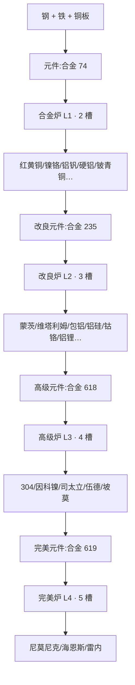
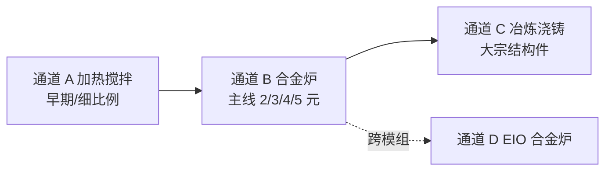

# IU 合金总规划（32 种合金的成分、档位与岗位）

> 适用版本：MC 1.21.1 / NeoForge / IU 3.4.0.11 / kubejs_iu 1.0.2 / SinkJourneyCore 0.1.0
> 本文定位：`IU_METAL_PLAN.md` 的姊妹篇。那篇讲**纯金属**（哪台机器该吃什么金属、按服役条件选材），
> 这篇讲**合金**：每种合金的现实成分、在哪台机器按什么比例熔、最早什么时候能做、该装在哪。
> 相关文档：`IU_METAL_PLAN.md`（纯金属口径与机壳五档）、`METAL_PROGRESSION.md`（金属时代门）、
> `IU_MODDING_METHODS.md`（改配方的手段：桥 / sjcore 补丁 / KJS）、`IU_ELECTRIC_MOTOR.md`（红铜死锁先例）、
> `OSMIUM_LUMEN_ALLOY.md`（EIO 合金炉做自定义合金的现成范式）、`CASING_PROGRESSION.md`（Create 机壳链）、
> `EARLY_METALLURGY.md`（青铜/琥珀金的早期口径）。
>
> 状态：**方案**。§1 是实测审计（反编译 `IndustrialUpgrade-1.21.1-3.4.0.11.jar` 得来），
> 推进方式：**四个阶段逐段魔改**，见下面的路线图；§5 是逐合金成分表，§6 是岗位表，
> §7 是奇幻材料退出清单，§10 是每段的逐条改动清单（P0–P3）。

---

## 0. 一句话结论

IU 的合金系统**不缺合金**：32 种合金锭 × 8 种形态（锭/板/双板/粉/齿轮/外壳/粒/块）已经全部注册，
四台合金炉共 52 条配方覆盖了全部 32 种，32 种也全都真的被机器配方吃着（合计 600 余处标签引用，含每种合金自己的锭/板/齿轮/外壳互换）。
它缺的是两件东西——**成分**和**岗位**：

- **成分**：52 条里有 14 条的配料与合金本名对不上。最刺眼的是两条五元"拼盘"
  （海恩斯 = 不锈钢+红铜+铝钒+钡+TTH，雷内 = 海恩斯+钆+钋+锆+伍德 ），
  以及碳化铪（Hf+Ta+4 铜，**没有碳**）、钼钢（Mo+钢+**铊**）、坡莫合金（Fe+**2 煤粉**+Ni+Mo）。
- **岗位**：伍德合金（Bi-Pb-Sn-Cd，熔点 70 ℃）在殖民地当建筑板，
  锰铁（转炉脱氧剂）在完美超导线圈里，阿卢梅尔（K 型热电偶负极）在改良超导线圈里，
  维塔利姆（Co-Cr-Mo 植入体）在"完美元件:装配"里。这些都是**功能件材料被当结构件用**。

所以这份规划和纯金属那篇一样，只改三件事：**成分对、工艺对、岗位对**；
外加一条硬规则：纯虚构材料整条退出科技线（§7）。
不改物品 id、不改形态数量、不新增进度轴——32 种全部保留，因为下游已经铺开了。

---

## 路线图（四个阶段，逐段推进）

后面按阶段魔改，所以这里只给"一段一盘"的口径：每段的范围、玩家能感觉到什么、怎么算这段做完、
以及为什么不能跳到下一段。阶段 1 已经做完，作为格式样例。

| 阶段 | 范围 | 玩家可感的变化 | 验收（都能离线跑） | 依赖 |
| --- | --- | --- | --- | --- |
| **0 定盘** | 32 种合金的成分表（§5）、岗位表（§6）、奇幻退出清单（§7）、预留档（§5.7） | 无（纯文档） | 你认可 §5 的比例与 §7 的名单 | — |
| **1 炉子与粉料** ✅ | 41 条合金炉补丁 + 13 条混粉 + 温度门槛 mixin + lint（§10 P0/P0.5/P1） | 合金炉只剩真实配方；红黄铜/阿卢梅尔/304 之类必须按配比混粉 | `lint_iu_alloys.py` 通过；`/sjcore iu reload` 后 JEI 抽查 5 种 | 阶段 0 |
| **2 岗位重排** | 4 小批：铜基 → 铝基 → 铁基/镍基 → 钴基/难熔（§6） | 蒙茨不再做"元件:垂钓"，伍德不再当建筑，锰铁退出结构件，铝钒进 140/707 机壳 | 该族的 JEI 用途里没有跨族位置；lint 的结构件检查项 | 阶段 1（替代材料得先能稳定量产） |
| **3 奇幻退出** | 4 步且不可跳序：断 116 条引用 → 机器池 → 删来源 → 挂 `era.radiance` + 矿表决策（§7.3） | 精金/秘银/奥利哈刚不再出现在太空机件里，改由钛/钨/铝锂承担；科技线搜不到这些名字 | JEI 搜 9 个名字，科技分类 0 条；太空章全链可造 | 阶段 2（替代材料要先有稳定岗位） |
| **4 预留档升级** | 补铼/镧等缺元素，接 L5+：真雷内、HfC/HfB₂/TTH 进超高温段、锇铱克级配额制度化（§5.7） | 顶层机器开始吃"下一层"材料，而不是复用 L4 | 新段机器的材料表不落在 §5.7 的预留线上 | 阶段 2（岗位定了才知道哪一档需要往上顶） |

四条推进纪律：

1. **一段一次 reload**：每段改完先 `/sjcore iu reload`（机器配方）和 `/reload`（KJS 配方），
   确认 JEI 没有空配方再进下一段。IU 的配方池是 JVM 级快照，跨段积累的错误很难回头拆。
2. **`lint_iu_alloys.py` 当红线**：每段结束跑一次，它挂了就说明这段有洞（多来源、缺来源、槽数超限、奇幻漏网）。
3. **阶段 2 按族推进，不要按机器推进**：同一族的替代材料一起换，JEI 才是自洽的；
   按机器推进会反复改同一个合金的用途。
4. **阶段 3 的 stage 锁永远排在本段最后**：锁早了整章变死配方（§7.3）。

---

## 1. 现状审计

### 1.1 供给侧：四台合金炉 = 2/3/4/5 个进料位

`BlockEntity{Alloy,Adv,Imp,Per}AlloySmelter.init()` 里写死了全部合金配方。四台炉子的**唯一结构性差别是进料槽数**：

| 炉 | 方块 id | 等级 | 进料槽 | 配方数 | 温度元数据 |
| --- | --- | --- | ---: | ---: | --- |
| 合金炉 | `industrialupgrade:basemachine/alloy_smelter` | L1 基础 | **2** | 26 | 1000–5000 |
| 改良合金炉 | `industrialupgrade:basemachine1/adv_alloy_smelter` | L2 改良 | **3** | 16（1 条重复） | 3000–5000 |
| 高级合金炉 | `industrialupgrade:basemachine3/imp_alloy_smelter` | L3 高级 | **4** | 7 | 5000–8000 |
| 完美合金炉 | `industrialupgrade:basemachine3/per_alloy_smelter` | L4 完美 | **5** | 3 | 7000–10000 |

**这是本包最好用的一条现成轴**：IU 的合金炉不是"更快的炉子"，而是"能同时熔更多组元的炉子"。
槽位 2/3/4/5 恰好就是合金的**组元数**，而现实里的合金按组元数天然分层：

| 组元数 | 现实典型 | IU 对应炉档 |
| --- | --- | --- |
| 2 元 | 青铜 Cu-Sn、镍铬 Ni-Cr、铌钛 Nb-Ti、锇铱 Os-Ir | 合金炉（L1） |
| 3 元 | 蒙茨黄铜 Cu-Zn-Pb、硬铝 Al-Cu-Mg、因瓦 Fe-Ni-C、维塔利姆 Co-Cr-Mo | 改良（L2） |
| 4 元 | 304 Fe-Cr-Ni-(Mn)、因科镍 Ni-Cr-Fe-Mo、司太立 Co-Cr-W-C | 高级（L3） |
| 5 元 | 尼莫尼克 Ni-Cr-Co-Ti-Al、雷内 Ni-Cr-Co-Ta-W、海恩斯 Ni-Cr-W-Mo | 完美（L4） |

温度元数据（`nbt.putShort("temperature", …)`）IU 自己**只写不读**——合金炉类里没有任何比较它的代码路径，
所以原版里它只是给 JEI 看的标签。本包把它接成了真门槛（`Sink-Journey-Core` 的 `IuAlloyHeat` +
`IuAlloyHeatGateMixin`，见 §1.1.1）：四档炉子上限 1500 / 2000 / 3000 / 4000 ℃，配方带的温度超过上限就不出产物。
于是温度这一列变成"这台炉子最高能到多少度"，值一律按现实熔点填
（铜 1085 / 钢 1500 / 铬 1907 / 铌 2477 / 钽 3017 / 碳化铪 3890 ℃）。

#### 1.1.1 温度门槛（Java 侧，已实装）

| 配方池 | 炉子 | 上限 | 能熔什么 |
| --- | --- | ---: | --- |
| `alloysmelter` | 合金炉 L1 | 1500 ℃ | 铜/铝/锌/铅/锡/金/银 基合金，铁基边缘 |
| `advalloysmelter` | 改良合金炉 L2 | 2000 ℃ | 钢、低温镍基、钛合金 |
| `impalloysmelter` | 高级合金炉 L3 | 3000 ℃ | 锇铱 2660、碳化钨 2870、镍钨重合金 2900 |
| `peralloysmelter` | 完美合金炉 L4 | 4000 ℃ | 硼化铪 3250、碳化铪 3890、难熔金属 |

三个实现细节：

1. 注入点在 `InventoryRecipes#getOutputFor()` 的返回值上——它是所有机器匹配配方的唯一出口，
   而 `this.recipe` 就是配方池名，所以一个注入点覆盖四台炉子，不用逐个方块实体改；
2. 超温时返回 `null`，对机器等于"没有可用配方"：不耗电、不走进度、不吐产物，JEI 里那条配方
   仍然显示温度，玩家能看出是炉子不够热；
3. **只管带 `sj_heat` 标记的配方**（补丁的 `meta` 写进 NBT）。这样 IU 自带的粉料/化学反应配方
   （温度是它自己的随手数字，不少在 4000–5000）不会被误伤，门槛只落在合金这一层。

### 1.2 组件侧：四台合金炉本身是"合金元件"套娃出来的

合金炉自己也要合金元件才能造（数据包配方实测）：

| 机器 | 需要的合金元件 | 元件的配料 |
| --- | --- | --- |
| 合金炉 `industrialupgrade_1450` | 元件:合金 `crafting_74` | 钢双板 ×2 + 铁板 ×3 + 铜板 ×2 |
| 改良合金炉 `_1451` | 改良元件:合金 `crafting_235` | 阿卢梅尔板 / 锰钢板 / 硬铝板 + 机壳 138 |
| 高级合金炉 `_1452` | 高级元件:合金 `crafting_618` | 铝钒板 / 铝硅板 / 维塔利姆板 + 机壳 139 |
| 完美合金炉 `_1453` | 完美元件:合金 `crafting_619` | 不锈钢板 / 因科镍板 / 坡莫合金板 + 机壳 140 |

还有一条并行的"首件"元件 `crafting_56`：八种二元/三元合金各一块板围一圈（红黄铜、阿卢梅尔、维塔利姆、蒙茨、镍铬、铝钒、硬铝、包铝）。



这条链已经是自洽的，而且是**按组元数自举**的（低元合金的元件开门，高元合金才能熔）。
规划要做的是把这条链接口对齐到 §5 的成分表，而不是另立一套。

### 1.3 需求侧：32 种合金全都被机器吃，但吃的位置大多不对

对 `data/industrialupgrade/recipe/` 的 2509 条工作台配方做标签扫描（`c:plates|doubleplate|ingots|gears|casings/<合金>`，
名字按 IU 的 CamelCase 归并），32 种合金**全部有下游**，用量前六是维塔利姆 42、包铝 35、硬铝 34、蒙茨 33、镍铬 32、红黄铜 31。
问题不在"没人用"，在于**用的地方荒谬**：

| 合金 | 现实身份 | IU 里的落点（实测） | 问题 |
| --- | --- | --- | --- |
| woods 伍德合金 | Bi-Pb-Sn-Cd，**熔点 70 ℃** | 殖民建筑 `high_entertainment` ×2、伍德合金存储模块、反应堆数据件、地热泵机壳 | 70 ℃ 就熔的合金做殖民建筑与机壳 |
| ferromanganese 锰铁 | 转炉脱氧剂（Fe-Mn，出钢前烧掉） | **完美超导线圈**、粉碎工具、雏形模板、压缩机 | 脱氧剂当超导与刀具 |
| alumel 阿卢梅尔 | Ni-Mn-Al-Si，K 型热电偶负极 | **改良超导线圈**、存储容量增加、元件:分析仪 | 热电偶合金做超导线圈 |
| vitalium 维塔利姆 | Co-28Cr-6Mo，铸造植入体/热腐蚀件 | **完美元件:装配** ×2、高级超导线圈、元件:水 | 植入体合金当装配基准件 |
| alcled 包铝 | Alclad（2024 芯 + 纯铝包覆） | 充电模块、采石场模块（per/ef）、反应炉温度元件 | 航空蒙皮做采石场模块 |
| muntsa 蒙茨 | Cu60Zn40，冷凝管/海水管路 | 元件:垂钓、元件:刷怪、水轮机升级 | 海水管材当杂项元件 |

这不是"随机"——IU 是按稀有度把合金往上堆的，和纯金属那篇 §1 的病根是同一个。

### 1.4 成分错误清单（14 条）

按"本名 → 现实成分 → IU 现配方"对照，错误分三类：

| # | 合金 | 现实成分 | IU 现配方 | 错在哪 |
| ---: | --- | --- | --- | --- |
| 1 | alumel 阿卢梅尔 | Ni-2Mn-2Al-1Si | **Al + Ti** | 没有镍、没有硅；Al+Ti 是 TiAl 金属间化合物，不是热电偶合金 |
| 2 | vitalium 维塔利姆 | Co-28Cr-6Mo | **Cr + W + Ni** | 没有钴；Ni-Cr-W 是另一族镍基耐磨合金 |
| 3 | duralumin 硬铝 | Al-4.4Cu-1.5Mg（2024） | **Al + Mg** | 缺铜——硬铝的"硬"来自 CuAl₂ 时效析出，没铜就不是硬铝 |
| 4 | aluminum_bronze 铝青铜 | Cu-10Al-5Fe-5Ni | **Al + Cu + Sn** | 锡不是铝青铜的组元（锡是锡青铜） |
| 5 | beryllium_bronze 铍青铜 | Cu-2Be(-Ni) | **Be + Cu×3 + Sn** | 同上，多一颗锡 |
| 6 | aluminium_silicon 铝硅 | AlSi12 | **Al + Mg + 燧石** | 镁不是组元；燧石（SiO₂）当硅源勉强可用，但铝热还原要写清楚 |
| 7 | vanadoalumite 铝钒 | V-Al（Ti-6Al-4V 的钒载体） | **Al + V + Co** | 钴多余，钒铝中间合金是 V-Al（或 V-Al-Ti） |
| 8 | hafnium_carbide 碳化铪 | HfC（3890 ℃） | **Hf + Ta + Cu×4** | **没有碳**；铜不是碳化铪的烧结助剂 |
| 9 | molybdenum_steel 钼钢 | 2.25Cr-1Mo 钢 | **Mo + 钢 + 铊** | 铊是剧毒低熔点金属，冶金里没有这个用法 |
| 10 | permalloy 坡莫 | Ni80Fe20（含 Mo 即超坡莫） | **Fe + 煤粉×2 + Ni + Mo** | 碳不进坡莫；煤粉应该是还原/渗碳的残留 |
| 11 | stellite 司太立 | Co-Cr-W-C | **Co + Cr + Fe + W** | 铁不是组元，碳才是（司太立靠碳化物硬化） |
| 12 | superalloy_haynes 海恩斯 | Ni-Cr-W-Mo（230）/ Co-Ni-Cr-W（188） | **不锈钢 + 红铜 + 铝钒 + 钡 + TTH** | 五种成品合金乱配，没有一种元素对得上 |
| 13 | superalloy_rene 雷内 | Ni-Cr-Co-Ta-W-Al（CMSX-4 系） | **海恩斯 + 钆 + 钋 + 锆 + 伍德** | 同上，还带进了放射性钋与 70 ℃ 的伍德合金 |
| 14 | red_brass 红铜 | Cu-15Zn-5Sn-5Pb（红黄铜） | **Cu + Zn** | 这是**黄铜**，不是红铜；红铜必须有锡 |

另有两条是**名字与成分对不上**，不是配方错：

| 合金 | 情况 | 处理 |
| --- | --- | --- |
| alcled | 配方 Al+Mg+Mn 是 **5052 铝镁合金**的准确成分，但名字叫"包铝"（Alclad = 2024 芯 + 纯铝包覆） | 改名"铝镁合金（5052）"，或按 §5 改成 Al-Cu-Mg 芯 + 铝包覆两步 |
| zeliber 泽利伯 | 配方 Cu+Ni+Zn **完全正确**，这是**镍银/白铜**（German silver, Cu60Ni20Zn20） | 名字保留（音译），文档里写明就是白铜 |

反过来，有三条是**教科书级正确**，应当作为样板保留不动：

- **青铜**：3 铜 + 1 锡 → 4（Sn 10%，正是 Cu-10Sn 炮铜）；
- **伍德合金**：锡 + 铅 + 铋 + 镉（正是 Bi50-Pb25-Sn12.5-Cd12.5，熔点 70 ℃）；
- **钇铝石榴石**：钕 + 钇 + 铝（Nd:YAG，掺钕钇铝石榴石，激光介质）。

### 1.5 标签与统一层的坑

| 坑 | 现状 | 后果 |
| --- | --- | --- |
| 标签大小写混用 | 基础炉写 `c:ingots/copper`，其余写 `c:ingots/Copper`；`c:ingots/vanadium` 又是小写 | `InputOreDict` 会统一 `toLowerCase()`，**目前不炸**，但补丁和 lint 必须按小写写，否则排查时对不上 |
| 合金标签名与物品名不一致 | 物品 `hafnium_boride_alloy` ↔ 标签 `c:plates/hafniumboride`；`aluminium_lithium_alloy` ↔ `c:plates/aluminiumlithium` | 写补丁/脚本时按**标签名**查，不是按物品名 |
| `c:ingots/lithium` 里混着进度物品 | IU 的 `crafting_447_element`（电解锂）与核电的 `lithium_ingot` 同在一条 tag | 铝锂合金的配方可能吃到进度物品（`unify-review.md` 已判定该 tag 不统一） |
| 红铜 ≠ 黄铜 | IU 的 `red_brass` 被 `unify-review.md` 归在青铜/黄铜一类 | **不要把 `red_brass` 统一到 `c:ingots/brass`**（Create 的黄铜）——两者是不同合金，统一了会毁掉红铜的岗位 |

---

## 2. 三条原则（合金版）

纯金属那篇的三条原则是"功能决定材料族 / 服役条件决定等级 / 稀有度决定用量形态"。合金要在这个基础上加一层：

### A1 成分对：一条合金配方 = 名义成分的比例

- **合金炉能表达的最细比例是一颗锭**。所以二元合金用"几颗 + 几颗 → 几颗出"就够（青铜 3:1→4）。
- 组元占比 <10%（304 的碳、316L 的钼、司太立的碳）**在合金炉里表达不出来**，必须走**混粉通道**：
  `N 颗粉 + M 颗粉 → N+M 颗合金粉 → 熔炉/高炉 → 锭`（`stainless_steel.js` 已经这么做了：7 铁粉 + 2 铬粉 + 1 镍粉 → 10 粉）。
- 判断标准：**看 JEI 里的比例能不能对上现实成分表**。对不上就换通道，不要硬凑。

### A2 工艺对：熔点、易氧化、碳/硼、难熔决定用哪台机器

| 合金特征 | 现实工艺 | 本包对应 |
| --- | --- | --- |
| 低熔点、易挥发（Zn 907 ℃ 沸腾） | 密闭蒸馏 / 覆盖剂 | Create 搅拌 + 加热（§3 通道 A） |
| 常规熔配（Cu/Al/Fe/Ni 基） | 感应炉 / 电弧炉 | IU 合金炉（通道 B），温度元数据写熔点 +150 |
| 含碳/含硼（司太立、碳化铪、硼化铪） | 粉末冶金 + 热压/烧结 | 混粉 → 压块 → 高炉/合金炉（通道 A→B） |
| 活泼金属（Ti/Zr/Al-Li） | 真空/惰性气氛、Kroll | 时代门卡在氯+镁+氩（见 `METAL_PROGRESSION.md`） |
| 难熔（W/Mo/Ta/Hf，>2500 ℃） | 垂熔/粉末冶金，不能在坩埚里熔配 | 只走混粉 + 完美炉高温档，或直接由粉末压制 |
| 大批量结构合金 | 冶炼厂 → 熔体 → 连铸 | IU 冶炼厂 + 熔融合金流体 + `ingot_casting` 池（通道 C） |

### A3 岗位对：合金是功能件材料，不是"更高级的铁"

纯金属那篇的硬规则（贵金属/剧毒金属不得出现在结构件）在这里扩成三条：

1. **结构件只认铁基/铝基/钛基/镍基**（机壳、框架、机身、履带、管道）。
2. **功能件认物理性质**：导电→铜/银，电阻→镍铬，磁性→坡莫/硅钢，热电→镍铬+阿卢梅尔，
   耐磨→司太立/碳化钨，高温→因科镍/尼莫尼克/雷内，超导→铌钛，低熔点→伍德，光学→YAG，半导体→GaAs。
3. **低熔点合金（<300 ℃）与贵金属合金禁止进结构件**：伍德、锇铱、琥珀金、镓砷化物只能做焊料/触头/支点/芯片。

---

## 3. 四条生产通道

IU 提供了三条半合金化路径：混粉烧结（A）、熔配（B）、熔炼浇铸（C，目前只是"熔→铸"回路）、
以及跨模组的 EIO 合金炉（D）。规划要做的是**给每条通道划清职责**，而不是让同一件合金有四个来源。

| 通道 | 机器 / 手段 | 能表达的比例 | 适用 | 可改性 | 现成先例 |
| --- | --- | --- | --- | --- | --- |
| **A 加热搅拌** | Create 搅拌盆（加热）/ IU 铁砧 | 任意（粉/锭计数） | 低熔点、二元三元、电力时代之前就要有的合金 | KJS `create.mixing` + `heated` | `IU_ELECTRIC_MOTOR.md` 的红铜（3 铜 + 1 黄铜）、`stainless_steel.js` 的混粉 |
| **B 合金炉** | 4 台 IU 合金炉（2/3/4/5 槽） | ≥1 锭/组元 | 主线：所有 32 种合金的"正路" | sjcore 补丁池 `alloysmelter` / `advalloysmelter` / `impalloysmelter` / `peralloysmelter` | 现有 52 条 |
| **C 冶炼浇铸** | IU 冶炼厂（controller/furnace/casting）+ 熔融合金流体 | **90 mB = 1 锭**（比一颗锭细 90 倍） | 大宗结构合金：先出熔体，再铸锭/铸板；也是唯一能表达"熔体配比"的通道 | sjcore 流体池 `smeltery` / `ingot_casting` | 冶炼厂已能熔 26 种流体，其中 9 种是合金熔体（青铜/铝青铜/硬铝/殷钢/琥珀金/镍铬/锰铁/钛钢/砷化镓），浇铸块能铸回锭 |
| **D 跨模组** | EIO 合金炉（`enderio:alloy_smelting`） | 任意 | 自定义合金、跨模组合金（锇莹黑）、EIO 自家合金 | KJS `event.custom` | `mek_osmium_alloy.js` |

**分派建议**：

- 32 种 IU 合金**只走 B**（+ 必要时 A 做粉料预处理）。
- **C 现在是个空转的回路**：冶炼厂能把合金融成熔体、浇铸块能把熔体铸回锭，但流体混合器（23 条配方全是化工）**不混熔体**，
  所以它目前只能"熔了再铸"，不产生新合金。它的真正价值是**精度**：90 mB = 1 锭，能表达 1 % 级的配比。
  要启用它就等于新增一条产线（见 §11 第 5 条），不要顺手接。
- D 只留给 `kubejs:alloy_osmium_lumen_black` 与 EIO/Mek 自己的合金，不要再往 D 里塞 IU 合金——两套机器做同一件合金，JEI 会重复，玩家也会问"到底该用哪台"。
- A 的定位是**早期与细比例**：电力时代之前（黄铜、青铜、琥珀金、伍德），以及 <10% 的组元。



---

## 4. 六个族谱

按"基体金属"分族，是现实里查手册的顺序，也是本包分配岗位的顺序：

| 族 | 合金 | 服役主题 | 最早时代 |
| --- | --- | --- | --- |
| **铜基** | 青铜、红黄铜、蒙茨、铝青铜、铍青铜、白铜（zeliber） | 耐蚀、导热、耐磨、无火花 | 蒸汽（青铜/黄铜）→ 电力（铝青铜/铍青铜/白铜） |
| **铝基** | 硬铝、铝镁(5052)、铝硅、铝锂、铝钒中间合金 | 轻量化、铸造、导电排 | 电力后段（要 Hall-Héroult 电解铝） |
| **铁基** | 锰铁、钼钢、304、因瓦、坡莫、琥珀金(贵金属基) | 结构、耐蚀、磁路、脱氧 | 蒸汽（锰铁/钢）→ 电力（304）→ 中后（钼钢） |
| **镍基** | 镍铬、阿卢梅尔、因科镍、尼莫尼克、海恩斯、雷内 | 电阻、热电、高温、单晶 | 电力（镍铬/阿卢梅尔）→ 中后（因科镍以上） |
| **钴基** | 钴铬、司太立、维塔利姆 | 耐磨、耐热腐蚀、植入 | 电力后段 → 中期 |
| **难熔/功能** | 铌钛、TTH、碳化铪、硼化铪、锇铱、YAG、GaAs、伍德 | 超导、超高温、触点、激光、半导体、焊料 | 中期 → 中后 |

---

## 5. 逐合金成分表（32 条）

列说明：**现配方**取自反编译的 `init()`；**建议**给的是"通道 + 比例"，`×N` 是锭/粉的颗数。
三条读数规则：

1. `B` = 合金炉，比例**受槽数限制**（2/3/4/5 个不同组元），所以 B 只能表达"整颗锭"的比例；
2. `A` = 混粉（Create 搅拌 + 加热），按**每炉 10–20 颗**给比例，1 颗 = 5–10 %，这是 <10 % 组元的唯一表达方式；
   混好的合金粉用 IU 自带的"合金粉 → 锭"熔炉配方出锭，不需要另写熔炼；
3. 温度按"熔点 + 150 ℃"给整数刻度（IU 的温度元数据就是这类整数，只影响 JEI 显示，不牵动机器判定）。

### 5.1 铜基（7）

| 合金 | 中文 | 现实成分 | 现配方（炉） | 建议 | 温 |
| --- | --- | --- | --- | --- | --- |
| （bronzeIngot） | 青铜 | Cu-10Sn | 3 Cu + 1 Sn → 4（L1）**✓** | 不动 | 1200 |
| red_brass | 红黄铜 | Cu-15Zn-5Sn-5Pb | Cu + Zn（L1） | A：17 Cu + 1 Zn + 1 Sn + 1 Pb → 20（85/5/5/5）；纯 Cu-Zn 的二元配方让给 Create 黄铜 | 1100 |
| muntsa | 蒙茨（Muntz） | Cu60Zn40（+Pb 2%） | Cu + Zn + Pb（L2） | B：3 Cu + 2 Zn → 5（60/40），铅 2% 省略；原来 1:1:1 是各三分之一 | 1050 |
| aluminum_bronze | 铝青铜 | Cu-10Al-5Fe-5Ni | Al + Cu + Sn（L2） | A：16 Cu + 2 Al + 1 Fe + 1 Ni → 20（80/10/5/5），去锡 | 1150 |
| beryllium_bronze | 铍青铜 | Cu-2Be | Be + 3 Cu + Sn（L2） | A：19 Cu + 1 Be → 20（5 % Be，取上限），去锡 | 1000 |
| zeliber | 白铜（镍银） | Cu60Ni20Zn20 | Cu + Ni + Zn（L2） | B：3 Cu + 1 Ni + 1 Zn → 5（60/20/20）；原来 1:1:1 是各三分之一 | 1150 |
| nitenol | 镍钛诺 | Ni-45Ti（近等原子） | Ni + Ti（L1，温度写 4000） | B：1 Ni + 1 Ti → 2（原来 1+1→1，白丢一颗） | 1450 |

### 5.2 铝基（5）

| 合金 | 中文 | 现实成分 | 现配方（炉） | 建议 | 温 |
| --- | --- | --- | --- | --- | --- |
| duralumin | 硬铝（2024） | Al-4.4Cu-1.5Mg-0.6Mn | Al + Mg（L1） | A：18 Al + 1 Cu + 1 Mg → 20（90/5/5，铜取上限）；B 退化为 1 Al + 1 Mg 只算铝镁 | 800 |
| alcled | 铝镁（5052） | Al-2.5Mg-0.25Cr | Al + Mg + Mn（L2） | A：19 Al + 1 Mg → 20（95/5）；原来三槽各三分之一是 33% 镁，不是铝合金 | 800 |
| aluminium_silicon | 铝硅（AlSi12） | Al-12Si | Al + Mg + 燧石（L2） | A：9 Al + 1 Si → 10（AlSi10，硅取上限；铝热还原 SiO₂ 也可，注释写明） | 750 |
| aluminium_lithium | 铝锂（2195） | Al-4Cu-1Li | Al + Li（L1） | A：18 Al + 1 Cu + 1 Li → 20（90/5/5）；锂易烧损，要在惰性气氛段 | 800 |
| vanadoalumite | 铝钒中间合金 | V-55Al（Ti-6Al-4V 用） | Al + V + Co（L2） | B：1 V + 1 Al → 2（二元，退回 L1），去钴；要 Ti 时做 Al-V-Ti 三元 | 1750 |

### 5.3 铁基 / 贵金属基（6）

| 合金 | 中文 | 现实成分 | 现配方（炉） | 建议 | 温 |
| --- | --- | --- | --- | --- | --- |
| ferromanganese | 锰铁 | FeMn80（高碳） | Fe + Mn（L1） | B：1 Fe + 3 Mn → 4（≈75 % Mn）；**只做脱氧剂/高锰钢，不进结构件** | 1300 |
| molybdenum_steel | 钼钢（2.25Cr-1Mo） | Fe-2.25Cr-1Mo-0.1C | Mo + 钢 + **铊**（L2） | A：48 钢 + 1 Cr + 1 Mo → 50（2Cr/2Mo），去铊 | 1550 |
| stainless_steel | 304 | Fe-18Cr-8Ni | Fe + Cr + Ni + Mn（L3） | 炉里那条删掉，只走混粉 7 铁 + 2 铬 + 1 镍（`stainless_steel.js` 已实装） | 1550 |
| （crafting_480） | 碳化钨锭 | WC（W 94 / C 6） | 不锈钢 + 2 钨（L1） | **L3**：19 W + 1 碳 → 20；原来**根本没有碳**，还掺了不锈钢 | 2870 |
| （wolframite） | 镍钨重合金 | 90W-7Ni-3Fe | 2 W + 1 Ni（L1） | **L3**：18 W + 1 Ni + 1 Fe → 20（90/5/5）；原来 67% 钨、没有铁 | 2900 |
| permalloy | 坡莫（超坡莫） | Ni79Fe16Mo5 | Fe + 2 煤粉 + Ni + Mo（L3） | A：16 Ni + 3 Fe + 1 Mo → 20（80/15/5），去煤粉 | 1500 |
| （invar_ingot） | 因瓦 | Fe-36Ni | 2 Fe + 1 Ni（L1） | 保留（Fe2Ni 是 33 % Ni，接近 Invar 36）；温度元数据 1500 | 1500 |
| （electrum_ingot） | 琥珀金 | Au-45Ag | 金 + 银 → 2（L1）**✓** | 不动（1:1 = 50 % Ag，接近天然琥珀金） | 1100 |

### 5.4 镍基（6）

| 合金 | 中文 | 现实成分 | 现配方（炉） | 建议 | 温 |
| --- | --- | --- | --- | --- | --- |
| nichrome | 镍铬 | Ni80Cr20 | Ni + Cr（L1）**✓** | B：4 Ni + 1 Cr → 5（80/20）；当前 1:1 是 50 % Cr，偏高但是同族 | 1450 |
| alumel | 阿卢梅尔 | Ni-2Mn-2Al-1Si | **Al + Ti**（L1） | A：48 Ni + 1 Mn + 1 Al → 50（96/2/2），硅省略，**钛去掉** | 1450 |
| inconel | 因科镍 625 | Ni-61Cr-22Mo-9Fe | Fe + Cr + Ni + Mo（L3） | A：13 Ni + 4 Cr + 2 Mo + 1 Fe → 20（65/20/10/5）；原来四槽各 25%，差得太远 | 1400 |
| nimonic | 尼莫尼克 | Ni-20Cr-2.5Ti-1.5Al(-Co) | Co + Cr + Ni + Mo + Al（L4） | B：11 Ni + 4 Cr + 3 Co + 1 Ti + 1 Al → 20（55/20/15/5/5） | 1400 |
| superalloy_haynes | 海恩斯 230 | Ni-22Cr-14W-2Mo | 不锈钢+红铜+铝钒+钡+TTH（L4） | B：11 Ni + 5 Cr + 3 W + 1 Mo → 20（55/25/15/5），四元可降到 L3 | 1450 |
| superalloy_rene | 雷内 N5 | Ni-7Cr-8Co-6Ta-5W-3Re-6Al | 海恩斯+钆+钋+锆+伍德（L4） | B：12 Ni + 1 Cr + 1 Co + 1 Ta + 1 W → 16（75/6/6/6/6）；铼无物品，用钨占位 | 1450 |

### 5.5 钴基（3）

| 合金 | 中文 | 现实成分 | 现配方（炉） | 建议 | 温 |
| --- | --- | --- | --- | --- | --- |
| cobalt_chrome | 钴铬 | Co-28Cr-6Mo | Cr + Co（L1） | B：7 Co + 3 Cr → 10（70/30），钼 6% 暂时省略；原来 1:1 是 50% 铬 | 1450 |
| stellite | 司太立 | Co-30Cr-12W-2C | Co + Cr + Fe + W（L3） | A：11 Co + 6 Cr + 2 W + 1 碳 → 20（55/30/10/5），铁换碳 | 1350 |
| vitalium | 维塔利姆 | Co-28Cr-6Mo | **Cr + W + Ni**（L2） | B：13 Co + 6 Cr + 1 Mo → 20（65/30/5），去钨去镍 | 1400 |

### 5.6 难熔与功能件（5 + 3 杂项）

| 合金 | 中文 | 现实成分 | 现配方（炉） | 建议 | 温 |
| --- | --- | --- | --- | --- | --- |
| niobium_titanium | 铌钛 | Nb-47Ti | 2 Nb + Ti（L1） | **L2**：1 Nb + 1 Ti → 2（50/50）；原来 2:1 是 67% 铌 | 1900 |
| tantalum_tungsten_hafnium | TTH | Ta-8W-2Hf | Hf + Ta + W（L2）**✓** | A：18 Ta + 1 W + 1 Hf → 20（90/5/5）；现在的 1:1:1 是等原子，偏铪 | 3100 |
| hafnium_carbide | 碳化铪 | HfC（Hf 94.7 / C 5.3 wt%） | Hf + Ta + **4 Cu**（L2） | **L4**：18 Hf + 1 碳（煤粉）+ 1 Ta → 20（HfC + TaC 固溶），铜去掉 | 3890 |
| hafnium_boride_alloy | 硼化铪 | HfB₂（Hf 93 / B 7） | Hf + B + Ta（L2） | **L4**：18 Hf + 1 B + 1 Ta → 20（HfB₂ + TaB₂ 固溶）；原来 1:1:1 是 33% 硼 | 3250 |
| yttrium_aluminium_garnet | 钇铝石榴石 | Y₃Al₅O₁₂:Nd | Nd + Y + Al（L2）**✓** | B：3 Y + 5 Al + 1 Nd → 9（Y₃Al₅ 化学计量 + 一颗掺质钕，掺量放大到看得见） | 2000 |
| osmiridium | 锇铱 | Os-Ir（天然，≈60/40） | 2 Os + Ir（L1） | **L3**：3 Os + 2 Ir → 5（60/40），**克级配额**（触头/支点/阳极涂层） | 2660 |
| gallium_arsenic | 砷化镓 | GaAs（1:1 化合物） | 2 As + Ga（L1） | B：1 As + 1 Ga → 2（50/50）；原来 2:1 是 67% 砷 | 1250 |
| woods | 伍德合金 | Bi50Pb25Sn12.5Cd12.5 | Sn + Pb + Bi + Cd（L3） | B：4 Bi + 2 Pb + 1 Sn + 1 Cd → 8（50/25/12.5/12.5），正好是共晶成分；原来各 25% | 200 |

### 5.7 预留档（L5 以后，本轮不动）

IU 的 4 级炉档不是终点：后面还要继续分级，所以有一批"现实里本来就更晚一层"的材料**这轮不消耗**——
不新增用途、不接进现在的机器配方、不做 L4 的门。它们的成分按 §5.6 修正好，但岗位留白：

| 预留材料 | 为什么留到后面 | 现在允许的用途（IU 原有，不动） | 留给什么 |
| --- | --- | --- | --- |
| 碳化铪 HfC | 熔炼 3890 ℃，现实里要热压/垂熔，不是炉子里能配的东西 | 镜片/外壳类零件 | 超高温段：坩埚、喷嘴、电极 |
| 硼化铪 HfB₂ | 同上（UHTC 陶瓷） | 现有少量零件 | 再入前缘、熔体接触件 |
| TTH（Ta-W-Hf） | 火箭喷管级材料，现实产量以公斤计 | 现有板件 | 超弦段热端 |
| 锇铱 | 铂族克级配额，天然合金 | 元件模板、电解阳极涂层（克级） | 精密触点/支点的高一档 |
| 雷内（含铼 3%） | 包内没有铼，现在只能用钨占位；单晶叶片本体属于下一层 | 光子级热端 | L5 引入铼之后的真单晶 |
| 钨 / 钽 / 铪 原料本身 | 垂熔/粉末冶金才有，IU 现在给得偏早 | 现有用途 | 难熔段的产能门槛 |

> 一句话：**顶层材料不进 L4 的门**。完美炉（L4）的元件 619 用的是不锈钢/因科镍/坡莫，
> 正好都在预留线以下——这条边界不要破。

> 合计：成分错的 **14** 条（§1.4）+ 比例偏的 **10** 条（蒙茨、白铜、钴铬、铌钛、砷化镓、硼化铪、锰铁、镍铬、锇铱、YAG）+ 两条**根本不是合金**的（碳化钨锭、镍钨重合金，原配方缺碳/缺铁）已经全部改完；
> 32 种合金锭里 **32 种全部动过**：20 条在炉里就地改（其中 6 条顺带按熔点挪到更热的炉档），
> 1 条镍钛诺修正产量与温度，14 条挪去混粉（其中不锈钢在 `stainless_steel.js`）。
> 另有 2 条不是合金的锭（碳化钨、镍钨重合金）一并修正并挪到 L3。

---

## 6. 岗位表：每种合金该在哪

按"服役条件"重新分配，改的只是**配方里那一格**，不新增物品。左列是本包的机器/产线（对齐 `MIDGAME_PLAN.md`），
右列是该位置该用的合金。

### 6.1 结构件（机壳、机架、履带、管道）

| 位置 | 现在 | 应为 | 理由 |
| --- | --- | --- | --- |
| 改良机壳 138 | 304 板（已改） | 304 / 316L | 潮湿、弱酸碱 |
| 高级机壳 139 | 316L 板（已改） | 316L（304 + 2 Mo） | 氯离子 |
| 完美机壳 140 | 钛板（已改） | 钛 + Ti-6Al-4V（= 钛 + **铝钒中间合金**） | 这才给 vanadoalumite 一个正经岗位 |
| 铝钛合金外壳 707 | 已改钛+铝+钒 | 同上，用 vanadoalumite | 与 140 共用一条中间合金链 |
| 镍钨合金外壳 505 | 钨镍铁重合金 | 保留（W-Ni-Fe 屏蔽/配重） | 离心机转鼓、配重 |
| 殖民建筑 / 机壳类 | **伍德合金**、坡莫合金 | 硬铝、铝镁 5052、304 | 伍德 70 ℃ 就熔，坡莫是磁屏蔽材料 |
| 履带 | 蒙茨、镍钛诺 | 保留镍钛诺（形状记忆履带是真事，NASA 做过），蒙茨换成高锰钢/铝青铜 | 蒙茨是冷凝管材 |
| 流体管道 | 司太立、钴铬、白铜 | 保留（三种都是真耐蚀/耐磨管材） | 这组本来就对 |

### 6.2 机电转换（电机、线圈、变压器、磁路）

| 位置 | 现在 | 应为 | 理由 |
| --- | --- | --- | --- |
| 超导线圈 ×4（387/425/372/398） | 铌钛（已改） / 铌+锡（已改） / 铌+铜（已改） / 铜+钇+钡（已改） | 保留 | 与 `IU_METAL_PLAN.md` §6.2 一致 |
| 线圈 / 电机绕组 | 红黄铜 + 阿卢梅尔残留 | 铜 / 银镀；阿卢梅尔退出线圈 | 阿卢梅尔是热电偶 |
| 磁屏蔽 / 环形电感 / 数据线 | 坡莫合金（597 元件、589 数据线）**✓** | 保留 | 坡莫就是干这个的 |
| 变压器铁芯 | — | 硅钢（钢 + 硅） | 取向硅钢 B₈₀₀≈1.9 T |
| 触头 / 电刷 | 琥珀金、锇铱 | 保留（琥珀金镀层、锇铱克级触点） | 两者都是真触头材料 |

### 6.3 耐磨 / 高温 / 耐蚀（产线设备）

| 位置 | 现在 | 应为 | 理由 |
| --- | --- | --- | --- |
| 破碎/研磨刀具 | 钻石镍铬刀头（559）**✓** | 保留；高负荷段加司太立堆焊 | 司太立是阀座/泵套堆焊标准材料 |
| 高温夹具/炉管 | 因科镍、尼莫尼克 | 保留（因科镍 700 ℃、尼莫尼克叶片） | 与 `IU_METAL_PLAN.md` §5 一致 |
| 燃烧室/热端 | 海恩斯 | 保留 **但换真实成分**（Ni-Cr-W-Mo） | 现在的五种合金拼盘要改 |
| 单晶叶片/光子级 | 雷内 | 保留 **但换真实成分**（Ni-Cr-Co-Ta-W-Al） | 同上，钋/钆/伍德必须去掉 |
| 加氢反应器/裂化炉管 | 钼钢板 | 保留 **去掉铊**（钢 + Mo + Cr） | 2.25Cr-1Mo 是加氢标准钢 |
| 海水泵/浸出槽 | 蒙茨、铝青铜 | 两件都该在这里（现在跑去元件:垂钓/刷怪） | 冷凝管与海水泵阀 |
| 电解阳极 | 锇铱（adv_anode） | 保留（IrO₂/Os-Ir 涂层阳极是真事），底材换钛 | 氯碱工业 |

### 6.4 功能小件（克级）

| 位置 | 合金 | 说明 |
| --- | --- | --- |
| 温度元件 38/89 | 镍铬 + 阿卢梅尔 | K 型热电偶，−200…1300 ℃ |
| 电阻器 563/585 | 镍铬 / 钨 / 钼 | 线绕高温电阻 |
| 激光器 354 | YAG（钕+钇+铝） | Nd:YAG 退火/修复，与 `IU_CHIP_OVERHAUL.md` 光源表对齐 |
| 芯片/红外 | 砷化镓 | 高频与红外窗口 |
| 低温焊料 / 热熔断 / 模具 | 伍德合金 | 70 ℃ 熔点，这才是它的岗位 |
| 仪表支点 / 笔尖 / 精密触点 | 锇铱 | 克级，单条配方 ≤2 颗 |
| 弹簧 / 无火花工具 / 继电器 | 铍青铜 | 现在几乎没岗位，应挂到继电器与防爆工具 |
| 铸造泵体 / 活塞 | 铝硅 | 低热膨胀 |
| 太空结构 / 飞轮 | 铝锂 | 减重 10 %，挂在太空章节 |
| 磁盘记录层 | 钴铬 | 575 铝钇磁盘的钴铬层 |
| 热电偶补偿/装饰/仪表壳 | 白铜（zeliber） | 电阻率稳定、抗蚀 |

---

## 7. 奇幻材料退出清单（非现实材料一律退出科技线）

这是本规划的**硬规则**，不是建议：**现实里不存在、理论上也没有对应物质的材料，一律不进科技线**，
只保留在魔法线（星辉 / 光谱 / 水晶工业 / 新生活）。判据分四类，别一刀切：

| 类别 | 判据 | 处理 | 本包例子 |
| --- | --- | --- | --- |
| **纯虚构材料** | 现实没有，理论上也没有对应物 | **退出科技线**，只留魔法线 | 米哈洛夫、查瓦卡、精金、血石、龙晶、秘银、奥利哈刚、阳光化合物、下界之星合金 |
| **编名但材料真实** | 名字是现造的，成分能一一对应现实物质 | **改名保留**（不改 id） | 泽利伯 = 白铜 Cu-Ni-Zn；铝钴钒 = 铝钒中间合金 V-Al；包铝 = Alclad/5052 |
| **真实但非金属** | 现实是矿物/陶瓷/化合物，不是金属 | 保留在**磨料/耐火/光学/半导体**岗位，不进金属阶梯 | 尖晶石（MgAl₂O₄）、石英、黑曜石、钇铝石榴石、碳化铪、硼化铪、砷化镓 |
| **真实但历史性** | 现实存在过，只是形态或叫法特殊 | 保留，归到现实口径 | 陨铁（Fe-Ni 天铁）、琥珀金（Au-Ag 天然合金）、伍德合金 |

### 7.1 退出清单（按实测用途）

数字是 `data/industrialupgrade/recipe/` 里的引用数。实测：253 处引用分布在 **185 条**工作台配方里，
其中 **69 条是材料自己的加工链**（矿石 → 粉碎 → 纯净粉 → 粉 → 锭 → 板/齿轮/外壳/块），跟着材料一起走；
剩下 **116 条是科技配方在消费它**，必须换成替代材料。逐条清单：`kubejs/tools/fantasy_exit_plan.csv`。

| 材料 | 引用 | 现在用在哪（实测） | 现实替代 | 去向 |
| --- | ---: | --- | --- | --- |
| 米哈洛夫 mikhail | 37 | 元件:无线、冷却传感器、机壳类 | 钛合金 / 因科镍 | 魔法线 |
| 尖晶石 spinel | 40 | 完美线轴、`universal4` 线缆、磨料件 | **保留为磨料/耐火料**；结构用途换铝镁 5052 | 民用（非金属） |
| 阳光化合物 sunnarium | 22 | 太阳能板与板制造厂、光伏玻璃、量子模块 | **砷化镓 / 单晶硅**（真实光伏材料） | 魔法线 |
| 秘银 mithril | 19 | 高级发动机/燃料箱、燃气轮机鼓风机、基因元件 | 铝锂 / 铝镁（轻量化） | 魔法线 |
| 精金 adamantium | 15 | 精金灯、燃气轮机机壳、太空升级模块、镜片 | 钨重合金 / TTH | 魔法线 |
| 血石 bloodstone | 18 | 太空升级模块、DNA 元件、镜片 | 熔石英 / 蓝宝石（光学件） | 魔法线 |
| 龙晶 draconid | 16 | 龙晶外壳、镜片、蒸汽轮机控制器/冷却 | 蓝宝石 / 碳化硅（光学）、钛 / 因科镍（结构） | 魔法线 |
| 查瓦卡 caravky | 15 | 元件:刷怪、`antiupgradeblock`、量子采石场模块 | 铪/锆合金、钨铜 | 魔法线 |
| 奥利哈刚 orichalcum | 15 | 奥利哈刚灯、热防护层、完美发动机、发射稳定器 | 铜合金（历史对应物即黄铜/青铜）+ 碳-碳/陶瓷热防护 | 魔法线 |
| 下界之星锭 | 合金炉 1 条 | 硼 + 下界之星 → 锭（合金炉里唯一一条奇幻配方） | 无（整条删） | 魔法线 |

还有两条要一起处理：

- **熔融米哈洛夫**：`iufluidmoltenmikhail` 是唯一一条"奇幻熔体"，同族熔体都是真实金属/合金。
  它跟着米哈洛夫一起退出科技线，冶炼厂与浇铸配方里删掉；
- **陨铁不退出**：Fe-Ni 天铁是真实材料（人类最早的铁器来源之一），归到"铁镍合金"口径，
  继续做工具/仪表，不进魔法线。这一点和"精金/秘银"必须分开——它们是同一种视觉风格，但只有陨铁是真的。

### 7.2 为什么必须整条退，而不是"配方里少放一点"

纯虚构材料做结构件有个具体害处：它们**没有物理性质可依**，于是配方只能按"越高级越贵"塞，
这正是 `IU_METAL_PLAN.md` §1 那套"稀有度阶梯"的来源。留下任何一件在结构件里，
阶梯就会重新长回来；退出之后，每一格材料都能被"服役条件"解释，这正是 §6 岗位表能成立的前提。

### 7.3 退出的操作顺序

1. **先断引用**：把 §7.1 的每条消费配方换成替代材料（工作台配方走 KJS `remove + 重写`，
   机器配方走 sjcore 补丁）。不先断引用就删来源，会把机器配方变成死配方。
2. **再删来源**：合金炉那条"硼 + 下界之星"、以及熔融米哈洛夫的冶炼/浇铸配方删掉；
   矿石是否停止生成单独决策（它们都是太空矿，见 §11）。
3. **最后挂 stage**：奇幻物品统一挂 `era.radiance`（魔法线），科技线配方不再出现，
   魔法线配方（星辉/光谱/水晶工业）可以继续用它们。
   **这一步必须在第 1 步之后**：精金/秘银/奥利哈刚现在是燃气轮机、发动机、燃料箱的上游，
   先锁材料再改配方，等于让整个太空章的机器变成死配方。
4. **lint 兜底**：`kubejs/tools/lint_iu_alloys.py` 增加一条——机器/结构配方里出现
   `mikhail|caravky|adamantium|bloodstone|draconid|mithril|orichalcum|sunnarium|nether_star` 即报错。

---

## 8. 时代门

合金的**首次可得时代 = max（各组元金属的时代，工艺门槛）**。组元时代取自 `METAL_PROGRESSION.md`，
这里只补"工艺门槛"一列。

| 合金 | 组元最晚者 | 工艺门槛 | 首次时代 | 对应炉档 |
| --- | --- | --- | --- | --- |
| 青铜、红黄铜、琥珀金、伍德 | 铜/锡/锌/铋/镉 | 熔配（<1100 ℃） | **蒸汽** | A（加热搅拌）/ L1 |
| 蒙茨、锰铁、因瓦 | 锌/锰 | 熔配 | **蒸汽末期** | L1–L2 |
| 镍铬、阿卢梅尔、铍青铜、白铜 | 镍/铬/铍 | 镍电解 + 铬铝热 | **电力中段** | L1–L2 |
| 硬铝、铝镁、铝硅、铝锂、铝钒 | **铝** | Hall-Héroult 电解 | **电力后段**（硅整流之后） | L2 |
| 304、坡莫、钴铬、铌钛、锇铱 | 铬/钴/铌/锇 | 真空或氢还原 | **电力后段 – 中期** | L1–L3 |
| 因科镍、司太立、维塔利姆、钼钢 | 钼/钨 | 氢还原 + 垂熔 | **中期** | L3 |
| 尼莫尼克、海恩斯 | 钨/钽/钴 | 高温熔配 | **中后 – 后期** | L4 |
| 雷内（含铼） | 铼/钽/钨 | 单晶铸造 | **后期** | 预留（§5.7） |
| TTH、碳化铪、硼化铪 | 铪/钽/钨 | 粉末冶金/热压，>2500 ℃ | **中后** | 预留（不进 L4 的门，见 §5.7） |
| 铝锂、太空结构件 | 锂 | 惰性气氛 | **太空章节** | L2 |

两条联动要注意：

1. **铝是合金世界的总闸**：铝青铜、硬铝、铝镁、铝硅、铝锂、铝钒六种合金全在铝之后。
   铝又卡在硅整流之后（见 `METAL_PROGRESSION.md` §8），所以**这一批合金整体必须排在电力后段**，
   不要为了让电力章"有合金可做"而提前放铝。
2. **铬是第二道闸**：304、镍铬、因科镍、司太立、钴铬、维塔利姆六种都要铬，而铬要铝热法（要铝）。
   所以"不锈钢机壳 138"实际上是**电力后段**的产物——这一点 `IU_METAL_PLAN.md` §9.2 已按此实装。

---

## 9. 与现有文档的冲突

| 文档 | 现在的说法 | 本规划 | 处理 |
| --- | --- | --- | --- |
| `IU_METAL_PLAN.md` §7 | 已有 32 种合金的"现实定位"表 | 那张表是**用途**口径，本文是**成分 + 工艺 + 档位**口径 | §7 保留，末尾加一行指向本文 |
| `IU_METAL_PLAN.md` §6.2 | 电机五档用 AlNiCo/FeCrCo/NdFeB | 与合金系统不冲突（磁钢不在 IU 合金表里） | 不改 |
| `IU_ELECTRIC_MOTOR.md` | 红铜走"3 铜 + 1 黄铜 → 红铜"（加热搅拌，避免死锁） | 红铜（红黄铜）的正确成分要加锡，但**早期路线可以继续用这条近似**，后期由合金炉接管 | 在电机文档里补一句"早期近似，正式成分见 §5.1" |
| `METAL_PROGRESSION.md` | 只排纯金属 | 合金时代 = max(组元) + 工艺（§7） | 文档开头加一行指向本文 |
| `unify-review.md` | `c:ingots/redbrass` 未列入统一 | **不要统一**：IU 红黄铜 ≠ Create 黄铜 | 在 `TAG_OVERRIDES` 里显式 `false` 并写理由 |
| `EARLY_METALLURGY.md` | 琥珀金 金1+银1→2（与核电对齐） | 一致 | 不改 |
| `OSMIUM_LUMEN_ALLOY.md` | 自定义合金走 EIO | 一致（通道 D 只给自定义） | 不改 |
| `IU_METAL_PLAN.md` §3 注 | "奇幻材料退出 IU 结构件，只留在星辉／魔法线与最终幻想级机器" | 本文把这条扩成**全部纯虚构材料、全部科技配方** | §7 即执行口径；`IU_METAL_PLAN.md` §10 待确认第 1 条据此关闭 |

---

## 10. 实施清单

### P0 · 合金炉配方（不动物品，`/sjcore iu reload` 即生效）

**已实装**：`kubejs/sjcore/alloys.json`（36 条补丁，`/sjcore iu reload` 生效）。分三类：

| 处理 | 条数 | 对象 | 理由 |
| --- | ---: | --- | --- |
| `replace`（成分错） | 5 | vitalium、vanadoalumite、hafnium_carbide、superalloy_haynes、superalloy_rene | 原配方的组元根本不是这种合金 |
| `replace`（比例偏） | 14 | nichrome、osmiridium、yttrium_aluminium_garnet、ferromanganese、cobalt_chrome、niobium_titanium、muntsa、zeliber、woods、hafnium_boride_alloy、gallium_arsenic、nimonic、碳化钨锭、镍钨重合金 | 组元对得上，比例差一到两个数量级（逐条见 §5） |
| `remove` | 14 | red_brass、aluminum_bronze、beryllium_bronze、duralumin、aluminium_silicon、aluminium_lithium、alumel、molybdenum_steel、permalloy、stellite、tantalum_tungsten_hafnium、stainless_steel、alcled、inconel | 正确成分要 ≥4 个组元且含 <10 % 的组元，只能走混粉（P1） |
| `remove` | 1 | `nether_star_ingot` | §7 奇幻材料退出，合金炉里唯一一条奇幻配方 |

其中碳化钨锭与镍钨重合金其实不是合金：前者原配方**没有碳**（不锈钢 + 2 钨），后者是 67 % 钨、没有铁，
现在按 WC（19 W + 1 碳 → 20）与 90W-7Ni-3Fe（18 W + 1 Ni + 1 Fe → 20）重写。

每条补丁的进出货都做了平衡（进 20 锭出 20 锭、进 16 出 16…），`_why` 字段写了改这行的现实依据，
sjcore 读取时忽略未知字段，留着是给下一次改配方的人看。

示例（维塔利姆：把镍铬钨换成钴铬钼，`advalloysmelter` 正好三槽）：

```json
{
  "patches": [
    { "op": "replace", "pool": "advalloysmelter",
      "inputs":  [ { "tag": "c:ingots/cobalt",  "count": 13 },
                   { "tag": "c:ingots/chromium","count": 6 },
                   { "tag": "c:ingots/molybdenum","count": 1 } ],
      "outputs": [ { "item": "industrialupgrade:alloyingot/vitalium", "count": 1 } ],
      "temperature": 1400 }
  ]
}
```

> 注意四件事：① `replace` 按**产物**匹配旧条目，`outputs` 里写的 id 要与原配方一致；
> ② 不同组元数必须 ≤ 该池的槽数（`alloysmelter` 2 / `advalloysmelter` 3 / `impalloysmelter` 4 / `peralloysmelter` 5），
> 同种材料用 `count` 叠；
> ③ 比例 <10 % 或组元数 >5 的一律**不进合金炉**，走 P1 混粉（304 的碳、司太立的碳、铍青铜的铍、铝铜的锂都属此类）；
> ④ 池名与槽数是 sjcore 从 IU 内存里读的，写错池名不会报错、只会没生效，改完用 `/sjcore iu recipes advalloysmelter` 核一遍。

### P0.5 · 温度门槛（Java 侧，`Sink-Journey-Core`）

IU 自己读都不读温度，所以这一层必须动 Java。已实装两个文件 + 一行 mixin 注册：

| 文件 | 作用 |
| --- | --- |
| `Sink-Journey-Core/src/main/java/com/vbiafe/sjcore/iu/IuAlloyHeat.java` | 四档上限（1500/2000/3000/4000 ℃）、从配方 NBT 读温度、判断是否带 `sj_heat` 标记 |
| `.../mixin/IuAlloyHeatGateMixin.java` | 注入 `InventoryRecipes#getOutputFor()` 的返回值，超温就返回 `null` |
| `src/main/resources/sinkjourneycore.mixins.json` | 注册 `IuAlloyHeatGateMixin` |

构建与安装（这台机器离线可用）：`tools/build-offline.sh --install`，产物覆盖 `mods/sinkjourneycore-0.1.0.jar`，
**要重启游戏**（和 kubejs_iu 一样）。`injectors.defaultRequire` 是 0，IU 换版本时方法名对不上就静默跳过，
退化成"只删不改"，不会把机器 tick 打崩。

验收：拿基础合金炉放 3 锇 + 2 铱（锇铱 2660 ℃），进度条不走、不耗电；换高级炉就能熔。
反过来 4 镍 + 1 铬（镍铬 1450 ℃）在基础炉里正常。

### P1 · 细比例走混粉（新增脚本）

**已实装**：`kubejs/server_scripts/metallurgy/alloy_blends.js`（13 条 Create 搅拌，`/reload` 生效），
照 `stainless_steel.js` 的范式（Create 搅拌 → `alloydust/<合金>` → IU 自带的"合金粉烧锭"熔炉配方，
32 种合金的 `furnace_2xx` / `blasting_2xx` 都在，不需要另写熔炼）。

| 合金 | 混粉配比 | 产物（`industrialupgrade:alloydust/…`） |
| --- | --- | --- |
| 红黄铜 | 17 Cu + 1 Zn + 1 Sn + 1 Pb → 20 | `red_brass` |
| 铝青铜 | 16 Cu + 2 Al + 1 Fe + 1 Ni → 20 | `aluminum_bronze` |
| 铍青铜 | 19 Cu + 1 Be → 20 | `beryllium_bronze` |
| 硬铝 | 18 Al + 1 Cu + 1 Mg → 20 | `duralumin` |
| 铝锂 | 18 Al + 1 Cu + 1 Li → 20 | `aluminium_lithium_alloy` |
| 铝硅 | 9 Al + 1 Si → 10（AlSi10） | `aluminium_silicon` |
| 阿卢梅尔 | 48 Ni + 1 Mn + 1 Al → 50 | `alumel` |
| 钼钢 | 48 钢 + 1 Cr + 1 Mo → 50 | `molybdenum_steel` |
| 坡莫合金 | 16 Ni + 3 Fe + 1 Mo → 20 | `permalloy` |
| 司太立 | 11 Co + 6 Cr + 2 W + 1 碳 → 20 | `stellite` |
| TTH | 18 Ta + 1 W + 1 Hf → 20 | `tantalum_tungsten_hafnium` |
| 铝镁 5052 | 19 Al + 1 Mg → 20 | `alcled` |
| 因科镍 625 | 13 Ni + 4 Cr + 2 Mo + 1 Fe → 20 | `inconel` |

P0 已经把这 10 条从炉里删掉，所以这 11 条混粉是它们的**唯一来源**，两边必须一起生效。

验收记录（不用开游戏）：

- `python kubejs/tools/check_js_rhino.py` → `OK … ALL PARSED`；
- Rhino 桩跑一遍回调，13 条配方全部生成，id 与产物/配料如下（摘录）：
  `kubejs:alloy_blends/red_brass :: 20x alloydust/red_brass <- 17x copper_dust + 1x zinc_dust + 1x tin_dust + 1x lead_dust`、
  `…/alumel :: 50x ← 48x nickel_dust + 1x manganese_dust + 1x aluminium_dust`、
  `…/tantalum_tungsten_hafnium :: 20x ← 18x tantalum_dust + 1x tungsten_dust + 1x hafnium_dust`；
- 三种 IU 没有的粉（钢/锂/铍）写的是统一层里的 canonical id（`mekanism:dust_steel`、`mekanism:dust_lithium`、
  `nuclearcraftneohaul:beryllium_dust`），没有用 `Nx #tag`——那个写法在 Create 的松散 ingredient 里容易被当成单件；
- `python kubejs/tools/lint_iu_alloys.py` → `补丁 36 条，炉内移除 14 种，混粉 13 条 / 合金一致：通过`
  （检查项：池名与槽数、进出货守恒、被删的合金是否都补了混粉、每种合金粉是否真有熔炉配方、两个文件里有没有奇幻材料）。

伍德合金没有再挪去混粉：它的四元配方在炉里就能写成共晶比例（4 Bi + 2 Pb + 1 Sn + 1 Cd → 8），已经就地改掉。

### P1.5 · 奇幻材料退出（§7 的执行）

这一步的产出最多、也最容易把配方改死，顺序必须是"先断引用、再删来源"：

| 步 | 做什么 | 手段 | 验收 |
| --- | --- | --- | --- |
| 1 | **116 条**科技配方换成替代材料（§7.1 右两列；清单在 `fantasy_exit_plan.csv`） | 工作台配方：KJS `remove` + 重写；机器配方：sjcore 补丁 | JEI 里搜 mikhail/caravky/精金…，科技分类下 0 条 |
| 2 | 删奇幻来源：合金炉"硼 + 下界之星"、熔融米哈洛夫的冶炼与浇铸、精金/血石/龙晶/秘银/奥利哈刚/阳光化合物的专属机器（若只服务它们） | sjcore `remove` | `/sjcore iu recipes alloysmelter` 里没有 `nether_star` |
| 3 | 奇幻物品挂魔法线 stage | `config/astages/simple/astages/item.json` 加 `era.radiance` | 科技存档里拿不到、也用不上 |
| 4 | 太阳能的材料换血：阳光化合物 → 砷化镓 / 单晶硅 | 与 `SILICON_WAFER_LINE.md` 对齐 | 太阳能板与板制造厂仍可造，材料是真实的 |

> 顺序反了会留下"死配方"：先删来源再改引用，会有一批机器在 JEI 里显示成空配方，
> 而 IU 的配方池是 JVM 级快照（见 `IU_MODDING_METHODS.md` §4.5），排查成本很高。

### P2 · 岗位重排（只改工作台/机器配方的材料格）

按 §6 逐条改，优先级：

| 优先级 | 改什么 | 文件 |
| --- | --- | --- |
| P2-1 | 殖民建筑/机壳类里的**伍德合金、坡莫合金**换掉（硬铝/5052/304） | `data/industrialupgrade/recipe/*` → 用 `kjs` remove + 自写配方，或直接数据包覆盖 |
| P2-2 | 超导四档里的**锰铁、阿卢梅尔**残留（已被 `iu_metal_realism.js` 改过，复核） | `industrial/iu_metal_realism.js` |
| P2-3 | "完美元件:装配"里的**维塔利姆**换成因科镍/雷内 | 同 P2-1 |
| P2-4 | 海水泵/浸出槽把**蒙茨、铝青铜、铍青铜**放进来 | `industrial/*.js` 或任务配方 |
| P2-5 | 元件:垂钓/刷怪里的蒙茨换白铜或黄铜 | 同 P2-1 |

### P3 · 刻度与防回退

| 项 | 做法 |
| --- | --- |
| 温度刻度 | 按 §5 的"熔点 + 150"批量改写 `temperature` 元数据（只影响 JEI 显示，安全） |
| 标签规范化 | 补丁与脚本统一写**小写、按下划线**的 `c:` 标签；`c:ingots/redbrass` 在 unify 里显式 `false` |
| lint | `kubejs/tools/lint_iu_alloys.py` **已实装**（池名/槽数、进出货守恒、被删合金是否都补了混粉、合金粉是否真有熔炉配方、两个新文件里有没有奇幻材料）。还差两条等 P2/P1.5：③ 结构件配方里出现 woods/osmiridium/electrum/gallium_arsenic 即报错；④ 铊（`c:ingots/thallium`）出现在任何配方里即报错 |

---

## 11. 待确认

1. **红黄铜的改造幅度**：把 `red_brass` 从 Cu-Zn 改成 Cu-Zn-Sn-Pb（红黄铜），意味着电动机/线圈里用到红铜的地方都要重审一遍
   （`IU_ELECTRIC_MOTOR.md` 的早期近似配方可以保留，但要写清"这不是正式成分"）。做，还是保持现状只改文档？
2. **alcled 的名字**：配方是 5052（Al-Mg-Mn），名字是 Alclad。是**改名成"铝镁合金"**（最省事），
   还是**保留 Alclad 语义、加一步"纯铝包覆"**（多一道工序，但更贴现实）？
3. **两条五元拼盘**（海恩斯、雷内）改真实成分后，铼（Re）、镧（La）在包内没有物品：
   是用钨/铪占位并在任务里注明，还是干脆把这两种合金的组元降到四元（少一味）？
4. **锰铁的去向**：按现实它只是脱氧剂，应该从所有结构件里清掉、只留在炼钢配方里。
   但 IU 的"雏形模板""压缩机"等配方用着它，清掉会动到一批机器配方——接受吗？
5. **熔体合金化要不要做成第三条正式通道**：冶炼厂能把金属熔成 90 mB/锭的流体，浇铸块能铸回去，
   但流体混合器不混熔体，所以"按 mB 配比熔出合金"目前不存在。如果接上（sjcore 的 `smeltery` + `ingot_casting` 池），
   就能用 1 % 精度表达 304、铝青铜、蒙茨这类比例，代价是多一条产线要教玩家。做，还是让混粉继续兼任这个角色？
6. **合金外壳（alloycasing）要不要参与机壳阶梯**：现在 32 种合金各有外壳，但只有 6 种被用。
   是让它成为"机器等级 L1–L4"里的一个维度，还是保持现状（只在少数模块里当零件）？
7. **奇幻矿要不要停止生成**：米哈洛夫（Europa）、奥利哈刚（Deimos）、精金（Mars）、秘银（Mercury）、
   血石（Mimas）、尖晶石（Umbriel）都是太空矿。退出科技线之后，它们是继续生成、只当魔法材料，
   还是直接从出矿表里删掉（`SpaceOreTable.java`）？前者要改 6 个行星的矿表语义，后者要动太空章节的奖励结构。
8. **泽利伯 / 铝钴钒 / 包铝这三个名字改不改**：材料是真的（白铜、铝钒中间合金、5052），只是名字是现造的。
   按 §7 它们是"编名但材料真实"，应当是**改名保留**——但如果科技线里不想再出现这类生造词，
   也可以一并换成中文正名（白铜 / 铝钒合金 / 铝镁合金），id 不动。
