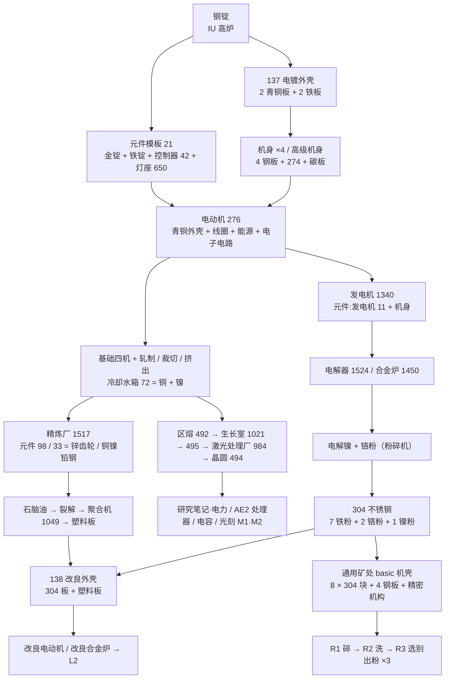
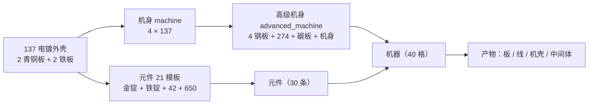

# IU L1 基础电力阶段物品规划（钢锭 → 不锈钢）

> 适用版本：MC 1.21.1 / NeoForge / IU 3.4.0.11 / kubejs_iu 1.0.2
> 证据来源：**IU jar 反编译 + 2850 条数据包配方逐条扫描**。
> - 阶段轴取自 `com.denfop.api.guidebook.GuideBookCore.init()` 的六页签名与 lang `iu.guidetab.*`；
> - 机器名录取自该页签里 `ldc` 的方块字段顺序（见 §6），配方 id 用 `data/industrialupgrade/recipe/*.json` 反查；
> - 每条"现配方"都来自配方 JSON，不是推测。
> 相关文档：`IU_METAL_PLAN.md`（纯金属：功能决定材料族）、`IU_ALLOY_PLAN.md`（合金：成分 / 炉档 / 岗位）、
> `METAL_PROGRESSION.md`（金属首次可得阶段）、`BASIC_ELECTRIC_AGE.md`（本阶段已经落地的魔改）、
> `IU_L2_IMPROVED_ELECTRIC.md`（下一段 L2，304 → 316L 的规划）、
> `IU_MODDING_METHODS.md`（改配方的手段）、`SE_LINE.md` / `OIL_LINE_V2.md`（SE 与石油两条线）、
> `ORE_UNIVERSAL_LINE.md`（通用矿处 R1–R6）、`SILICON_WAFER_TIERS.md`（一级晶圆 T1）
>
> 状态：§1–§8 是口径与清单，§9 是逐条改动清单。
> **P1（7 条）与 P2（元件 98 / 33 / 205 / 71 / 263 / 128、冷却机 1458、燃气混合室 1025）已实装**，
> 都在 `server_scripts/industrial/iu_l1_basic_electric.js`，`/reload` 生效；
> 通用矿处 basic 机壳按 **方案 A** 保持 304（§7.3 已定）；P3 只剩"铀线加阶段锁"与"银降成粒"两件小事。
> 本轮没有进游戏实测；所有配方 id 与材料都已对 jar 核对过，用到的标签已逐个确认存在。

---

## 0. 一句话

IU 自己把科技线切成六页签（原始 → 蒸汽 → **基础电力** → 改良电力 → 高级电力 → 完美/光子），
**L1 就是第三页**。这一段用两种钢划边界：**进去要钢锭，出来要第一块不锈钢**。
把机器件按这个窗口重排之后，L1 只允许 铁 / 钢 / 铜 / 锡 / 锌 / 铅 / 银 / 镍 + 六种二元合金，
铬只出现在出口工序（304、镍铬灯），所以 **镍铬、不锈钢、钛、镍基、米哈洛夫全部属于 L2 以后**。

这一段要跑的三条产线是 **塑料、一级晶圆、通用矿处**（§7）：
塑料与一级晶圆都落在 L1 口径内（塑料只差元件 98 / 33），通用矿处卡在 basic 机壳的 304 上，需要你选一个方案。

现状是：**一条元件配方（冷却水箱 72）把整段锁在太空金属上**，
另有 11 条元件 + 2 台机器带后期材料。清单在 §9，P1 的 7 条已实装。

---

## 1. 阶段轴：IU 自己的六页签

`GuideBookCore.init()` 依次创建 `main / primal / steamTab / baseElectricTab / improvedElectricTab /
advancedElectricTab / perElectricTab`，lang 里对应的中文是：

| 页签 | lang key | 中文 | 材料门（本包口径） |
| --- | --- | --- | --- |
| primal | `iu.guidetab.primal` | 原始时代 | 铜锡铅金银铁 |
| steamTab | `iu.guidetab.steamTab` | 蒸汽时代 | + 锌、钢（末期） |
| **baseElectricTab** | `iu.guidetab.baseElectricTab` | **基础电力时代 = L1** | **钢锭进，不锈钢出** |
| improvedElectricTab | `iu.guidetab.improvedElectricTab` | 改良电力 = L2 | 304 / 316L、改良元件 |
| advancedElectricTab | `iu.guidetab.advancedElectricTab` | 高级电力 = L3 | 钛、钼、镍基、核电 |
| perElectricTab | `iu.guidetab.perElectricTab` | 完美 / 光子 = L4 | 尼莫尼克、雷内、难熔 |

> 这条轴比"按电压段切"更贴 IU 自己的设计：页签里的每一格就是作者写的推荐顺序，
> 而本包要做的只是把每格的**材料**换成这一段现实可得的那批。

### 1.1 入口：钢锭

baseElectricTab 的第一格不是方块，是 **电动机 276**（`elemotor`），说明这一段的门槛是"能把电变成转动"。
而 276 往下数两格就撞上钢：

| 链条 | 实测配方 | 卡在钢的地方 |
| --- | --- | --- |
| 137 电镀外壳 `757` | 2 青铜板 + 2 铁板（`iu_steam_recipes.js` 已改） | — |
| 机身 `763` | 4 × 137 | — |
| 高级机身 `1687` | 4 钢板 + 元件 274 + 碳板 + 机身 | **钢板** |
| 元件:合金 `816`（合金炉的元件） | 2 致密钢板 + 3 铁板 + 2 铜板 | **致密钢板** |
| 电动机 `735` | 1 锡外壳 + 2 线圈 + 1 能源 + 1 电子电路（`iu_electric_motor.js` 已改为青铜外壳） | — |
| 发电机 `1340` | 元件:发电机 + 机身（shapeless） | — |

也就是说：**钢锭到位 → 高级机身 + 元件:合金 → 第一台合金炉 → 二元合金 → 整条 L1 展开**。
钢在蒸汽末期由 IU 高炉出（`metallurgy/iu_blast_furnace.js`），所以"拿到钢锭"是一个干净、可判断的入口。

### 1.2 出口：不锈钢（304）

IU 的 L2 全部挂在 **138 改良电镀外壳** 上：`improvedElectricTab` 的每一格都要 138 或改良元件，
而 `iu_metal_realism.js` 已经把 138 改成 **304 不锈钢板 + 塑料板**。所以：

```
不锈钢锭 → 不锈钢板 → 138 改良外壳 → 改良元件 / 改良电动机 → L2 全页签
```

`metallurgy/stainless_steel.js` 已经把这条路铺好了：**7 铁粉 + 2 铬粉 + 1 镍粉 → 10 不锈钢粉 → 熔炼 → 锭 → 冷轧板**。
于是"第一块不锈钢"既是 L1 的验收物，也是 L2 的门票。

### 1.3 铬的边界（必须先钉死的一条）

`METAL_PROGRESSION.md` §4 把铬排在铝之后（铝热法 Al + Cr₂O₃），
但本包的现实是：**铬矿 `baseore/chromium` 存在，铬粉由粉碎机出**，304 就是这么做的。
所以本包的口径是：

| 位置 | 铬能不能出现 |
| --- | --- |
| L1 的结构件、机壳、元件、机器 | **不能**（镍铬、不锈钢一律 L2） |
| L1 的出口工序 | **能**：304 配料，以及元件 650 那一格（已改青铜，不再是镍铬） |
| L2 起 | 能：304 / 316L 结构、镍铬发热件 |

这条不写清楚，§2 的白名单就会自相矛盾（一边说"铬是铝热法得到"，一边让 304 当出口）。


### 1.4 现状流程（P1 / P2 改完之后的一遍走）



四步走读法：

1. **骨架**：钢锭 → 137 外壳 → 机身 / 高级机身。137 是青铜 + 铁（蒸汽末期就有），
   高级机身才吃钢，所以钢锭是这一步的真门槛。
2. **电**：模板 21 → 电动机 276 → 元件:发电机 11 + 机身 → 发电机 1340。
   电子电路 272 由电子装配机（钢板 + 铁板 + 电路板）出；研究站两个节点分别解锁轧机与发电机配方。
3. **加工面**：电解器、合金炉、基础四机、轧制 / 裁切 / 挤出全部靠"机身 + 元件"搭，
   公共件是冷却水箱 72（铜 + 镍，P1 已改）——它一改，十余台机器同时解锁。
4. **三条产线**：一级晶圆（区熔 → 生长室 → 激光处理厂）、塑料（精炼厂 → 聚合机）、
   通用矿处（R1–R3，机壳要 304，属于 L1 收尾）。出口是 304 → 138 改良外壳 → L2。

---

## 2. L1 材料盘

### 2.1 允许（含来源）

| 类别 | 材料 | 形态 | L1 来源 | 干什么 |
| --- | --- | --- | --- | --- |
| 结构 | 铁 | 板 / 双板 / 外壳 | 土高炉 → IU 挤压机 | 机座、机筒、真空腔 |
| 结构 | **钢** | 板 / 双板 / 外壳 | IU 高炉（蒸汽末期） | 机身、机架、高压件 |
| 结构 | 青铜 | 板 / 外壳 | 合金炉（3 铜 + 1 锡，原样正确） | 机壳 137、泵体 |
| 结构 | 殷钢（因瓦） | 板 / 齿轮 | 合金炉（2 铁 + 1 镍） | 精密件、量具座 |
| 导体 | 铜 | 板 / 导线 / 外壳 | 蒸汽线既有 | 绕组、母线、触头底座 |
| 触头 | 银 | 板 / 杆 / 粒 | 炭炉 | 触头、镀层、焊料合金（单条 ≤2） |
| 焊料 | 锡、铅 | 板 / 外壳 | 柴堆 / 炭炉 | 焊点、密封、铅内衬 |
| 耐蚀 / 流体 | 镍 | 板 / 外壳 | 电力初期（电解镍） | 流体腔、水箱、抗蚀件 |
| 传热 | 铜 + 铁 | 板 | — | 加热夹套、散热片 |
| 耐热（L1 上限） | 镍带 | 板 | 电力初期 | 发热体（镍铬是 L2 的升级） |
| 磁路 | 铁、坡莫（Ni-Fe） | 板 | 铁；坡莫走混粉（Fe + Ni 二元） | 磁轭、磁屏蔽 |
| 耐磨 | 锰铁（Fe-Mn） | 板 / 齿轮 | 合金炉（1 铁 + 3 锰） | 衬板、磨盘、颚板 |
| 绝缘 / 密封 | 橡胶、塑料 | 板 | 石油线（本章内） | 垫片、衬里、线皮 |

### 2.2 禁止，以及它们什么时候进

| 材料 | L1 不许出现的位置 | 进入点 |
| --- | --- | --- |
| 铬、镍铬 | 结构件、发热件、触头 | **L1 出口**（304 配料）；L2 起做发热件 |
| 不锈钢 304 / 316L | 一切 L1 机器件 | **L1 出口**（138 机壳） |
| 钛、钨、钼、钒、钴、铌、钇、锶、镁 | 全部 | L3（氯化 / 氢还原 / 熔盐电解） |
| 铝 | 全部（含真空腔 46） | 电力后段（Hall-Héroult，硅整流之后） |
| 锗、镓、铪、铋、镉、铊、铍 | 全部 | L3 起，只做功能小件 |
| 铂、锇、铱、钯 | 全部 | L3 起，克级 |
| 米哈洛夫、尖晶石、血石、龙晶、精金、秘银、奥利哈刚 | 全部 | 太空 / 星辉线，科技线永不用作结构件 |
| 铀、钍、钋（元件 36 / 441 / 99） | L1 | L3 核电 |

### 2.3 五条硬规则（从 `IU_METAL_PLAN.md` P1–P3 落到 L1）

1. **结构只认 铁 / 钢 / 青铜 / 殷钢**；机壳与机身不出现贵金属、不出现在地难熔金属。
2. **导体是铜**；银只做触头与镀层，单条配方 ≤2 件。
3. **流体件是镍 + 铅**：镍做腔体与水道，铅做内衬、屏蔽、电池。
4. **发热件按段升级**：L1 铜导热 + 镍发热；L2 镍铬；L3 钼 / 钨。
5. **齿轮要按现有物品选**：`c:gears/*` 里**没有青铜 / 铁 / 铜 / 钢齿轮**（实测：`gears/` 只有合金与
   铝、镍、锌、锰、银、钴、因瓦等纯金属）。L1 可用的齿轮是：
   殷钢、镍、锌、锰、银、锰铁（`alloygear/ferromanganese`）、红铜（`alloygear/red_brass`）、坡莫（`alloygear/permalloy`）。
   写 `c:gears/bronze` 会得到 `key=null`，整条配方加载失败——这是本包已经踩过的坑。

---

## 3. 四层结构

L1 的每一台机器都由这四层叠出来，改材料时按层改，不要逐台乱改：



- **第 1 层（结构脊椎）**：137 / 机身 / 高级机身 / 模板。这一层改对，40 台机器的骨架就对。
- **第 2 层（元件）**：30 条 `crafting_N_element`，每台机器吃 2–5 条。
- **第 3 层（机器）**：页签里的 42 格，绝大多数只吃"机身 + 元件"，**直接写金属的只有 2 台**（§6 标红）。
- **第 4 层（产物）**：L1 机器吐出来的板、线、机壳、塑料、酸、氢，是下一段的原料。

> 边界：机器**内部**的加工配方（粉碎机磨什么、电解器电解什么）在 Java 内存里，不在本文范围；
> 那层走 `Sink-Journey-Core` 的补丁池（`IU_MODDING_METHODS.md` §3）。

---

## 4. 结构脊椎（实测表）

| 物品 | id | 现配方 | 判定 |
| --- | --- | --- | --- |
| 电镀外壳 137 | `757` | 2 青铜板 + 2 铁板 | ✅ 已改（`iu_steam_recipes.js`） |
| 机身 machine | `763` | 4 × 元件 137 | ✅ |
| 高级机身 advanced_machine | `1687` | 4 钢板 + 274 + 碳板 + 机身 | ✅ 本来就是钢 |
| 蒸汽机身 | `758` | 8 铝青铜板 | ✅ 被 `create/casing_progression.js` 接管（8 蒸汽机壳 + 黄铜之心） |
| 元件模板 21 | `726` | 4 金锭 + 4 铁锭 + 控制器 42 + 镍铬灯 650 | ✅（另两条 `2431/2432` 是锇铱版，L4 才用） |
| 控制器 42 | `739` | 3 青铜锭 | ✅ 已改（原钨锭 ×3） |
| 镍铬灯 650 | `1007` | 青铜外壳 | ✅ 已改，**建议改名"青铜灯座"**（现在名不副实） |
| 真空腔室 46 | `741` | 4 铁板 + 4 铝板 | 🔧 **铝不在 L1** → 铁板 + 铜板 |
| itemcell | `1667` | 4 锡外壳 + 玻璃板 | ✅ |
| 高级 RE 电池 | `1610` | 铜导线 + 铅粉 + 青铜外壳 + 476 + 充能红石 | ✅ |
| 琥珀金锅炉 601 | `1923` | 橡木罐 + 琥珀金板 | ✅ 已被 `kubejs:copper_boiler` 取代（蒸汽章） |

---

## 5. 元件清单（L1 涉及的全部元件，44 条）

图例：✅ 已经是 L1 口径（含已改，41 条中的 30 条）；⏭ 不属于 L1（4 条，随核电/反应堆移到 L3）。

| # | 名称 | 配方 id | 现关键材料 | L1 口径 | 判定 |
| ---: | --- | --- | --- | --- | --- |
| 21 | 元件模板 | 726 | 金锭 + 铁锭 + 42 + 650 | 不动 | ✅ |
| 42 | 控制器 | 739 | 青铜锭 ×3（原钨） | 不动 | ✅ |
| 650 | 青铜灯座（原"镍铬灯"） | 1007 | 青铜外壳（原镍铬） | 不动；已改名 | ✅ |
| 137 | 电镀外壳 | 757 | 2 青铜 + 2 铁板（原钛） | 不动 | ✅ |
| 46 | 真空腔室 | 741 | 铁板 + **铝板** | 铁板 + 铜板 | 🔧 |
| 44/47/49/51 | 插槽 1/2/3/4 | 819/820/821/822 | 元件模板 + 锡板 | 不动 | ✅ |
| 11 | 元件:发电机 | 1339 | 铁板 + 高级 RE 电池 | 不动 | ✅ |
| 60 | 元件:能源 | 730 | 高级 RE 电池 + 线圈 + 金板 + 模板 | 不动 | ✅ |
| 614 | 元件:增强能量 | 731 | RE 电池 + 模板 | 不动 | ✅ |
| 294 | 线圈 | 1606 | 铜导线 + 铁板 + 红铜（专家链） | 不动 | ✅ |
| 276 | 电动机 | 735 | 青铜外壳 + 线圈 + 能源 + 电子电路 | 不动 | ✅ |
| 272 | 电子电路 | （机器内） | — | 配方不动，只当原料 | ✅ |
| 154 | 元件:液体储存 | 1118 | 铁板 + itemcell | 不动 | ✅ |
| 27 | 元件:流体 | 824 | 镍板 + itemcell（原镁齿轮） | 不动 | ✅ |
| 43 | 元件:水箱 | 852 | 镍板 + itemcell（原镍钨） | 不动 | ✅ |
| 101 | 元件:水 | 1102 | 银板 ×2 + 镍锭 ×3 + 铅板 ×2 + 钢板 | 不动；P2 把银板降成银粒 | ✅ |
| 244 | 元件:电解机 | 1496 | 阳极（铅）+ 阴极（镍）+ 铁板 | 不动；L2 升 316L 阴极 | ✅ |
| 70 | 热水箱 | 744 | 铜锅炉 + 铁板 + 铜板（原镁） | 不动 | ✅ |
| **72** | **冷却水箱** | **743** | **真空腔室 + 米哈洛夫板 + 钴板** | **铜板 + 镍板** | 🔧 **P1 第一优先** |
| 73 | 元件:板 | 813 | 铬板 + 锡板 + 金板 | 钢板 + 锡板 + 铜板 | 🔧 |
| 34 | 元件:矿石粉碎 | 838 | 锰板 + 铝齿轮 | 锰铁板 + 锰齿轮 | 🔧 |
| 39 | 元件:热量 | 847 | 蒙茨板 + 镍铬板 | 铜板 + 镍板 | 🔧 |
| 65 | 元件:塑料合成 | 1366 | 锗板 + 铬板 | 钢板 + 铜板 | 🔧 |
| 262 | 元件:焊接 | 1588 | 阿卢梅尔齿轮 + 铝青铜板 + 钛板 | 红铜齿轮 + 铜板 + 钢板 | 🔧 |
| 205 | 元件:矿物 | 1144 | 钴齿轮 + 274 + 钛板 + 塑料板 | 锰齿轮 + 274 + 钢板 + 塑料板 | ✅ 已改 |
| 33 | 元件:精炼 | 833 | 钒板 + 镍壳 + 锰齿轮 + 米哈洛夫壳 + 钛双板 | 铜板 + 镍壳 + 锰齿轮 + 铅壳 + 钢双板 | ✅ 已改 |
| 98 | 元件:石油合成 | 890–895（6 条同形） | 镁齿轮 + 钛板 | 锌齿轮 + 钢板 | ✅ 已改（6 条） |
| 71 | 元件:气流 | 883 | 铱双板 + 锗齿轮 + 红铜齿轮 + 维塔利姆双板 | 铜双板 + 锌齿轮 + 红铜齿轮 + 钢双板 | ✅ 已改 |
| 263 | 元件:燃气发电机 | 1619 | 镍铬双板 + 能量水晶 | 铜双板 + 能量水晶（L2 升镍铬） | ✅ 已改 |
| 128 | 元件:工艺 | 1113 | 铂板 | 银板 | ✅ 已改 |
| 241 | 元件:泵 | 1497 | 致密铁板 | 不动 | ✅ |
| 673 | 元件:伐木机 | 2119 | 锡板 + 锌齿轮 | 不动 | ✅ |
| 258 | 元件:红石发电机 | 1573 | 铁板 + 高级 RE 电池 + 红石块 | 不动 | ✅ |
| 22 | 元件:地热能 | 1367 | 玻璃 + itemcell | 不动 | ✅ |
| 267 | 元件:混合 | 1288 | 铁板 + 青铜板 + 铜板（原钇/锶/铌） | 不动 | ✅ |
| 55 | 元件:浓缩 | 1341 | 见 `SE_LINE.md` | SE 线 | ✅ |
| 79 | 元件:SE | 1128 | 见 `SE_LINE.md` | SE 线 | ✅ |
| 36 / 441 / 99 | 辐射 / 核废料 / 聚变辐射 | 843 / 974 / 896 | 铀、钍、尖晶石 | 与核电一起 | ⏭ L3 |
| 470 | 元件:模拟 | 1040 | 尼莫尼克 + 伍德齿轮 | 与反应堆模拟一起 | ⏭ L3 |

---

## 6. 机器清单（`baseElectric` 页签，42 格）

顺序就是 `GuideBookCore` 里的 `ldc` 顺序（作者写的推荐顺序）。
"直接金属"一列只统计配方里**直接写金属**的格子；其余全部走机身 + 元件。

| 格 | 机器 | 方块 id | 配方 id | 需要的关键元件 | 直接金属 | 判定 |
| ---: | --- | --- | --- | --- | --- | --- |
| 1 | 电动机 | （元件） | 735 | 294 / 60 / 272 | 锡外壳 | ✅ |
| 2 | 液体加热器 | `basemachine3/fluid_heater` | 1020 | 276 | — | ✅ |
| 3 | 发电机 | `basemachine3/generator_iu` | 1340 | 11 | — | ✅ |
| 4 | 红石发电机 | `basemachine3/redstone_generator` | 1578 | 258 + 发电机 | — | ✅ |
| 5 | 地热发电机 | `basemachine3/geogenerator_iu` | 1529 | 11 / 22 | — | ✅ |
| 6 | 固体冰箱 | `basemachine3/solid_cooling` | 1934 | 72 / 276 | — | 🔧（等 72） |
| 7 | 基础机器组 | `simplemachine/{macerator,compressor,extractor,furnace}_iu` | 1311 / 1312 / 1314 / 1313 | 69 / 63 / 159 / 219 / 276 / 72 / 44 | — | 🔧（等 72） |
| 8 | 金属轧制 / 裁切 / 挤出 | `moremachine2/{rolling,cutting,extruder}` | 1316 / 1318 / 1317 | 165 / 132 / 163 / 276 / 72 | — | 🔧（等 72） |
| 9 | 微型芯片发电机 | `basemachine/generator_microchip` | 1454 | 73 / 70 / 51 / 276 | — | 🔧（等 73） |
| 10 | 合金炉 | `basemachine/alloy_smelter` | 1450 | 74 / 70 / 47 / 276 | — | ✅ |
| 11 | 齿轮机 | `moremachine3/gearing` | 1321 | 218 / 276 / 72 | — | 🔧（等 72） |
| 12 | 电子装配机 | `electronics_assembler/electronics_assembler` | 1259 | — | 钢板 + 铁板 + 电路板 | ✅ 已改 |
| 13 | 塑料制造机 | `basemachine2/plastic_creator` | 1520 | 47 / 27 / 65 / 276 | — | 🔧（等 65） |
| 14 | 塑料板制造机 | `basemachine2/plastic_plate_creator` | 1521 | 44 / 27 / 65 / 276 | — | 🔧（等 65） |
| 15 | 焊接机 | `basemachine3/welding` | 1590 | 47 / 276 / 262 / 70 | — | 🔧（等 262） |
| 16 | 洗矿机 | `moremachine3/orewashing` | 1323 | 34 / 276 / 72 / 44 / 27 / 154 | — | 🔧（等 34） |
| 17 | 物品分离器 | `basemachine3/item_divider` | 1046 | 43 / 154 / 276 / 27 / 47 | — | ✅ |
| 18 | 固体混合器（三） | `basemachine3/triple_solid_mixer` | 1023 | 267 / 44 / 276 / 51 | — | ✅ |
| 19 | 燃气混合室 | `basemachine3/gas_combiner` | 1025 | 263 / 267 + 原始燃气室 | 电动机 276（已改） | ✅ |
| 20 | 流体整合器 | `basemachine3/fluid_integrator` | 1051 | 27 / 43 / 276 / 65 / 44 | — | 🔧（等 65） |
| 21 | 矿处理机（辐射） | `basemachine3/radioactive_handler_ore` | 1169 | 36 / 441 + 改良电机 | 铀线 | ⏭ L3 |
| 22 | 工业选矿机 | `basemachine3/industrial_ore_purifier` | 1174 | 36 / 441 + 改良电机 | 铀线 | ⏭ L3 |
| 23 | SE 发电机 | `se_gen/se_gen` | 1539 | 79 + 太阳能板 | — | ✅（`SE_LINE.md`） |
| 24 | 阳光化合物板 | `gen_sunnarium_plate/…` | 1466 | 47 / 79 / 276 / 128 | — | 🔧（等 128） |
| 25 | 阳光化合物 | `gen_sunnarium/gen_sunnarium` | 1467 | 55 + 24 | — | ✅（已改） |
| 26 | 聚合机 | `basemachine3/polymerizer` | 1049 | 601 / 98 / 276 / 79 / 154 | — | 🔧（等 98） |
| 27 | 固液整合器 | `basemachine3/solid_fluid_integrator` | 1022 | 27 / 43 / 65 / 276 | — | 🔧（等 65） |
| 28 | 流体分离器 | `basemachine3/fluid_separator` | 1048 | 601 / 154 / 276 / 27 | — | ✅ |
| 29 | 矿石处理机（蒸汽升级） | `basemachine1/handler_ho` | 1459 | 70 / 44 / 205 / 276 | — | ✅ |
| 30 | 精炼厂 | `refiner/refiner` | 1517 | 276 / 43 / 98 / 33 | — | ✅ |
| 31 | 柴油发电机 | `basemachine2/gen_disel` | 1510 | 发电机 / 276 / 27 / 239 | — | ✅ |
| 32 | 汽油发电机 | `basemachine2/gen_pet` | 1511 | 发电机 / 276 / 27 / 236 | — | ✅ |
| 33 | 冷却机 | `basemachine3/cooling` | 1458 | 11 / 72 / 276 / 镍板 | 已改 | ✅ |
| 34 | 风力发电机（简易） | `basemachine3/simple_wind_generator` | 1446 | 71 / 276 | — | ✅ |
| 35 | 水力发电机（简易） | `basemachine3/simple_water_generator` | 1417 | 101 / 276 | — | ✅ |
| 36 | 改良合金炉 | `basemachine1/adv_alloy_smelter` | 1451 | 235 / 49 / 20 / 138 | — | ⏭ 138 = 不锈钢，属 L2 第一格 |
| 37 | 离心机 | `moremachine3/centrifuge_iu` | 1322 | 39 / 276 / 70 / 44 | — | ✅ |
| 38 | 浓缩机 | `basemachine1/enrichment` | 1465 | 47 / 99 / 276 | 铀线 | ⏭ L3 |
| 39 | 核废料再循环机 | `basemachine3/nuclear_waste_recycler` | 991 | 276 / 44 / 36 / 441 | 铀线 | ⏭ L3 |
| 40 | 电解器 | `basemachine2/electrolyzer_iu` | 1524 | 276 / 27 / 154 / 244 | — | ✅ 页签外，本包电力章在用 |
| 41 | 泵 | `basemachine3/pump_iu` | 1512 | 276 / 27 / 154 / 241 | — | ✅ 页签外 |
| 42 | 锯木厂 | `basemachine3/sawmill` | 2172 | 276 / 44 / 673 | — | ✅ 页签外 |

> 39 格取自 `baseElectricTab` 的 `ldc` 顺序；第 40–42 格（电解器 / 泵 / 锯木厂）不在该页签里，
> 但本包电力章在用，所以一并按 L1 口径管住。
>
> 页签里还有若干"元件 / 流体"格（硝石粉、氮、氨、硝酸、硫酸银、铀矿碎块、丙烷、溴、丙烯、塑料、塑料板），
> 它们是产物不是机器，跟着所在机器的材料走，不单独列。

**统计**：42 格里 **37 格已达标**（其中 18 格靠元件改完自动达标）、
**1 格属 L2**（改良合金炉 1451 要 138）、**4 格属 L3**（铀线 1169 / 1174 / 1465 / 991）。

---

## 7. L1 的三条目标产线（塑料 / 一级晶圆 / 通用矿处）

§6 的机器只是"能造出来"。这一段真正要跑通的是三条产出线，而它们各自还多要求几件东西——
耗材、内件、机壳档位。三条线都落在 `BASIC_ELECTRIC_AGE.md` 的电力章里，所以这里的任务是把
**它们的建造材料与耗材拉回 L1 口径**，再加一句"每条线各自开到哪一级"。

### 7.1 塑料线（石油线的终点件）

| 工序 | 机器 | 建造材料（实测） | L1 判定 |
| --- | --- | --- | --- |
| 原油 → 馏分 | 精炼厂 `refiner/refiner`（1517） | 高级机身 + 元件 43 / 98 / 33 / 276 | ✅（98 / 33 已改） |
| 石脑油 → 裂解气 | MMCR 通用反应器（`reactors_v2.js`） | 结构件按 MMCR 电压档，L1 用 basic 仓 | ✅ |
| 乙烯 / 丙烯 → 塑料 | 聚合机 `basemachine3/polymerizer`（1049） | 铜锅炉 + 机身 + 元件 98 / 79 / 154 / 276 | ✅ |
| 塑料 → 塑料板 | 塑料板制造机（1521） | 机身 + 元件 65 / 27 / 44 / 276 | ✅（65 已在 P1 改） |
| 塑料粒 | 塑料制造机（1520） | 机身 + 元件 47 / 27 / 65 / 276 | ✅（65 已在 P1 改） |

- **原来的卡点只有两格**：元件 98（镁齿轮 + 钛板）与元件 33（钒 / 米哈洛夫 / 钛），
  已在 P2 改成 锌齿轮 + 钢板 / 铜 + 镍 + 铅壳 + 钢双板，**塑料线现在是整条通的**。
- 元件 79（SE）与 601（铜锅炉）已经在 `SE_LINE.md` / 蒸汽章处理过，不再重复。
- 塑料板是 L2 的入场券之一：138 改良外壳要塑料衬里。

### 7.2 一级晶圆（T1 = 6N，W1 = IU `494`）

| 工序 | 机器 | 建造材料（实测） | L1 判定 |
| --- | --- | --- | --- |
| 石英 + 碳 → 冶金硅 | 炭炉 / 合金炉 | — | ✅ |
| 一次区熔 → 492 | 区熔炉（`silicon/zone_refiner.js`，铁 / 金 / 钻石圈） | 铜 / 铁 / 金 | ✅ |
| 提纯 492 → 493 | 晶体生长室（1021） | 原始生长室 + 机身 + 495 ×3 + 元件 276 | ✅ |
| 直拉 493 → 495 | 同上 | 同上 | ✅ |
| 切片 495 → 494 ×4 | 激光处理厂（984） | 机身块 + 元件 276 + 354 ×4 + 44 + 蒸汽磨刀机 | ✅ |

- **这条线不需要任何改动**：354 激光器早就在原始章换成金板 + 红石 + 红宝石，
  984 里也没有后期金属。唯一要盯的是 `c:machineblock`（机身类标签）在 L1 是否可得——它由电镀外壳 / 机身给出。
- 一级晶圆是 L1 的"第三种货币"，一条产物喂四个下游：
  研究笔记·电力（8 片）、AE2 印刷硅片、IU 电容 `circuit_part1`、光刻 M1 / M2 掩模。
- T2 起的 9N / 11N / 12N 需要精馏塔、磁控直拉、铌钛线圈 → 属 L3 以后，不在 L1。

### 7.3 通用矿处（MMCR 选矿机，R1–R3）

| 项 | 实测 | 与 L1 的关系 |
| --- | --- | --- |
| 结构 | basic 3×3×4，机壳 = `industrialupgrade:baseblockalloy/stainless_steel` | **basic 档就吃 304 块 → 已定按方案 A 保留** |
| 控制器 | 8 本档机壳 + 4 钢板 + 精密机构（`ore_line.js`） | 钢板 ✅ |
| 能量 | `mmcr:energy_input_hatch_reinforced`（4,000 FE/t，mv） | ✅ |
| 内件 | `level('mill','steel')` + `level('separation', …)`，只做 modifier | 钢档 ✅ |
| 耗材 | 黄药 = 硫粉 + 煤粉 + 烧碱，在化学反应釜里做（不是工作台，刻意避开金属钠） | ✅ |
| 产物 | 磨矿 ×2 → 洗选 → 选别出金属粉 ×3 + 尾矿浆（R3 = 3.1 锭/矿当量） | ✅ |

**304 机壳是唯一的冲突点。决定：方案 A（不改配方）。** 通用矿处 basic 就是"第一块 304 的第一个用途"——L1 的收尾礼物：
304 → 8 块不锈钢块 + 4 钢板 + 精密机构 → 选矿机，R3 从 L1 末端开始跑。
这样 304 同时开三扇门（138 机壳、通用矿处、R4–R6 的电解设备），一条出口带三个去向，
比把它降级成钢块更值；而钢块改机壳本来也只是省一档材料，不解决任何死锁。

**这条线在 L1 能跑到哪一级**：R1（粉碎）→ R2（洗选，IU 洗矿机只有 9 种金属）→ **R3（通用选矿，全矿种）**。
R4 焙烧段目前还没实装（`ORE_UNIVERSAL_LINE.md` 实施现状表），R5 / R6 的熔盐槽 basic 机壳也是 304，
所以 **304 正好是 R4–R6 的钥匙**——这也是把 L1 的出口定在不锈钢的第二个理由。

### 7.4 三张通行证

| 通行证 | 打开什么 |
| --- | --- |
| 钢锭 | 高级机身、元件:合金、L1 全体机器的骨架 |
| 一级晶圆 494 | 研究笔记·电力、AE2 处理器、IU 电容、光刻 M1/M2 |
| 塑料 / 塑料板 | L2 的 138 机壳衬里、工业先锋机器框架、L1 的绝缘件 |
| 不锈钢 304 | 138 机壳（L2 全页签）、R4–R6 的电解 / 熔盐设备、（方案 A 下）通用矿处 basic |

---

## 8. 自举与死锁检查

| 潜在死锁 | 现状 | 结论 |
| --- | --- | --- |
| **冷却水箱 72 要米哈洛夫板** | 米哈洛夫是太空矿（`europa_mikhail_ore`） | **真死锁**：它是 8 台基础机器的公共件，P1 必须第一个改 |
| 真空腔室 46 要铝板 | 铝在电力后段（硅整流之后） | 半死锁：46 只被 72 用，改 72 时一起改 |
| 元件模板 21 要 42 / 650 | 42 = 青铜、650 = 青铜外壳（都已在蒸汽章改掉） | 不会死 |
| 电动机 276 要电子电路 272 | 272 由电子装配机产；装配机 1259 已改成钢板 | 不会死 |
| 元件:电解机 244 要阳极 / 阴极 | 阳极铅、阴极镍（`iu_electric_recipes.js` 已改） | 不会死 |
| 元件:热量 39 要镍铬 | 镍铬要铬，铬在 L1 是出口材料 | 换成"铜导热 + 镍发热"；L2 再升级 |
| 元件:塑料合成 65 要锗 / 铬 | 锗是电力后段的区熔产物 | 换成钢 / 铜（机筒 + 加热圈） |
| 改良合金炉 1451 要 138 | 138 = 304 | 这是 L1→L2 的门，**故意留** |
| 铀线四台（1169 / 1174 / 1465 / 991） | 铀、钍、尖晶石 | 整段移到 L3，与核电一起 |
| 塑料线要元件 98 / 33 | 98 = 镁齿轮 + 钛板，33 = 钒 / 米哈洛夫 / 钛 | ✅ 已在 P2 改掉，塑料线通 |
| 通用矿处 basic 要 304 块 | `ore_line.js` 的 basic 机壳 = `baseblockalloy/stainless_steel` | 已定方案 A：它就是 L1 的收尾礼物，不是死锁 |
| 一级晶圆线 | 354 激光器已在原始章改金板，984 / 1021 无后期金属 | 不会死，无需改动 |

---

## 9. 改动清单

### P1（L1 自举，必须先做，7 条）— ✅ 已实装

| 顺序 | 配方 id | 产物 | 由 → 改为 |
| ---: | --- | --- | --- |
| 1 | `industrialupgrade_743` | 冷却水箱 72 | 真空腔室 + **米哈洛夫板 + 钴板** → **铜板（导热）+ 镍板（水道）** |
| 2 | `industrialupgrade_741` | 真空腔室 46 | 铁板 + **铝板** → **铁板 + 铜板**（真空件用铜做密封面） |
| 3 | `industrialupgrade_813` | 元件:板 73 | **铬板** + 锡板 + **金板** → **钢板** + 锡板 + **铜板** |
| 4 | `industrialupgrade_838` | 元件:矿石粉碎 34 | **锰板 + 铝齿轮** → **锰铁板 + 锰齿轮**（高锰钢衬板 + 传动齿轮） |
| 5 | `industrialupgrade_847` | 元件:热量 39 | **蒙茨板 + 镍铬板** → **铜板 + 镍板**（导热 + 发热带） |
| 6 | `industrialupgrade_1366` | 元件:塑料合成 65 | **锗板 + 铬板** → **钢板 + 铜板**（机筒 + 加热圈） |
| 7 | `industrialupgrade_1588` | 元件:焊接 262 | **阿卢梅尔齿轮 + 铝青铜板 + 钛板** → **红铜齿轮 + 铜板 + 钢板**（焊嘴 + 极头 + 机架） |

> P1 只动这 7 条，`simplemachine/*`、`moremachine2/*`、齿轮机、洗矿机、离心机、固体冰箱
> 等 10 余台机器会自动变成可造——它们只是"机身 + 元件"。

### P2（L1 中后段）— ✅ 已实装（14 条）

| 配方 id | 产物 | 由 → 改为 |
| --- | --- | --- |
| `industrialupgrade_833` | 元件:精炼 33 | ✅ 已改：钒板 + 米哈洛夫壳 + 钛双板 → **铜板 + 铅壳 + 钢双板** |
| `industrialupgrade_890–895` | 元件:石油合成 98（6 条） | ✅ 已改：镁齿轮 + 钛板 → **锌齿轮 + 钢板** |
| `industrialupgrade_1144` | 元件:矿物 205 | ✅ 已改：钴齿轮 + **钛板** → **锰齿轮 + 钢板** |
| `industrialupgrade_883` | 元件:气流 71 | ✅ 已改：**铱双板 + 锗齿轮 + 维塔利姆双板** → **铜双板 + 锌齿轮 + 钢双板** |
| `industrialupgrade_1619` | 元件:燃气发电机 263 | ✅ 已改：**镍铬双板** → **铜双板**（L2 升镍铬） |
| `industrialupgrade_1113` | 元件:工艺 128 | ✅ 已改：**铂板** → **银板** |
| `industrialupgrade_1458` | 冷却机 | ✅ 已改：**高级电动机 96 + 坡莫板** → **电动机 276 + 镍板** |
| `industrialupgrade_1025` | 燃气混合室 | ✅ 已改：**改良电机** → **电动机 276** |

### P3（收尾与整理，不改动可玩性）

| 项 | 做什么 |
| --- | --- |
| 元件 101 / 27 / 43 的命名与降本 | 银板 → 银粒；"镍铬灯 650" → "青铜灯座"（lang 覆盖，不动 id） |
| 铀线四台 | `1169 / 1174 / 1465 / 991` 加 `era.mid` 级 stage 锁，移出 L1 任务线 |
| 机器内配方 | 只处理"内部加工仍吃后期金属"的条目，走 sjcore 补丁池 |
| lint | 新增 `tools/lint_iu_l1_metals.py`：扫 L1 名单里所有配方 id，出现 §2.2 的金属即报错 |

### 脚本归属

| 文件 | 内容 |
| --- | --- |
| `server_scripts/industrial/iu_l1_basic_electric.js`（新） | P1 + P2 的 15 条 `remove + custom` |
| `server_scripts/industrial/iu_electric_recipes.js` | 保持原样（水 / 流体 / 水箱 / 无线 / 阳极阴极 / RE 电池 / 装配机） |
| `server_scripts/metallurgy/stainless_steel.js` | 出口链，不动 |
| `config/astages/simple/astages/item.json` | P3 的 L3 锁 |

---

## 10. 验收

1. **日志**：`[IU] L1 基础电力已改：冷却水箱/真空腔室/元件板/矿石粉碎/热量/塑料合成/焊接 改用 铜/镍/钢/锰铁`。
2. **JEI 抽查**（改完 `/reload`）：
   - 冷却水箱：铜板 + 镍板，**搜不到米哈洛夫、钴**；
   - 真空腔室：铁板 + 铜板，**没有铝**；
   - 元件:板 / 矿石粉碎 / 热量 / 塑料合成 / 焊接：**没有铬、锗、钛、镍铬、阿卢梅尔、铝青铜**；
   - 基础四机（粉碎 / 压缩 / 提取 / 电炉）、轧制 / 裁切 / 挤出、齿轮机、洗矿机、离心机：都能在工作台做出来。
3. **正向流程**：新档从钢锭起，按页签顺序能一路造到 **电子装配机 → 电动机 → 发电机 → 电解器**，
   并在同一段里做出 **304 不锈钢 → 138 改良外壳**，然后进 L2。
4. **三条产线各跑一批**（§7）：
   - 塑料：原油 → 精炼厂 → 石脑油 → 聚合机 → 塑料板，全程不出现镁 / 钛 / 钒；
   - 一级晶圆：石英 → 冶金硅 → 区熔 492 → 生长室 493 / 495 → 激光处理厂 → 494 ×4；
   - 通用矿处：铜矿 1 → 碎 2 → 净碎 2 → 铜粉 3 + 尾矿浆，选矿机 basic 由钢块建成（方案 B）。
5. **静态检查**：`python kubejs/tools/check_js_balance.py server_scripts/industrial/iu_l1_basic_electric.js` 通过。

---

## 11. 待确认

1. **坡莫（Ni-Fe）算不算 L1**：它是二元合金、1500 ℃ 以下可熔，但 IU 里它挂的是磁屏蔽件。
   本文按"L1 只用来做磁屏蔽、不进结构"处理。
2. **铀线四台**（1169 / 1174 / 1465 / 991）要不要加阶段锁（`era.mid`）？现在它们只是不在 L1 清单里，
   配方没锁；真要锁得顺带给 `midgame.json` 的研究节点挂 `era.mid`。
3. **元件 101 的银板 ×2** 要不要降成银粒 ×1（`IU_METAL_PLAN.md` §9.2 的遗留项）。
