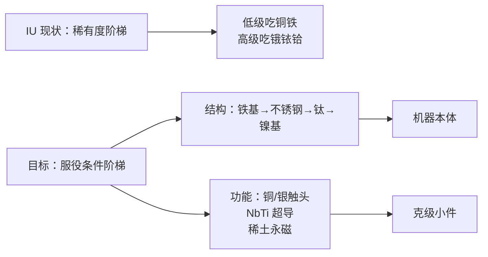

# IU 金属总规划（现实冶金口径）

> 适用版本：MC 1.21.1 / NeoForge / IU 3.4.0.11 / kubejs_iu 1.0.2
> 本文定位：**取代** `BASIC_ELECTRIC_AGE.md` §1、`IU_PRIMAL_STEAM.md` §1 里那张"四种金属分工"表，
> 给出从原始时代到超弦电压段**整套 IU 材料的现实口径**。
> 相关文档：`IU_ALLOY_PLAN.md`（合金的成分/炉档/岗位，本文 §7 的展开）、`IU_MODDING_METHODS.md`（改配方的手段）、`CASING_PROGRESSION.md`（机壳套娃链）、
> `IU_ELECTRIC_MOTOR.md`（电动机专家链）、`SE_LINE.md`、`OIL_LINE_V2.md`、`PGM_LINE.md`、
> `SILICON_WAFER_TIERS.md`、`IU_CHIP_OVERHAUL.md`、`MIDGAME_PLAN.md`。
>
> 状态：§9.2 的 P1 已实装（`server_scripts/industrial/iu_metal_realism.js`，10 条配方），
> 其余条目仍是规划；实施前旧配方按旧白名单运行，§9 是逐条改动清单与进度。

---

## 0. 一句话结论

IU 现在的材料表是**按稀有度排的阶梯**（越高级的机器越吃越吃锇、铱、铪），
现实里的机器是**按服役条件选材**：结构永远是铁基／铝／铜／钛／镍基，
贵金属与难熔金属只出现在克级功能件上（触头、催化剂、电极、支点、超导线）。

所以要改的不是"哪台机器该吃哪种金属"，而是三件事：

1. **按功能分工**：结构、导体、磁路、触头、耐磨、耐蚀、高温、催化、超导，各归各的材料族；
2. **按服役条件分档**：温度、介质、磨损、辐照决定升级，**电压只决定绝缘和截面**；
3. **按用量形态分档**：贵金属只用粒／粉／线，结构件只认板／双板／外壳。

---

## 1. 现状审计（2850 条工作台配方实测）

把 `IndustrialUpgrade-1.21.1-3.4.0.11.jar` 里 `data/industrialupgrade/recipe/` 全部 2850 条配方
按 `c:plates|doubleplate|ingots|gears|casings|dusts|rods|nuggets` 前缀统计，共出现 **95 种材料名**（含碳、木材等非金属，下表只取金属）：

| 排名 | 金属 | 出现 | 排名 | 金属 | 出现 |
| ---: | --- | ---: | ---: | --- | ---: |
| 1 | 铁 iron | 113 | 11 | 锗 germanium | 35 |
| 2 | 钢 steel | 57 | 12 | 因瓦 invar | 35 |
| 3 | 钛 titanium | 52 | 13 | 钽 tantalum | 34 |
| 4 | 锡 tin | 42 | 14 | 硬铝 duralumin | 34 |
| 5 | 维塔利姆 vitalium | 41 | 15 | 铱 iridium | 34 |
| 6 | 锇 osmium | 41 | 16 | 蒙茨合金 muntsa | 32 |
| 7 | 钴 cobalt | 41 | 17 | 青铜 bronze | 31 |
| 8 | 铅 lead | 37 | 18 | alcled（IU 铝合金） | 31 |
| 9 | 镉 cadmium | 36 | 19 | 铂 platinum | 30 |
| 10 | 碳 carbon | 35 | 20 | 琥珀金 electrum | 30 |

出现次数本身不说明问题，**出现的位置**才说明问题。下面是从配方里直接读出来的硬伤：

| 物品 | 配方 | 现状材料 | 现实里这是什么 |
| --- | --- | --- | --- |
| 完美电动机（120） | `industrialupgrade_729` | 锰双板 + 尖晶石双板 | 锰是炼钢脱氧剂／高锰钢耐磨件，尖晶石是磨料／耐火料；两者都不做电机 |
| 光子电机（622） | `industrialupgrade_1034` | 砷板 + 钽板 | 砷只以 GaAs 形式进半导体；钽的工业用途是电容与化工换热器，不是电机本体 |
| 超导线圈（387） | `industrialupgrade_1097` | 锗双板 | 锗是第一代晶体管与红外窗口材料，1950 年代就被硅取代；超导线是 NbTi／Nb₃Sn |
| 改良超导线圈（425） | `industrialupgrade_1098` | 阿卢梅尔双板 | 阿卢梅尔是 K 型热电偶的负极（Ni-Al-Mn-Si），一辈子没进过磁体 |
| 高级超导线圈（372） | `industrialupgrade_1099` | 维塔利姆双板 | 维塔利姆是 Co-Cr-Mo 铸造牙科／植入合金 |
| 完美超导线圈（398） | `industrialupgrade_1100` | 锰铁双板 | 锰铁是转炉里的脱氧剂，出钢前就烧掉了 |
| 辐射屏蔽罩（439） | `industrialupgrade_1083` | 锇双板 ×4 | 屏蔽用铅（γ）、含硼聚乙烯／硼钢（中子）；锇贵且 OsO₄ 剧毒 |
| 铁氧体环形电感（599） | `industrialupgrade_1750` | 锰铁 + 钆 | 铁氧体是 Fe₂O₃-MnO-ZnO 陶瓷；钆是磁制冷／中子吸收材料 |
| 电镀外壳·改良（138） | `industrialupgrade_759` | 琥珀金板 | 金银合金是触头／装饰，不做机壳 |
| 电镀外壳·高级（139） | `industrialupgrade_760` | 血石外壳 | 奇幻材料 |
| 电镀外壳·完美（140） | `industrialupgrade_761` | 龙晶外壳 + 木板 | 奇幻材料 |
| 元件模板（21） | `industrialupgrade_2431/2432` | 锇铱外壳（+精金） | 锇铱天然合金历史上只做笔尖、仪表支点、精密触点 |
| 铝钛合金外壳（707） | `industrialupgrade_1991` | 阿卢梅尔板 + 复合金属板 | 名字是 Ti-Al 系，配方给的是热电偶合金 |

同时也要承认：**IU 的微件表已经很现实**——坡莫合金环形电感、铁氧体电感、铜扭线电感、
钨／钼线绕电阻、钴铬磁记录盘、碳化钨、碳化铪，这些都是真东西。
问题集中在**整机与结构件**这一层，所以改的重点就是机壳、电机、线圈、变压器、电极。



---

## 2. 三条原则

### P1 功能决定材料族

一台机器拆开只有六类零件，每类在现实里都有固定材料族，**跨族使用就是错的**：

| 功能 | 现实材料族 | 判据 | 反例 |
| --- | --- | --- | --- |
| 结构／机座／框架 | 铸铁 → 碳钢 → 不锈钢 → 钛 → 镍基高温合金 | 强度、韧性、耐蚀、成本 | 机壳用锇、铱、铂 |
| 导体／绕组／母线 | 铜（ETP／OFHC）→ 铝（母线）→ 超导线 | 导电率 × 成本 × 截面 | 整机用银板、金板做导体 |
| 磁路／磁芯 | 硅钢（Fe-3Si）→ 坡莫合金 → 铁氧体 | 饱和磁感、铁损、频率 | 磁芯用锰铁、钆 |
| 触头／电刷 | 铜 → 银／AgSnO₂／AgW → 钨铜 → 锇铱 | 电弧侵蚀、接触电阻 | 触头用整块铂板 |
| 耐磨／刀具／轴承 | 高锰钢、高铬铸铁、GCr15、铍青铜、司太立、WC-Co | 硬度、冲击、温度 | 磨盘用尖晶石（它是磨料本身） |
| 耐蚀／高温／催化／电极 | 316L → 钛 → 锆 → 因科镍 → 铂族（催化） | 介质、温度、电流密度 | 电解阳极用蒙茨黄铜 |

### P2 服役条件决定等级，电压不决定

这是最反直觉的一条，也是现在配方错得最多的一条：

- 现实的 500 kV 变压器和 400 V 电机，**磁路都是取向硅钢、绕组都是铜**；
  差别在绝缘（油纸／环氧／瓷套管）、冷却（油浸／风冷）、分接开关、套管与触头，不在"塔体用什么金属"。
- 所以电压段应该体现在**绝缘件、冷却液、套管、触头材料、线径**上，
  而不是让高压机器的外壳改吃铪。

真正推动结构材料升级的是下面六个变量：

| 变量 | 现实门槛 | 材料跃迁 | 本包落点 |
| --- | --- | --- | --- |
| 温度 | 200 / 450 / 650 / 900 / 1200 ℃ | 碳钢 → 低合金 Cr-Mo → 304 → 316L/310S → 因科镍 → 难熔金属 | 焙烧、裂化、加热炉、核电 |
| 腐蚀介质 | 水／稀酸／氯离子／湿氯／氢氟酸 | 碳钢 → 304 → 316L → 双相钢 → 钛 → 锆 → 哈氏 | 洗矿、浸出、氯碱、电解 |
| 磨损 | 冲刷、磨粒 | 高锰钢 → 高铬铸铁 → 司太立堆焊 → WC-Co | 破碎、研磨、挤压 |
| 电流 | 接触电阻与电弧 | 铜 → 银镀 → AgSnO₂/AgW → 钨铜 | 触头、断路器、电刷 |
| 频率 | >1 kHz 起铁损主导 | 硅钢 → 坡莫合金 → 铁氧体 → 非晶 | 电感、开关电源 |
| 真空／低温／辐照 | 10⁻⁴ Pa、4.2 K、10²¹ n/cm² | 无氧铜、科瓦、NbTi/Nb₃Sn、锆合金 | 超导、核电、光刻 |

### P3 稀有度只决定用量形态

现实里贵金属的年用量是"吨"，但单件用量是"克"：

| 形态 | 现实含义 | 允许的金属 |
| --- | --- | --- |
| 外壳／双板（≈2–8 kg） | 结构件、承压件 | 铁、钢、不锈钢、钛、铝、铜、青铜、镍基合金、难熔合金（仅热区） |
| 板／锭（≈0.5–1 kg） | 一般零件 | 上述 + 铬、锰、钼钢、钴基、锆 |
| 棒／线／齿轮（≈50–200 g） | 传动件、导体、热电偶 | 上述 + 钨、钼、镍铬、阿卢梅尔 |
| 粒／粉／箔（≈1–20 g） | 触头、催化、镀层、焊料 | 银、金、铂、钯、铑、锇、铱、铍、镓、锗、钽 |

**硬规则**：贵金属（Au/Ag/Pt/Pd/Rh/Os/Ir/Ru）与剧毒金属（Cd/Tl/Be/As）
**不得出现在机壳、框架、机身、结构件的配方里**；只能是粒、粉、线、箔、棒，单条配方 ≤2 个。

---

## 3. 五档机壳 = 五档服役环境

IU 的 294 台机器方块全部挂在 4 档电镀外壳 + 光子外壳上（实测：基础 137 只在 2 台机器里当外框，
138/139/140 分别出现在 19/18/17 台机器配方中，其余靠机身嵌套）。所以**机壳就是机器等级**，
这一层改对了，整条阶梯就对了。

| 档 | 物品 | 现实定位 | 结构 | 内衬／绝缘 | 判据 |
| --- | --- | --- | --- | --- | --- |
| 基础（LV/MV） | `crafting_137` 电镀外壳 | 铸铁／碳钢机座 | Q235 钢板 + HT200 铸铁 | 油漆、橡胶垫 | 室内、无腐蚀、<100 ℃ |
| 改良（HV） | `crafting_138` 改良电镀外壳 | 304 不锈钢机柜 | 304（06Cr19Ni10） | 塑料衬里、环氧 | 潮湿、弱酸碱 |
| 高级（EV/UMV） | `crafting_139` 高级电镀外壳 | 316L 承压壳体 | 316L（022Cr17Ni12Mo2） | 碳纤维增强塑料罩、PTFE 垫 | 氯离子、稀硫酸、<300 ℃ |
| 完美（UHV/UEV） | `crafting_140` 完美电镀外壳 | 钛制化工设备 | 工业纯钛 Gr2 / Ti-6Al-4V | 陶瓷、CFRP | 湿氯、海水、强氧化介质 |
| 光子（特异以上） | `crafting_623` 光子电镀外壳 | 镍基单晶热端 | 尼莫尼克 + Rene（含 Re） | 陶瓷基复材、气膜冷却 | >900 ℃、燃气、辐照 |

这五条外壳是 294 台机器方块的等级开关，**改这五条等于改全部机器**，这是最省力的杠杆：

```
基础  钢板 + 铸铁件
改良  304 板 + 塑料衬里           （原：琥珀金板）
高级  316L 板 + 钼 + 碳纤维罩     （原：血石外壳）
完美  钛板 + 铝 + 钒（Ti-6Al-4V） （原：龙晶外壳 + 木板）
光子  尼莫尼克 + Rene             （原样保留，这条本来就是对的）
```

> 奇幻材料（血石、龙晶、精金、秘银、山铜、draconid）**退出 IU 结构件**，
> 只留在星辉／魔法线（`astralsorcery`、`create_crystal_industry`）与最终幻想级机器里。
> 这是本次规划唯一的"删除型"改动，取舍见 §10 第 1 条。

---

## 4. 电压段 → 材料（真正该随电压变的东西）

| 段 | IU 名 | 现实对应 | 导体 | 绝缘／冷却 | 触头 | 结构 |
| --- | --- | --- | --- | --- | --- | --- |
| LV | 低压 | ≤1 kV 配电 | 铜 ETP | 漆包线、纸板、空气 | 铜／银镀 | 铸铁、Q235 |
| MV | 中压 | 1–35 kV 配网 | 铜，大截面 | 环氧浇注、SF₆／干燥空气 | 银钨 AgW | 304 |
| HV | 高压 | 35–220 kV | 铜（OFHC） | 油纸电容式套管、变压器油 | AgSnO₂／铜钨 | 304 油箱 |
| EV | 超高压 | 220–500 kV | 铜母线 | 瓷套管、油循环 | 钨铜 | 316L 油箱 |
| UMV | 特高压 | ≥800 kV | 铝母线（扩径导线） | 复合绝缘子 | 钨铜 | 316L |
| UHV | 终极 | 大电流工业母线 | 铜排 + 铝排 | 强迫风冷／水冷 | 银钨 + 石墨电刷 | 316L／钛 |
| UEV | 临界 | 核电／真空器件 | 无氧铜 OFHC | 陶瓷封接、真空 | 钨铜 | 锆合金／因科镍 |
| UMHV | 特异 | 超导馈线 | 铜包 NbTi | 液氦、真空杜瓦 | 锇铱（克级） | 镍基 + 因瓦 |
| UMEV | 相态 | 超流氦温区 | Nb₃Sn | 超流氦 | — | 因瓦／钛 |
| UHEV | 零点 | 虚构 | YBCO 涂层导体 | 液氮 | — | 镍基单晶 |
| HEEV | 超弦 | 虚构 | 超导 + 等离子体约束 | 真空 | 铪／钨合金 | TTH（Ta-W-Hf）／HfC |

**这张表里只有后三列该随电压动**：绝缘、触头、导体截面。
前两列（结构）只在"温度／介质"跨档时换材料。

关于铝母线补一句现实依据：铝只有 61 % IACS（铜 100 %），但密度只有铜的 30 %，
**同重量导电率约为铜的 2 倍**，所以架空线与大电流母线用铝；代价是截面要放大约 1.6 倍，
而且铝铜接头必须用过渡片（双金属板），否则电偶腐蚀——这一条可以直接做进配方：
`c:plates/aluminium` 母线 + `c:plates/copper` 过渡片。

---

## 5. 机器职能 → 选材（本包真正的落点）

按 `MIDGAME_PLAN.md` 的产线分段，把现实选材直接对上去：

| 职能（本包机器／产线） | 服役条件 | 结构 | 接触介质件 | 关键功能件 |
| --- | --- | --- | --- | --- |
| 破碎／研磨 | 磨粒冲刷 | 铸铁机座 | 高铬铸铁衬板、高锰钢锤头 | 轴承钢 GCr15 |
| 洗矿／浸出 | 稀硫酸、氯离子 | 316L 槽体 | 橡胶衬里、PVC 管 | 钛泵、316L 叶轮 |
| 焙烧 | 600–900 ℃ + SO₂ | 碳钢外壳 | 耐火砖 | 310S／因科镍夹具 |
| 电积／电解 | 硫酸 + 大电流 | 混凝土／FRP 槽 | **铅锡阳极 + 316L 阴极** | 铜母线、石棉／全氟膜 |
| 氯碱 | 湿氯、强氧化 | 钛壳体 | 钛基 RuO₂/IrO₂ 阳极 | 镍阴极、Nafion 膜 |
| 石油裂化／加氢 | 400–500 ℃、H₂/H₂S | 2.25Cr-1Mo 钢 | 不锈钢内衬 | 因科镍炉管、V₂O₅／Pt-Re 催化 |
| 聚合（PE/PP） | 压力、TiCl₄ | 不锈钢 | — | 齐格勒-纳塔 Ti 系催化剂 |
| 核电 | 中子辐照 | 316L 一回路 | **锆合金包壳**（除铪） | 硼钢／铪控制棒、因科镍 690 传热管 |
| 光刻 | 亚微米精度 | 花岗岩基座 | — | **因瓦**工作台、熔石英／CaF₂ 镜、铍窗口 |
| 超导磁体 | 4.2 K | 不锈钢／环氧 | 液氦杜瓦 | NbTi／Nb₃Sn 线 |
| 高温加热 | 1200 ℃ | 耐火炉膛 | — | 镍铬／钼／钨／石墨发热体 |

把这张表和 IU 的机器配方对齐，就得到 §6 的逐件映射。

---

## 6. 逐件映射

### 6.1 结构／机壳

| 物品 | 现状 | 改为 | 现实依据 |
| --- | --- | --- | --- |
| 电镀外壳 137 | 钢板 + 元件 501 | 钢板 + 铸铁件（保留） | Q235 机座 + HT200 铸铁端盖 |
| 改良电镀外壳 138 | 琥珀金板 + 塑料板 | **304 钢板 + 塑料板** | 不锈钢机柜 + 绝缘衬里 |
| 高级电镀外壳 139 | 血石外壳 + 元件 479 | **316L 板 + 钼锭 + CFRP** | Mo 2–3 % 是 316L 抗氯离子的关键 |
| 完美电镀外壳 140 | 龙晶外壳 + 木板 | **钛板 + 铝板 + 钒锭** | Ti-6Al-4V（6 % Al、4 % V） |
| 光子电镀外壳 623 | 尼莫尼克 + Rene | 保留 | 单晶镍基 + 3 % Re，现实航发叶片 |
| 钛外壳 726 | 复合金属板 + 钛板 | 保留（钛 Gr2） | 化工换热器／压力容器 |
| 钛合金外壳 727 | 复合金属板 | **钛 + 铝 + 钒（Ti-6Al-4V）** | 航空结构钛合金 |
| 铝钛合金外壳 707 | 复合金属板 + 阿卢梅尔板 | **钛 + 铝 + 钒**（或按 Alumide 做：铝粉 + 塑料 + 钛板） | 阿卢梅尔是热电偶合金，不是结构合金 |
| 镍钨合金外壳 505 | 钨镍铁重合金 | 保留 | 90W-7Ni-3Fe：屏蔽、配重、离心机转鼓 |
| 辐射屏蔽罩 439 | 锇双板 ×4 | **铅板 ×4（γ）+ 硼钢（中子）** | 锇不做屏蔽，OsO₄ 剧毒 |

### 6.2 机电转换（电机／线圈／变压器）

| 物品 | 现状 | 改为 | 现实依据 |
| --- | --- | --- | --- |
| 电动机 276（LV） | 青铜外壳 + 铜导线 + 铁板 + 红铜 | 青铜外壳 + 铜导线 + 铁板 + **锡锭**（焊点） | 低价电机：铁氧体磁钢 + 铜绕组 + 铸铁机座；红铜是铜锌合金，不做绕组 |
| 改良电动机 20（MV） | 阿卢梅尔 + 琥珀金双板 | **AlNiCo 磁钢（铝+镍+钴+铁）+ 铝壳 + 钢板** | 1931 年三岛德七的 AlNiCo，1930–60 年代主力永磁 |
| 高级电动机 96（HV） | 铂 + 维塔利姆双板 | **FeCrCo 磁钢（铁+铬+钴）+ 304 机座 + 铜绕组** | Fe-28Cr-23Co 滞后／力矩电机磁钢；铂不做结构 |
| 完美电动机 120（EV） | 锰 + 尖晶石双板 | **钕铁硼（钕+铁+硼）+ 钛机座 + 铜绕组** | Nd₂Fe₁₄B，1984 年起最强永磁；>150 ℃ 要换 SmCo（本包无钐，留注释） |
| 光子电机 622 | 砷板 + 钽板 | **NbTi 励磁 + 钕铁硼 + 因科镍 + 液氦** | 超导电机（MRI／舰船推进同构） |
| 线圈 294 | 铜导线 + 铁板 + 红铜 | 铜导线 + 铁板 + **锡锭** | 漆包铜线 + 硅钢／铁磁轭 + 焊锡 |
| 超导线圈 387 | 锗双板 | **铌钛板 + 液氦** | Nb-47Ti，Tc 9.2 K，MRI 主力线材 |
| 改良超导线圈 425 | 阿卢梅尔双板 | **铌板 + 锡锭（Nb₃Sn）** | A15 结构，Tc 18 K，10 T 以上用 |
| 高级超导线圈 372 | 维塔利姆双板 | **Nb₃Sn + 铜稳定基体** | 铜包超导线，失超时导流 |
| 完美超导线圈 398 | 锰铁双板 | **钇 + 钡 + 铜（YBCO）** | YBa₂Cu₃O₇₋δ，Tc 92 K，液氮温区 |
| 变压器 206–216 | 木板 + 锡导线 + 模板 | 铁芯 **硅钢（钢+硅）**，绕组铜；高压段加**陶瓷套管 + 变压器油** | 取向硅钢 B₈₀₀≈1.9 T；木板其实对应绝缘纸板（pressboard），可保留但改名 |

### 6.3 电子／仪表／电化学

| 物品 | 现状 | 改为 | 现实依据 |
| --- | --- | --- | --- |
| 电解机 244 / 阳极 648 / 阴极 584 | 铅板 ×6 / 镍板 ×6 | 阳极 **铅 + 锡**（Pb-Sn，本包无锑）；阴极 **316L 或铝** | 铜电积就是 Pb-Sb 阳极 + 316L 阴极；镍板做阴极是浪费 |
| 元件:水 1102 | 银板 ×2 + 镍锭 ×3 + 铅板 ×2 + 钢板 | **316L + 铅内衬 + 铜管**，银降为 1 粒 | 水腔要耐蚀不要导电率 |
| 元件:无线 1127 | 银板 ×3 + 镍锭 ×2 + 钢板 | **铜板 + 银粒（镀银）+ 镍 + 钢** | 射频件是镀银铜，不是实心银 |
| RE 电池 1609 | 铅外壳 ×4 | 保留（铅酸壳体） | 铅酸电池：铅板栅 + 硫酸 |
| 元件模板 21 | 锇铱外壳（+精金） | **因瓦／铸铁基座 + 镀铬层**；锇铱只留 1 粒做支点 | 计量基准用因瓦（Fe-36Ni，α≈1.2×10⁻⁶/K） |
| 铁氧体环形电感 599 | 锰铁 + 钆 | **铁 + 锰 + 锌（MnZn 铁氧体）** | 钆是磁制冷／中子吸收，不是铁氧体组分 |
| 钇铝磁覆层 736 | 钇 + 铝 | **钇 + 铁（YIG 钇铁石榴石）** | Y₃Fe₅O₁₂ 是微波铁氧体；钇铝合金是结构中间合金 |
| 铝钇磁盘 575 | 铝 + 钇 | **铝镁基板 + 钴铬记录层** | 硬盘基板是 Al-Mg + NiP，记录层是 Co-Cr |
| 反应炉温度元件 38/89 等 | 铂／镍铬 | **阿卢梅尔 + 镍铬（K 型热电偶）**；高温档 **铂铑** | K 型：NiCr-NiAl，−200…1300 ℃ |
| 钨／钼电阻器 563/585 | 钨／钼 | 保留 | 线绕高温电阻、发热体 |
| 激光器 354 | 金板（原始时代已改） | 掺钕 YAG（钇+铝+钕）用于退火／修复；曝光用 KrF/ArF 气体 | 与 `IU_CHIP_OVERHAUL.md` 的光源表对齐 |
| 镉（36 处） | 机器／触头 | **退出结构件**，只留镍镉电池与镀层，逐步换锌／镍 | RoHS 2006 起限制镉 |
| 铊（20 处） | 机器件 | **退出全部机器配方**，只留研究／红外光学 | 铊盐剧毒，工业无结构用途 |

---

## 7. 本包已有合金的现实定位

IU 自带一批**真合金名**，这是最值得利用的资产。按现实用途重新定位，不要按稀有度乱塞
（成分、炉档、时代门、逐条改动清单见 `IU_ALLOY_PLAN.md`，本节只列用途）：

| 合金 | 现实成分 | 现实用途 | 本包落点 |
| --- | --- | --- | --- |
| 蒙茨合金 muntsa | Cu 60 / Zn 40 | 冷凝管、海水管路、船舶包板 | 换热器管、海水泵 |
| 红黄铜 redbrass | Cu 85 / Sn 5 / Zn 5 / Pb 5 | 阀门、管件、轴承 | 低压管件、轴瓦 |
| 铝青铜 aluminumbronze | Cu-Al-Fe-Ni | 海水泵阀、螺旋桨、抗磨环 | 浸出／海水段泵阀 |
| 铍青铜 berylliumbronze | Cu-2Be | 弹簧、触点、无火花工具 | 继电器弹簧、防爆工具 |
| 硬铝 duralumin | Al-4.4Cu-1.5Mg | 航空结构（2024） | 轻型机架、风扇叶 |
| 铝锂合金 aluminiumlithium | Al-Cu-Li（2195） | 航天减重 10 % | 高速转子、飞轮 |
| 铝硅合金 aluminiumsilicon | AlSi12 | 铸造活塞、缸体 | 泵体、压缩机活塞 |
| 坡莫合金 permalloy | Ni 80 / Fe 20 | 磁屏蔽、弱信号变压器 | 磁屏蔽罩、精密电感 |
| 因瓦 invar | Fe 36 / Ni | 精密仪器、基准尺、光刻台 | **光刻工作台／掩模基板** |
| 因科镍 inconel | Ni-Cr-Fe(+Nb/Mo) | 700 ℃ 炉管、核电传热管 | 焙烧夹具、蒸汽发生器 |
| 尼莫尼克 nimonic | Ni-Cr-Ti-Al | 涡轮叶片（80A/90） | 燃气轮机叶片 |
| Rene superalloyrene | Ni 基 + 3–6 % Re | 单晶叶片（CMSX-4） | 光子级热端 |
| Haynes superalloyhaynes | Co/Ni 基 | 燃烧室、高温紧固件 | 燃烧室衬套 |
| 司太立 stellite | Co-Cr-W-C | 阀座／泵套堆焊 | 耐磨密封面 |
| 维塔利姆 vitalium | Co-28Cr-6Mo | 铸造植入体、热腐蚀件 | 高温阀座、耐蚀铸件 |
| 钴铬 cobaltchrome | Co-Cr | 磁记录层、植入体 | 磁盘记录层 |
| 镍铬 nichrome | Ni 80 / Cr 20 | 电热丝（1200 ℃） | 加热元件、电阻器 |
| 阿卢梅尔 alumel | Ni-2Mn-2Al-1Si | K 型热电偶负极 | 温度元件 |
| 锰铁 ferromanganese | Fe-Mn | **炼钢脱氧剂**（中间合金） | 只进炼钢配方，不进机器 |
| 钒铝 vanadoalumite | V-Al | **钛合金中间合金** | 只进 Ti-6Al-4V 链 |
| 钼钢 molybdenumsteel | 0.2–0.5 % Mo 钢 | 高温高压管道（2.25Cr-1Mo） | 裂化／加氢反应器 |
| 不锈钢 stainlesssteel | 304/316L | 通用耐蚀 | 改良／高级机壳 |
| 铌钛 niobiumtitanium | Nb-47Ti | 低温超导线 | 超导线圈、MCZ 磁体 |
| TTH tantalumtungstenhafnium | Ta-W-Hf | 火箭喷管、高超声速前缘 | 超弦段热端 |
| 碳化铪 hafniumcarbide | HfC（3890 ℃） | 超高温陶瓷 | 超弦段坩埚／喷嘴 |
| 硼化铪 hafniumboride | HfB₂ | 超高温陶瓷（UHTC） | 再入／熔体接触件 |
| 锇铱 osmiridium | Os-Ir 天然合金 | 笔尖、仪表支点、精密触点 | 克级触点／支点 |

---

## 8. 获取门槛（现实工艺 → 时代门）

材料的时代门槛应该由**现实工艺**决定，而不是由矿石颜色决定。这一列可以直接翻成 astages：

| 金属 | 现实工艺 | 真正的门槛 | 建议时代 |
| --- | --- | --- | --- |
| 铜／锡／铅／铁／金／银 | 火法还原、灰吹法 | 1100–1300 ℃、还原气氛 | 原始 |
| 锌 | 密闭蒸馏罐（950 ℃ 下 Zn 蒸气） | 冷凝收集装置 | 蒸汽末期 |
| 黄铜 | 渗锌法／铜锌熔配 | 锌 | 蒸汽 |
| 钢 | 渗碳、坩埚钢 | 密闭高温 + 控碳 | 蒸汽末期 |
| 镍 | 硫化矿火法（Cu-Ni 冰铜） | 转炉、电解精炼 | 电力初期 |
| **铝** | **Hall-Héroult 电解**（冰晶石熔盐，4.2 V／200 kA 直流） | **必须有大电流直流电** | 电力初期（入口工艺） |
| 镁 | 电解法／皮江法（硅热还原） | 真空罐、1200 ℃ | 电力中段 |
| 铬 | 铝热法（Al + Cr₂O₃）／电解 | 需要铝 | 电力中段 |
| 镉／锗 | 锌渣、铝土矿副产 | 湿法冶金 + 区熔提纯 | 电力中段 |
| 钨／钼 | 焙烧 → 氢还原 → 粉末冶金 | **氢气** + 垂熔／旋锻 | 电力中后段 |
| 钒 | 钒渣 → V₂O₅ | 转炉副产 + 接触法硫酸 | 电力中段（接石油线） |
| 钛 | Kroll 法（TiCl₄ + Mg，氩气保护） | **氯气 + 镁 + 惰性气氛 + 真空蒸馏** | 中后期 |
| 锆／铪 | 锆英石氯化 → 萃取分离（Hf <100 ppm） | 溶剂萃取，锆铪分离是著名难题 | 后期 |
| 稀土（钕／钇／钆） | 独居石／氟碳铈矿 → 萃取分离 | P204/P507 多级萃取 | 后期 |
| 钽／铌 | 钶钽铁矿浸出 → MIBK 萃取分离 | Ta/Nb 分离 | 后期 |
| 铍 | 绿柱石 → 氟化物电解 | 剧毒防护 | 后期 |
| 镓／锗 | 拜耳法母液／锌渣副产 + 区熔 | 与硅线共用区熔炉 | 中期（Ge 早于 Si） |
| 铂族 | 镍阳极泥 → 王水 → 蒸馏／萃取 | **已有 `PGM_LINE.md`** | 中期 |
| 锇／铱 | 同上，年产量以吨计 | 克级配额 | 后期（功能件） |

两条可以直接落地的联动：

1. **铝 = 电力时代的入口工艺**：`era.electric` 一开就该能做电解铝，之后的母线、机架、散热器才有材料基础。
   这也解释了为什么蒸汽时代禁用铝——不是"太难"，是**没有直流电就炼不出来**。
2. **V₂O₅ = 硫酸接触法催化剂**：石油线的硫酸塔接上钒，钒就有了第一个正经用途；
   铂族则只做重整催化（Pt-Re），与 `OIL_LINE_V2.md` 的三代催化剂床（硅铝→分子筛→Pt-Re）对齐。

---

## 9. 与现有文档的冲突与改动清单

### 9.1 口径冲突

| 文档 | 现在的说法 | 本规划 | 处理 |
| --- | --- | --- | --- |
| `BASIC_ELECTRIC_AGE.md` §1 | 钢=结构、**银=导体**、铅=密封、镍=抗蚀 | 银只做触头／镀层；导体是铜，母线是铝 | 改这一行，指向本文 |
| `IU_PRIMAL_STEAM.md` §1 | 三时代白名单 | 不变（原始／蒸汽本来就现实） | 加一行"完整口径见本文" |
| `IU_PRIMAL_STEAM.md` §2 | 余烬压印按熔点分流 | 保留，补充：**压印只能出低熔点板**，与"结构件不用贵金属"一致 | 不变 |
| `SE_LINE.md` §1 | 银板做导体 | 银降为粒／粉，导体换铜板 | 与 9.2 一起改 |
| `IU_ELECTRIC_MOTOR.md` §0 | 线圈含红铜 | 红铜→锡（焊料） | 小改 |
| `IU_CHIP_OVERHAUL.md` | 已用 NbTi + 液氦 + 12N | 一致 | 不改 |
| `OIL_LINE_V2.md` 催化剂床表 | Pt-Re／TiCl₄／硅铝催化 | 一致，补 V₂O₅ 硫酸催化 | 补一行 |
| `PGM_LINE.md` | 镍阳极泥 → 铂钯锇铱 | 一致，锇铱限定克级功能件 | 补一行 |

### 9.2 实施进度（P1 已落地）

`kubejs/server_scripts/industrial/iu_metal_realism.js`（工作台配方，`/reload` 生效）：

| 配方 id | 产物 | 由 → 改为 |
| --- | --- | --- |
| `industrialupgrade_759` | 改良电镀外壳 138 | 琥珀金板 → **304 不锈钢板** + 塑料衬里 |
| `industrialupgrade_760` | 高级电镀外壳 139 | 血石外壳 → **316L 板 + 钼锭**（Mo 2~3%）+ CFRP |
| `industrialupgrade_761` | 完美电镀外壳 140 | 龙晶外壳 + 木板 → **钛板 ×2 + 不锈钢内衬** |
| `industrialupgrade_1083` | 辐射屏蔽罩 439 | 锇双板 ×4 → **铅板 ×4** |
| `industrialupgrade_1991` | 铝钛合金外壳 707 | 阿卢梅尔板 → **钛 + 铝 + 钒（Ti-6Al-4V）** |
| `industrialupgrade_1750` | 铁氧体环形电感 599 | 锰铁 + 钆 → **铁粉 / 锰粉 / 锌粉（MnZn 铁氧体）** |
| `industrialupgrade_1097` | 超导线圈 387 | 锗双板 → **铌钛板**（NbTi） |
| `industrialupgrade_1098` | 改良超导线圈 425 | 阿卢梅尔双板 → **铌板 + 锡锭**（Nb₃Sn） |
| `industrialupgrade_1099` | 高级超导线圈 372 | 维塔利姆双板 → **铌板 + 铜锭**（Nb₃Sn + 铜稳定基体） |
| `industrialupgrade_1100` | 完美超导线圈 398 | 锰铁双板 → **铜 + 钇 + 钡**（YBCO） |

光子电镀外壳（623，尼莫尼克 + Rene）原本就是对的，没有动。

不锈钢（304）的配料路线同时在 `metallurgy/stainless_steel.js` 里铺好了，
因为机壳 138 现在卡在 `c:plates/stainlesssteel` 上：

```
7 铁粉 + 2 铬粉 + 1 镍粉 ──机械搅拌器──▶ 10 不锈钢粉
                              └──熔炉/高炉──▶ 不锈钢锭（IU 自带 furnace_303 / blasting_304）
不锈钢锭 ──Create 压板──▶ 不锈钢板
```

70/20/10 就是 304 的名义成分（现实 72/19/9），碳、锰、硅因为含量都在 2% 以下、
做不到一颗粉的粒度，省略。粉本身来自 IU 粉碎机，电力时代既有产物。

还没做的（需要单独决定，不阻塞上面这批）：

- 元件模板 21 的两条“专家配方”（`industrialupgrade_2431/2432`，锇铱 / 精金外壳）——
  和序列装配并存，等于模板还有第三条来源；
- 电解阴极 584 的 316L、合金元素（铬）显式化；
- 元件:水 1102 / 元件:无线 1127 把「银板」降成「银粒」；
- 铝 / 钛 / 锆 / 稀土的 astages 时代锁。

### 9.3 脚本改动（按优先级）

| 优先级 | 文件 | 改什么 |
| --- | --- | --- |
| P1（已做） | `server_scripts/industrial/iu_metal_realism.js` | 机壳 759/760/761、辐射屏蔽罩 1083、铝钛外壳 1991、铁氧体电感 1750、超导线圈 1097–1100。工作台配方，`remove + custom` 即可，不需要桥 |
| P1（已做） | `server_scripts/metallurgy/stainless_steel.js` | 304 配料：7 铁粉 + 2 铬粉 + 1 镍粉 → 10 不锈钢粉（搅拌），锭 → 板（压板）；烧炼沿用 IU 自带 furnace_303 / blasting_304 |
| P1 | `industrial/iu_electric_recipes.js` | 按 §6.3 改水／无线／电解三件套：银降为粒，阴极换 316L，阳极 Pb-Sn |
| P2 | `industrial/iu_electric_motor.js` | 线圈 294 红铜→锡；电机 5 档按 §6.2 换磁钢体系（AlNiCo／FeCrCo／NdFeB／超导） |
| P2 | `industrial/iu_se_line.js` | 银板→铜板 + 银粒，与 9.1 对齐 |
| P3 | `config/astages/simple/astages/item.json` | 给铝／钛／锆／稀土加 `era.electric`／后期 stage 锁（现在只有钢被锁） |
| P3 | 机器配方池（`kubejs_iu` 桥） | 只改"机器内加工"里用到贵金属的条目；`CompressorRecipe` 这类标签自动生成的池不用动 |
| P4 | 新增 `kubejs/tools/lint_iu_metals.py` | 扫全部配方 JSON + KubeJS 脚本：结构槽位出现贵金属／镉／铊即报错，防止回退 |

> 实现注意：IU 的机器配方在 Java 内存里，改不动就换工作台那一层；
> 标签驱动的自动配方（挤压机等）不要碰，它们是"金属名 × 标签"自动生成的，
> 只要标签还在就会自己回来（见 `IU_MODDING_METHODS.md` §B3）。

---

## 10. 待确认

1. **奇幻材料怎么退**：血石／龙晶／精金／秘银／山铜从 IU 结构件里全部退出（只留星辉线与终极机器），
   还是保留其中一两样作为"超越现实"的第六档？
2. **镉与铊**：是直接从机器配方里清掉（现实无毒替代：锌／镍／钢），还是保留但限定在电池／红外件？
3. **银的降级幅度**：从"银板 ×2–3"降到"银粒 ×1–2"会明显降本，是否接受整章难度下降？
4. **时代硬锁**：是否给铝／钛／锆／稀土加 astages 锁？加了以后电力章的配方要重审一遍，
   不加则"现实工艺门槛"只停留在文档上。
5. **超导四档**：NbTi → Nb₃Sn → 铜稳定 Nb₃Sn → YBCO 这条线要不要跟着电压段走
   （现在 IU 的四档是锗／阿卢梅尔／维塔利姆／锰铁，完全随机）。
