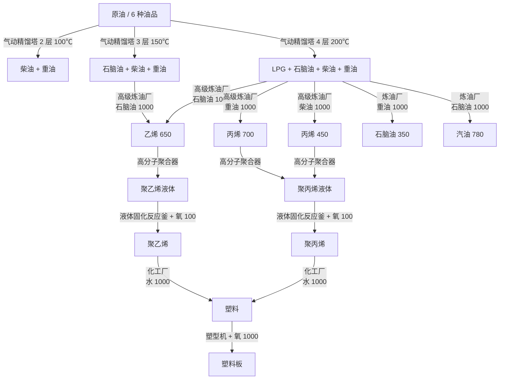

# 石油—石化线（GTNH 式）

> **⚠ 已被 `OIL_LINE_V2.md`（v4）取代。** v4 起：前端仍是气动精炼厂，但石脑油裂解改由
> MMCR 蒸汽裂解炉承担，**IU 高级炼油厂整池清空、不再产乙烯**；IU 炼油厂只留渣油回炼与
> 柴油裂化补丙烯，重整（石脑油→汽油）也撤掉，归 G2 的催化重整装置。
> 本文保留作为历史实现记录，数值与流程以 `OIL_LINE_V2.md` 为准。
>
> 版本：IU 3.4.0.11 / PneumaticCraft: Repressurized 8.2.24 / KubeJS 2101.7.2
> 脚本：`startup_scripts/industrial/oil_fluids.js`（石脑油流体）、
> `server_scripts/industrial/iu_oil_line.js`（气动精馏塔的配方）
> 补丁：`kubejs/sjcore/oil_line.json`（IU 侧机器配方，走 Sink Journey Core）
> 相关文档：`IU_MODDING_METHODS.md`（通道与坑）、`unify-fluids-review.md`（原油统一）

---

## 1. 为什么改成这样

原版 IU 的塑料有两处"一步到位"：

- **高级炼油厂（`imp_oil_refiner`）**：10 mB 原油直接出 5 mB 聚乙烯 + 5 mB 聚丙烯，
  六种原油各一条。抽上来就是塑料原料，石油工业被压成一台机器。
- **炼油厂（`oil_refiner`）**：10 mB 原油直接出汽油 + 柴油，把本该拿去裂解的
  石脑油当燃料烧掉。

气体路线（天然气 → 甲烷 → 乙炔 → 乙烯）也不像石油工业：没有分馏、没有裂解段、
没有渣油深加工。而气动工艺那条原油—精馏塔—燃料链条完全独立，两套石油系统互不相通。

这条线按 GTNH 的石油工业重排：

- **常压分馏**是入口，放在气动时代（精馏塔不要电，只要压力和热）。
- **石脑油**单独成为一种流体，只做裂解原料和重整原料，不再混在燃料里。
- **乙烯**只能来自石脑油裂解，**丙烯**来自重油催化裂化与柴油裂化。
- **渣油（重油）**必须深加工回石脑油，形成回路。
- **塑料**仍然由原来的 化工厂（聚乙烯+聚丙烯+水）产出，只是原料必须先过油。

---

## 2. 流程



---

## 3. 数值表

### 3.1 常压分馏（气动精馏塔，按 1000 mB 原油计）

| 层数 | 温度门槛 | LPG | 石脑油 | 柴油 | 重油 |
| --- | --- | --- | --- | --- | --- |
| 2 层 | 100 ℃ | — | — | 600 | 400 |
| 3 层 | 150 ℃ | — | 260 | 420 | 320 |
| 4 层 | 200 ℃ | 100 | 400 | 280 | 220 |

六种原油按"轻/重"微调：石脑油 `+d`、重油 `-d`，柴油与 LPG 不变。

| 原油 | d |
| --- | --- |
| 原油（普通） | 0 |
| 甜中质原油 | +50 |
| 甜重质原油 | −50 |
| 酸轻质原油 | +30 |
| 酸中质原油 | −20 |
| 酸重质原油 | −70 |

酸质原油仍可先过 **原油脱硫釜**（IU 自带，酸→甜，300 mB 进 225 mB 出）再进塔，
这是原版就有的路线，这里保留。

### 3.2 裂解 / 裂化（IU 机器，1 进 2 出）

> 数值在 `kubejs/sjcore/oil_line.json`，改完 `/sjcore iu reload` 即生效，不用重启。
> 

| 机器（配方池） | 输入 | 主产物 | 联产物 |
| --- | --- | --- | --- |
| 高级炼油厂 `imp_oil_refiner` | —（v4 起整池清空，裂解交给 MMCR 蒸汽裂解炉） | — | — |
| 炼油厂 `oil_refiner` | 重油 1000 | 石脑油 350 | 柴油 200 |
| 炼油厂 `oil_refiner` | 柴油 1000 | 丙烯 450 | 重油 250 |

> **为什么必须两个产物**：高级炼油厂 / 炼油厂各有 2 个输出罐（`fluidTank2` / `fluidTank3`），
> 机器 `update()` 里无条件 `output_fluid.get(0)`、`get(1)`，`FluidHandlerRecipe#canFillFluid`
> 也按输出罐数量遍历。只给 1 个流体产物的配方一旦被匹配就 `IndexOutOfBoundsException`，
> 表现是机器完全不工作——原来 JS 版本的一进一出配方就是卡在这里。

聚合与成型沿用原版：乙烯 400 → 聚乙烯 200，丙烯 400 → 聚丙烯 200，
液体固化 250 mB + 氧 100 → 1 个固体，化工厂（水 1000 + 两种固体各 1）→ 1 塑料。

### 3.3 一条 1000 mB 原油大概能出多少

4 层塔、普通原油：

- 石脑油 400 → 260 乙烯 → 约 0.52 个聚乙烯
- 重油 220 → 154 丙烯，柴油 280 → 126 丙烯，合计 280 丙烯 → 约 0.56 个聚丙烯

即 **约 1 桶原油 ≈ 0.5 个塑料**，剩下的 LPG/柴油/汽油是燃料副产品。
产量集中在脚本里的 `add(...)` 调用处，调平衡只改数字。

---

## 4. 删掉了什么

| 池 | 原配方 | 处理 |
| --- | --- | --- |
| `imp_oil_refiner` | 原油 → 聚乙烯 + 聚丙烯（6 条） | 按产物循环删空 |
| `oil_refiner` | 原油 → 汽油 + 柴油（6 条） | 按产物循环删空 |
| `gas_combiner` | 乙炔 + 氢 → 乙烯 | 按产物删空 |
| `gas_combiner` | 丙烷 + 溴 → 二溴丙烷 | 按产物删空 |
| `fluid_integrator` | 二溴丙烷 + 锌 → 丙烯 | 按产物删空 |
| `pneumaticcraft:refinery` | oil_2 / oil_3 / oil_4（气动原油 → 柴油/煤油/汽油/LPG） | 整条替换成本线的分馏（仍在 JS 里） |

前四行的机器配方现在由 `kubejs/sjcore/oil_line.json` 施加（`op=clear` / `remove`），
不再走 `kubejs_iu` 桥。

保留下来的天然气路线：天然气 → 甲烷 + 丙烷、甲烷 → 乙炔 + 氢。
它们还能供氢、乙炔（聚合成苯），但**不再通到乙烯/丙烯**，所以不能绕开石油做塑料。

气动自己的燃料升级链（柴油 → 煤油 → 汽油 → LPG，热力加工厂）没有动，
所以煤油灯、液体压缩机、气动塑料（LPG + 煤 → 熔融塑料 → 塑料板）都在，
只是它们的 LPG/柴油现在来自本线的分馏塔。

---

## 5. 时代衔接

| 阶段 | 能做什么 |
| --- | --- |
| 气动 / 蒸汽 | 地震传感器找油 → 气举抽油（原油已被 OEF 统一成 IU 原油）；或者 IU 磕头机/无线油泵抽沙漠油脉。2 层塔出柴油+重油，柴油直接当燃料或进气动燃料升级链 |
| 气动中期 | 3 层塔（150℃）拿到石脑油，但还没有机器能吃它——这是故意的断点，石脑油必须等电 |
| 电力 | 4 层塔（200℃）+ 高级炼油厂/炼油厂，塑料线正式开动 |

IU 的机器（两台炼油厂、聚合器、固化釜、化工厂、塑型机）都沿用原版的能量与
升级模块，本线不新增机器、不新增多方块。

---

## 6. 实现通道与坑（实测结论）

- **气动精馏塔**：普通数据包配方，`event.custom({type:'pneumaticcraft:refinery', ...})`，
  输入用 `{fluid, amount}`（六种原油各一条，不挂 tag，避免 tag 配方抢在前面）。
- **IU 机器只能走 `kubejs_iu` 桥的 1 进 1 出**（`addFluidRecipe`），写在
  `ServerEvents.loaded`，每次先按产物循环删、再加。

  `industrialupgrade:universal_recipe` 这条数据包通道在本包**实测无效**：
  它把条目塞进 `RecipesCore` 的"新增登记表"，而登记表在 `TagsUpdatedEvent`
  里重放，配方解析发生在更晚的 RecipeManager 阶段，重放时表还是空的。
  症状就是：日志里 `Added 483 recipes, removed 188 recipes` 一切正常、
  没有任何解析报错，但机器配方池里一条都没多出来。以后别再往这条通道上写。

  删除分两种：

  - **整池归本线的**（`imp_oil_refiner`、`oil_refiner`，原本只有六条原油配方）：
    用桥的 `removeFluidRecipe(pool)` 清池，再用 `addFluidRecipe` 重加，
    和桥的 `replaceFluidRecipe` 是同一套路。
  - **只删单条、池子里还有硅烷/硫酸/乙炔等别家配方的**（`gas_combiner`、
    `fluid_integrator`）：桥没有"按流体产物删一条"的能力
    （`removeByOutput` 只按物品匹配，对着流体调用会一直返回 true 却什么都不删；
    `removeFluidRecipe` 是整池清空），所以调桥内部用的同一个 IU 方法
    `Recipes.recipes.getRecipeFluid().removeAllRecipe(pool, true, new FluidStack(...))`。

- **石脑油**是 `startup_scripts` 注册的新流体，**改完要整个重启游戏**。

---

## 7. 验收

```text
1. 进世界或 /reload（石脑油流体已经注册过就不用重启）
2. 日志搜 [石油线]，应该看到：
     [石油线] imp_oil_refiner 清 fluidpolyeth：9 -> 3 条
     [石油线] oil_refiner 清 fluidgasoline：8 -> 2 条
     [石油线] imp_oil_refiner：1000mB kubejs:naphtha -> 650mB industrialupgrade:iufluidethylene
     [石油线] 自检 imp_oil_refiner 共 3 条，含石脑油 1 条
3. /kubejs_iu recipes imp_oil_refiner  应有 石脑油→乙烯、重油→丙烯、柴油→丙烯
4. /kubejs_iu recipes oil_refiner      应有 重油→石脑油、石脑油→汽油，且没有原油条目
5. JEI：高级炼油厂不再显示"原油 → 聚乙烯"，气体混合器里不再有"乙炔 + 氢 → 乙烯"
6. /reload 两次后再查 3~4，条目数不变
7. 实机：抽一桶原油走完 4 层塔 → 裂解 → 聚合 → 固化 → 化工厂，拿到塑料
```

---

## 8. 还可以继续做的

- 酸质原油再补一条"含硫燃料气 → 硫酸"的支线（IU 有二氧化硫/三氧化硫/硫酸全套流体），
  让酸油比甜油多一道成本，而不是只在产量上打折。
- 想把"蒸汽"加回裂解段，只能走自建多方块（MBD2）或者给 `kubejs_iu` 桥加一个
  双流体方法——现在这两个通道都做不到。
- 塑料产量如果偏低，优先调 `add('imp_oil_refiner', F_NAPHTHA, ...)` 的乙烯产量。
