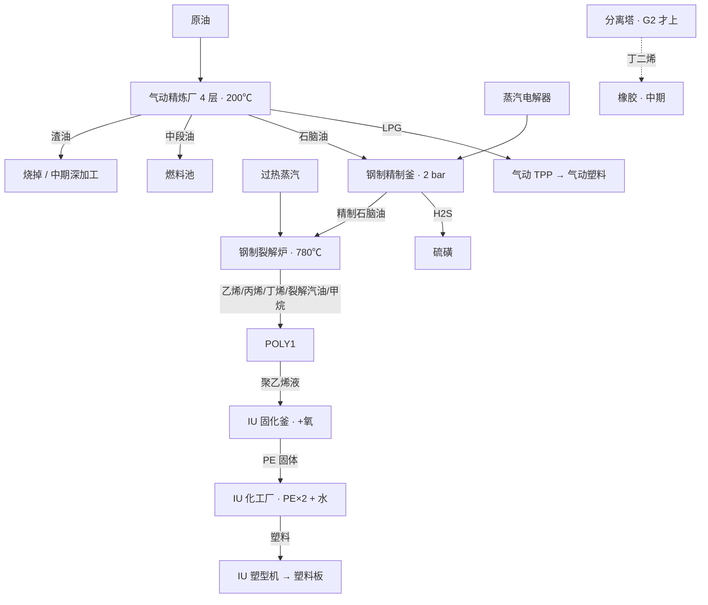

# 石油—石化线 v4 设计方案（气动精炼厂前端 · 分级装置 · 材料与时代对齐）

> 状态：**设计方案，未实装**
> 版本基线：MC 1.21.1 / NeoForge / MMCR 0.1.7 / IU 3.4.0.11 / PneumaticCraft:R 8.2.24 / KubeJS 2101.7.2
> 相关：`OIL_LINE.md`（现行实现）、`BASIC_ELECTRIC_AGE.md`（材料分级）、`EARLY_METALLURGY.md`、`IU_MODDING_METHODS.md`
>
> **实装状态（2026-11-25）**：S1 流体/物品、S2 等级体系已落地
> （`startup_scripts/oil/oil_v4_fluids_items.js`、`startup_scripts/oil/g1_machines.js` 只剩等级体系）。
> G1 的两台装置——石脑油加氢精制与蒸汽裂解——已经并入**通用反应器**
> `sinkjourney:universal_reactor`：加氢精制走 `reactor_gas_solid` 池（气压 2 bar + 硅铝催化剂床），
> 裂解走 `reactor_cracking` 池（气压 2 bar + 炉管等级）。配方在
> `server_scripts/industrial/reactors_v2.js`，机器与内件的说明见 `REACTOR_TYPES_PLAN.md`。
> 分离塔不在 G1：裂解炉直接出五股馏分，分离塔（C4 抽提 + 氢回收）随 PP 一起排到 G2。
> 任务：电力时代章节里「电力机壳」之后新增五格支线到塑料（`0C41A7B3D9E256F1` 精制釜 → `…F2` 裂解炉 → `…F8` 聚合器 → `…F9` 固化釜 → `…FA` 化工厂/塑料），
> 文案在 `config/ftbquests/quests/lang/zh_cn.snbt`。

---

## 0. 修正记录

| 版本 | 错在哪 |
| --- | --- |
| v1 | 时代顺序写成「气动 → 电力 → 末地」 |
| v2 | 顺序对了，但前端用 MMCR 常压塔 + IU 高级炼油厂，一步出乙烯 |
| v3 | 前端交回气动精炼厂了，但**材料分级错**：电力初期用了钛炉管、钛系催化剂、不锈钢塔板 |
| **v4** | 按 `BASIC_ELECTRIC_AGE.md` 的材料分级重排全部等级方块与催化剂，并补上**分级产线（G1/G2/G3 三代装置）** |

**关键事实（摘自 `BASIC_ELECTRIC_AGE.md` 第 24~25 行）**：

| 时代 | 可用金属 |
| --- | --- |
| 蒸汽时代 | 铜、锡、锌、铅、铁、金、银、琥珀金、青铜、黄铜、红铜 + 末期**钢** |
| **基础电力时代（电力初期）** | 以上全部 + **镍**。**没有钛、钨、不锈钢、因科镍、铂族** |
| 电力中期及以后 | 不锈钢、钼钢、因科镍、镍铬、铬、钛、钴铬、铌钛…… |

所以石油线的等级方块必须逐级吃这些材料，**电力初期的最高等级只能到钢/镍**。

---

## 1. 三条硬约束（不变）

1. **时代顺序**：气动 → 末地 → 电力（`gate.end` 通过后研究站解锁电力）。
2. **塑料是电力时代的钥匙，且分两种**：气动塑料（LPG 基低分子聚烯烃）与聚合塑料（PE/PP 系），互不替代。
3. **前端是气动精炼厂**：不耗电、只要热，气动时代就能造；IU 高级炼油厂是后期机器，不进电力初期的塑料链。

---

## 2. 材料谱系（两种塑料 + 一条橡胶）

| 材料 | 单体 | 制造 | 催化剂/引发剂 | 时代 | 用途 |
| --- | --- | --- | --- | --- | --- |
| **气动塑料** | LPG（丙烷/丁烷） | 气动 TPP：LPG + 煤 → 液态塑料 → 塑料板 | 无需 | 气动 | 气动装置、压力管、无人机、密封件（非结构件） |
| **低密度聚乙烯 LDPE** | 乙烯 | IU 聚合器（高压法） | **微量氧 + 过氧化物引发剂** | **电力初期** | 薄膜、电缆绝缘、管道内衬 |
| **塑料（LDPE 基）** | LDPE | IU 化工厂：PE×2 + 水 | — | 电力初期 | 机壳内衬、绝缘件、包装 |
| **聚丙烯 PP** | 丙烯 | IU 聚合器（淤浆法） | **四氯化钛 TiCl₄（化学级，不需要钛锭）** | 电力中期 | 机壳、齿轮、耐热件 |
| **塑料（共混改性）** | LDPE + PP | IU 化工厂：PE + PP + 水 | — | 电力中期 | 结构件、机壳、AE 部件 |
| **高密度聚乙烯 HDPE** | 乙烯 | IU 聚合器（气相法） | 钛系/铬系负载催化剂 | 电力后期 | 压力管、储罐、承力件 |
| **聚丁二烯橡胶** | 丁二烯（裂解 C4） | IU 聚合器 | 锂系/钴系 | 电力中期 | 密封圈、传送带、轮胎 |
| **聚苯乙烯 PS**（可选） | 苯乙烯（苯 + 乙烯） | MMCR 聚合釜 | 过氧化物 | 电力中期 | 高频绝缘、透镜 |
| **环氧树脂**（可选） | 双酚 A + 环氧氯丙烷 | MMCR 缩聚釜 | 碱催化 | 电力后期 | 覆铜板、电路板 |

**两个要点**：
- 电力初期的聚乙烯只能是 **LDPE（高压自由基法）**，用氧/过氧化物引发，不需要任何稀有金属——这是现实里 1930 年代就有、设备只要耐高压的工艺，正好落在"钢 + 镍"的时代。
- 聚丙烯必须等 **TiCl₄**。但 TiCl₄ 是化学品（钛铁矿 + 氯气/盐酸 → 四氯化钛），**不等于钛锭/钛板**，所以它可以出现在电力中期，而结构钛（炉管、塔板）留在后期。

---

## 3. 分级产线（G0–G3）

"分级"分两件事：**装置等级**（同一工序的三代机型）与**材料等级**（结构方块）。玩家升级的路径是：先换材料 → 机器更强 → 再扩规模。

| 等级 | 时代 | 结构材料 | 装置规模 | 单批处理量 | 并行上限 | 代表装置 |
| --- | --- | --- | --- | --- | --- | --- |
| **G0** | 气动 / 末地 | 铜、琥珀金、铁、青铜 | 气动精炼厂 2/3/4 层 + TPP | 1000 mB/次 | 堆塔 | 常压拔顶、燃料升级、气动塑料 |
| **G1** | 电力初期 | **钢**（+ 镍件），最高到钢 | MMCR 3×3×4 / 3×3×6 | 4000~8000 mB | 4 | 精制釜、裂解炉 |
| **G2** | 电力中期 | **钼钢 / 不锈钢 / 因科镍** | MMCR 3×3×9、5×5×6 | 16000 mB | 8 | 常压塔五段、减压塔、FCC、重整 |
| **G3** | 电力后期 | **钛 / 钴铬 / 哈氏合金** | MMCR 5×5×7 ~ 5×5×8 | 32000 mB | 16 | 加氢裂化、焦化、高 severity 裂解 |

**为什么这样分**：
- G1 的装置尺寸小（3×3×4~6）、单批 8000 mB，钢制的压力容器做得到；压力上限 2~3 bar 也符合"钢制设备"的现实限制。
- G2 才开始有 16 bar 级的不锈钢/因科镍容器，所以加氢精制（5 bar）在 G2、加氢裂化（10 bar）在 G3。
- G3 的钛/钴铬才撑得住 850 ℃ 炉管与 20 bar 高压，这也是乙烯收率从 240 爬到 360 的物质基础。

---

## 4. 等级方块（全部按材料分级重排）

| 等级类型 | L0 | L1 | L2 | L3 |
| --- | --- | --- | --- | --- |
| `furnace_tube` 炉管 | **钢**（G1，780 ℃） | **钼钢**（G2，800 ℃） | **因科镍**（G2 后段，820 ℃） | **钛/钴铬**（G3，850 ℃） |
| `tray` 塔板 | **钢**（G1） | **不锈钢**（G2） | **因科镍**（G2 后段） | **钛**（G3） |
| `catalyst_bed` 催化剂床 | **硅铝**（G1，硅胶 + 氧化铝） | **分子筛**（G2） | **贵金属 Pt-Re**（G3） | —（三级封顶） |
| `compressor` 压缩机 | **钢 2 bar**（G1） | **不锈钢 5 bar**（G2） | **因科镍 10 bar**（G2 后段） | **钛 20 bar**（G3） |
| `vacuum_system` 真空系统 | **单级钢**（G2） | **双级不锈钢**（G2） | **蒸汽喷射**（G3） | — |

统一乘数：等级 0/1/2/3 → duration ×1.00/0.85/0.72/0.60，energy 同比例，parallelism +0/+2/+4/+8。

> 这张表就是"金属魔改"的落点：石油线的升级需求会反向拉动不锈钢、因科镍、钛的产能，和你正在做的冶金分级天然咬合。

---

## 5. 电力初期的完整链（九道工序，全部 G1）



| # | 工序 | 机器（等级） | 进料 | 产物 | 时代卡点 |
| ---: | --- | --- | --- | --- | --- |
| 1 | 常压分馏 | 气动精炼厂 4 层（G0） | 原油 1000 + 热 200 ℃ | LPG 30 / 石脑油 180 / 中段油 370 / 渣油 420 | 4 层 + 热源 |
| 2 | 脱盐（酸油） | MMCR 电脱盐罐（G1，钢） | 酸油 1000 + 水 50 | 脱盐原油 950 + 废水 50 | 只有酸油要过 |
| 3 | 石脑油加氢精制 | MMCR 精制釜 3×3×4（G1，钢，2 bar） | 石脑油 + 氢 30 | 精制石脑油 985 + H2S 12 | 氢（蒸汽电解器） |
| 4 | 蒸汽裂解 | MMCR 裂解炉 3×3×5（G1，钢炉管 780 ℃） | 精制石脑油 8000 + 过热蒸汽 4000 | 见 6.3 | 钢炉管、过热蒸汽 |
| 5 | （G2 再上）裂解气分离 | MMCR 分离塔（G2，不锈钢） | 丁烯 + 冷冻剂 | 丁二烯 / 回炼 C4 | IU 制冷机 |
| 6 | 聚合（LDPE） | IU 聚合器 | 乙烯 + 微量氧 + 引发剂 | 聚乙烯液 | 高压法（8~10 bar） |
| 7 | 固化 | IU 固化釜 | 液体 100 + 氧 100 | PE 固体 | — |
| 8 | 造粒 | IU 化工厂 | **PE×2 + 水 1000** | 塑料 | 化工厂（时代钥匙） |
| 9 | 塑型 | IU 塑型机 | 塑料 + 氧 | 塑料板 | — |

> 电力初期**不做 PP**：丙烯这一档只能当燃料或化工原料出口，等中期有了 TiCl₄ 再进聚合。这也让"中期解锁共混塑料"成为一个真实的产线升级点，而不是数值微调。

---

## 6. 数值表

### 6.1 常压分馏（气动精炼厂，4 个输出口）

| 层数 | 温度 | LPG | 石脑油 | 中段油（煤油+柴油） | 渣油 |
| ---: | ---: | ---: | ---: | ---: | ---: |
| 2 层 | 100 ℃ | — | — | 580 | 420 |
| 3 层 | 150 ℃ | — | 180 | 400 | 420 |
| 4 层 | 200 ℃ | 30 | 180 | 370 | 420 |

六种原油按轻重微调（`d` 越大越轻）：石脑油 `+d`、渣油 `−d`，中段油与 LPG 固定。

| 原油 | d | 硫 |
| --- | ---: | --- |
| 原油（甜轻） | +40 | 低 |
| 甜中质 | 0 | 低 |
| 甜重质 | −40 | 低 |
| 酸轻质 | +20 | 高 |
| 酸中质 | −20 | 高 |
| 酸重质 | −60 | 高 |

### 6.2 石脑油加氢精制（G1）

| 输入 | 输出 |
| --- | --- |
| 石脑油 1000 + 氢 30 + 2 bar | 精制石脑油 985 + H2S 12（甜油 6） |

### 6.3 蒸汽裂解（炉管等级 = 裂解深度，每 1000 mB 精制石脑油 + 500 过热蒸汽）

| 炉管（材料/时代） | 温度 | 乙烯 | 丙烯 | C4 | 裂解汽油 | 甲烷+氢 | 结焦周期 |
| --- | ---: | ---: | ---: | ---: | ---: | ---: | ---: |
| 钢（G1） | 780 ℃ | 240 | 140 | 90 | 200 | 330 | 20 批 |
| 钼钢（G2） | 800 ℃ | 280 | 155 | 90 | 190 | 285 | 45 批 |
| 因科镍（G2 后） | 820 ℃ | 320 | 170 | 90 | 180 | 240 | 80 批 |
| 钛/钴铬（G3） | 850 ℃ | 360 | 175 | 85 | 165 | 215 | 160 批 |

- **结焦**：v1 先把结焦做成**副产石油焦**（概率随炉管等级下降：钢 50% → 钼钢 30% → 因科镍 15% → 钛 5%）。石油焦占物品输出，堆满就会卡住裂解，玩家得定期抽走——这就是"清焦"的可玩形态；等有状态统计后再补"强制停机清焦"的硬版本。
- **稀释蒸汽**是必耗，不是可选 buff（现实里它降烃分压、抑制结焦）。

### 6.4 裂解气分离（G2 才上，吃冷冻剂）

G2 的分离塔接的是 C4 馏分与裂解富气，用来抽丁二烯、回收氢（下表为参考量，实装随 G2 一并落地）：

| 输出 | 数量 | 说明 |
| --- | ---: | --- |
| 乙烯（聚合级） | 1900 | C2 提纯 99.5% |
| 丙烯 | 1100 | 电力初期只当燃料/化工原料 |
| 丁二烯 | 450 | 中期做橡胶 |
| 裂解汽油 | 1580 | 进汽油池 |
| 甲烷 | 2340 | 燃料气/火炬 |
| 氢 | 230 | 回精制釜 |
| 损失（焦油/燃料气） | 400 | 深冷损失 |

### 6.5 聚合 / 固化 / 造粒 / 塑型

| 工序 | 配方 | 时代 |
| --- | --- | --- |
| 聚合 LDPE | 乙烯 400 + 氧 4 → 聚乙烯 200（高压法，8~10 bar） | 电力初期 |
| 聚合 PP | 丙烯 400 + TiCl₄ 催化剂×1 → 聚丙烯 200 | 电力中期 |
| 聚合 HDPE | 乙烯 400 + 负载催化剂×1 → 高密度聚乙烯 200 | 电力后期 |
| 固化 | 液体 100 + 氧 100 → 固体 1 | 全期（**改动项**：原 250） |
| 造粒（早期） | PE×2 + 水 1000 → 塑料 1 | 电力初期 |
| 造粒（中期起） | PE×1 + PP×1 + 水 1000 → 塑料 1 | 电力中期 |
| 塑型 | 塑料 1 + 氧 1000 → 塑料板 1 | 全期 |

> 固化 250 → 100 的理由：现实 1 个物品体积约 100~150 mB 聚合物，250 mB 等于凭空蒸发一半。这是唯一要动的 IU 数值，机器与配方结构都不动。

### 6.6 物料衡算（一批裂解 = 8000 mB 精制石脑油，G1 钢炉管）

| 步骤 | 数量 |
| --- | --- |
| 裂解 | 乙烯 1920 / 丙烯 1120 / C4 720 / 裂解汽油 1600 / 甲烷 2400 / 氢 240 |
| 聚合（仅 LDPE，取乙烯 1900） | 聚乙烯液 950 |
| 固化 | PE 固体 9 |
| 造粒（PE×2） | **塑料 4**（余 1 块 PE 做管材/板材） |
| 折算 | 8000 石脑油 ≈ 44 桶甜中质原油 → **整数批次下 ≈11 桶/块**（连续估算 9.3） |

### 6.7 单位成本随分级下降

| 阶段 | 每块塑料消耗原油 | 靠什么降 |
| --- | ---: | --- |
| 电力初期（G1，只有 LDPE） | ≈9.3 桶（整数批次 ≈11） | 钢炉管、无 PP |
| 电力中期（G2，共混塑料） | ≈4.2 桶 | FCC 补丙烯、重整补氢、不锈钢炉管 |
| 电力后期（G3，HDPE + 高 severity） | ≈3.5 桶 | 焦化/加氢裂化把渣油变石脑油、钛炉管、并行 |

**"桶/块"就是这条线的进度条**：每升一级炉管、每加一台 FCC，数字往下掉一截。

---

## 7. 时代门槛

| 时代 | 石油线 | 塑料 | 卡点 |
| --- | --- | --- | --- |
| 气动 | 气举抽油 + 精炼厂 2/3/4 层 + 燃料分级链 | 气动塑料（LPG + 煤），约 0.5~1/分钟 | 4 层 + 200 ℃ 热源 |
| 末地 | 同上规模化；末地材料给 MMCR 控制器与塔材 | 仍气动塑料 | 没有电力装置 |
| 电力初期 | 精炼厂 4 层 → 精制 → 裂解 → LDPE → 固化 → 造粒 → 塑型 | PE 塑料，≈9.3 桶/块（整数 ≈11），约 2/分钟 | 钢制两台装置 + 电解氢 + 化工厂 |
| 电力中期 | 五段常压塔 + 减压塔 + FCC + 重整 + HDS + 克劳斯；PP + 共混塑料 + 橡胶 | ≈4.2 桶/块 | 不锈钢/钼钢、TiCl₄、5 bar 压缩机 |
| 电力后期 | 加氢裂化 + 焦化 + 高 severity 裂解 + 叠合/润滑油/沥青；HDPE | ≈3.5 桶/块 | 钛/钴铬、因科镍、10~20 bar |

---

## 8. 中期与后期装置

### 8.1 电力中期（G2）

> 下面这些装置**不一定都要新机器**：通用反应器与塔器的"池 + 内件"已经能承接大部分工艺。
> 蒸馏塔（cdu / vdu）与沥青氧化这类连续分馏/氧化仍适合独立塔器，但 FCC、HDS、重整、克劳斯、
> 加氢裂化、叠合、润滑油这些"固定床 + 气压"的活，都可以落成通用反应器的新池 + 催化剂等级，
> 不用再造一台只跑一条配方的机器。

| 装置 | id | 结构 | 进料 | 产物 | 等级槽 |
| --- | --- | --- | --- | --- | --- |
| 常压蒸馏塔（五段） | `sinkjourney:cdu` | 3×3×9 | 脱盐原油 16000 + 过热蒸汽 800 | LPG / 石脑油 / 煤油 / 柴油 / 渣油 | 塔板（不锈钢起） |
| 减压蒸馏塔 | `sinkjourney:vdu` | 3×3×7 | 渣油 16000 + 过热蒸汽 1200 + 2 bar | 减压蜡油 + 减压渣油 | 塔板 + 真空系统 |
| 催化裂化 | `sinkjourney:fcc` | 5×5×6 | 减压蜡油 8000 + 分子筛催化剂×4 + 3 bar | 汽油 + 丙烯 70 + 丁烯 130 + 循环油 | 催化剂床（分子筛） |
| 加氢精制（馏分） | `sinkjourney:hds` | 3×3×5 | 馏分 8000 + 氢 + 5 bar | 精制馏分 + H2S | 催化剂床 |
| 催化重整 | `sinkjourney:ccr` | 3×3×6 | 精制石脑油 8000 | 重整汽油 + 氢 + LPG + 苯 | 催化剂床 + 炉管 |
| 硫回收 | `sinkjourney:claus` | 3×3×4 | H2S 4000 + 氧 2000 | 硫磺×4 + 水 | 催化剂床 |

### 8.2 电力后期（G3）

| 装置 | id | 结构 | 进料 | 产物 | 等级槽 |
| --- | --- | --- | --- | --- | --- |
| 加氢裂化 | `sinkjourney:hcu` | 5×5×7 | 减压蜡油 8000 + 氢 2400 + 10 bar | 石脑油 2400 / 航煤 2000 / 柴油 3200 / 燃料气 400 | 催化剂床 + 压缩机 |
| 延迟焦化 | `sinkjourney:coker` | 5×5×8 | 减压渣油 8000 + 1.5 bar | 石油焦×32 + 焦化石脑油 1440 + 焦化柴油 2400 + 焦化蜡油 3600 + 甲烷 560 | 炉管（钛） |
| 丁烯叠合 | `sinkjourney:butene_dimer` | 3×3×5 | 丁烯 8000 + 氢 200 | 高辛烷汽油 6800 | 催化剂床 |
| 润滑油 | `sinkjourney:lube` | 3×3×5 | 减压蜡油 8000 + 氢 400 | 基础油 4800 + 石蜡×24 + 轻油 | 催化剂床 |
| 沥青氧化 | `sinkjourney:bitumen` | 3×3×4 | 减压渣油 8000 + 1 bar | 沥青块×16 + 燃料气 | — |
| 苯乙烯/PS（可选） | `sinkjourney:styrene` | 3×3×5 | 苯 8000 + 乙烯 2400 | 苯乙烯 9600 → 聚苯乙烯 | 催化剂床 |

**不做**：烷基化（IU 无丁烷流体，用丁烯叠合替代）、芳烃抽提（苯已有来源）。

---

## 9. 与现行实现的差异

| 现状 | v4 处理 |
| --- | --- |
| `iu_oil_line.js`：气动精炼塔 4 层出 LPG/石脑油/柴油/重油 | **保留**，口径写清"中段油 = 煤油 + 柴油" |
| `sjcore/oil_line.json`：`imp_oil_refiner` 做石脑油→乙烯 | **撤出早期**；石脑油裂解改由 G1 钢制裂解炉承担，`imp_oil_refiner` 退回后期做重油/渣油深加工 |
| `oil_refiner`：重油→石脑油、石脑油→汽油 | **中期保留**（柴油裂化补丙烯、渣油回炼） |
| 塑料四件套 | **保留**，只改固化 250 → 100，并新增"造粒早期配方（PE×2）" |
| 气动塑料（TPP） | **升格为独立材料**，不并进 IU 塑料 |
| 新增 | 流体：减压蜡油、减压渣油；物品：石油焦、石蜡、四类催化剂、聚合引发剂 |

---

## 10. 实装路线

| 阶段 | 内容 | 生效 |
| --- | --- | --- |
| S1 ✅ | 注册流体（精制石脑油/减压蜡油/减压渣油）+ 物品（石油焦/石蜡/硅铝·分子筛·NiMo·Pt-Re 催化剂/引发剂） | 重启 |
| S2 ✅ | 等级类型与方块（钢/钼钢/因科镍/钛·钴铬的炉管与塔板、压缩机、真空系统） | 重启 |
| S3 ✅ | **G1 两台**：钢制精制釜、钢制裂解炉（结焦=石油焦副产） | `/reload` |
| S4 | IU 侧：`imp_oil_refiner` 裂解退役、固化 250→100、新增 PE×2 造粒配方、LDPE 聚合配方 | `/sjcore iu reload` |
| S5 | G2 七台（五段常压塔、减压塔、FCC、HDS、CCR、克劳斯、裂解气分离塔）+ PP 与共混塑料 | `/reload` |
| S6 | G3 六台（HCU、焦化、叠合、润滑油、沥青、PS） | `/reload` |
| S7 | 任务线：把 "Age of plastic" 挂在化工厂，前置指向裂解炉与分离塔 | 重启 |

---

## 11. 实现坑

1. **流体需求 type 是 `minecraft:fluid`**（不是 `mmcr:fluid`）；输出用 `stack:{id,amount}`，可带 `chance`。
2. **气压需求 type 是 `pneumaticcraft:air`**：`air_per_tick`、`min_pressure`；结构里必须有气压输入接口。
3. **气动精炼厂只有 4 个输出口**：中段油必须合并煤油与柴油。
4. **结焦先做副产石油焦**（概率输出），靠物品输出仓堆满来自然限制连续运行；别用 `beforeStart` 计批次做硬停机，存档里会留下计数状态。
5. **冷冻剂是消耗品**（500 mB/批），断料就停。
6. **两种塑料不许统一**：OEF 替换表里排除塑料板条目，否则材料谱系塌掉。
7. **气体产物给火炬配方**（+氧 → 二氧化碳 + 水，低优先级），否则甲烷罐先满、整塔停摆。
8. **别复用 `iufluidblackoil` 当减压渣油**，另开 `kubejs:vacuum_residue`。
9. **G1 的装置不要写钛/不锈钢**：材料一旦越级，整个分级就废了；所有 L1 以上方块在 JEI 里要写明所需合金。

---

## 12. 验收

```text
1. 气动：精炼厂 4 层 + LPG + 煤 → 气动塑料板（老路线没断）。
2. 电力初期：石脑油 → 钢制精制釜（耗氢、2 bar）→ 钢制裂解炉（过热蒸汽、780 ℃）
   → LDPE 聚合 → 固化 → 化工厂（PE×2）→ 塑料板。
3. 一批 8000 石脑油出 4 块塑料；≈9~11 桶原油/块。
4. 跑满 20 批后裂解炉要求清焦；清焦后恢复。
5. 把钢炉管换钼钢/因科镍（需要中期材料）：同一批乙烯 1920 → 2560 → 3200，清焦周期 20 → 45 → 80 批。
6. 中期做出 TiCl₄ → PP → 共混塑料，桶/块 从 ≈9.3 掉到 ≈4.2。
7. JEI 里气动塑料与聚合塑料用途分开，互不替代。
8. 酸油：精制耗氢翻倍、H2S 更多，能做成硫磺/硫酸。
```

---

## 13. 待定项

1. **固化 250 → 100 放不放行**（不改则桶/块 ≈22~25，塑料立刻变卡点）。
2. **电力初期无 PP** 是否接受？可接受则"中期共混塑料"成为真实升级点；不接受就只能给 PP 提前开一条不现实的捷径。
3. **可选塑料（PS/环氧）**要不要做，做的话多注册 5 个流体。
4. **末地时代**是否加专属内容（末地油田/龙息催化裂解），还是只当装备继承期。
