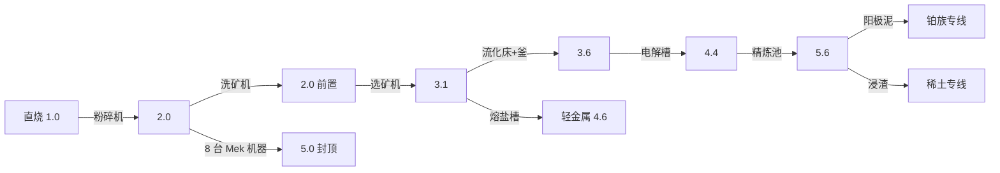

# 通用矿物处理（通用选矿线 v2：正反馈阶梯）

> 基线 MC 1.21.1 / NeoForge / MMCR 0.1.7 / IU 3.4.0.11 / KubeJS 2101.7.2 / Sink Journey Core 0.1.0
> 定位：**电力时代起的全矿种主资源线**。多路线并存，**投入越多复杂度，产率越高**，没有一条路线封顶。
> 取代 `MIDGAME_PLAN.md` §2 那套"每金属一条七段线"的原稿。
> 机器：新增 `sinkjourney:ore_beneficiator`（选矿机，两档）；焙烧 / 浸出 / 电积 / 熔铸全部复用既有机器。
> 相关：`ELECTROLYSIS_LINE.md`（电积与精炼段）、`CHEMICAL_REACTOR.md`（浸出池）、`RARE_EARTH_LINE.md`、
> `PGM_LINE.md`、`ORE_ITEM_MAP.md`（物品口径）、`IU_METAL_PLAN.md`（选材口径）、`MIDGAME_PLAN.md`（时代与电压）、
> `ORE_GENERATION.md`（这些矿从哪来：维度分层与生成参数）
>
> 阶段归属：basic 档在哪一段建、机壳用什么，见 `IU_L1_BASIC_ELECTRIC.md` §7.3（L1 = 钢锭 → 不锈钢）。
>
> 状态：**P1 脚本已写（选矿机 + 87 条配方），待重启验证**。v2 变更：删掉"Mek 5× 封锁"那一章，
> 改成 §4 的七级路线阶梯 —— 玩家可以一直用 Mek，也可以自己修产线，**修得越全，产率越高**。

## 实施现状（2026-11-26）

| 内容 | 状态 | 位置 |
| --- | --- | --- |
| 选矿机两档 + 磨介/选别内件 + 七个配方池 | ✔ 已写，待重启验证 | `startup_scripts/industrial/ore_line.js` |
| 29 种矿 × 磨矿 / 洗选 / 选别（87 条） | ✔ 已写 | `server_scripts/industrial/ore_line.js` |
| 黄药、尾矿浆 | ✔ 已注册 | `startup_scripts/industrial/ore_line_items.js` |
| 尾矿浆回收（砂 + 石粉，选矿机自己做） | ✔ 已写 | 选矿机的 wash 池 |
| 尾矿浆中和（釜里兜底） | ✔ 已写 | 釜的 leach 池 |
| R4 浸出段（粉 + 硫酸 → 硫酸盐液，接电解槽） | ✔ 已写 | 釜的 leach 池 |
| 任务树：矿物处理 12 格（R1→R6 + 铝支线） | ✔ 已写 | `config/ftbquests/quests/chapters/4f0a000000000000.snbt` |
| R4 焙烧段（硫化精矿 → SO₂ → 硫酸） | ⬜ 未做：需要硫化精矿物品，现在硫走不上来 | — |
| 尾矿里的伴生金属（R2 的 +0.3） | ⬜ 未做：一份尾矿浆分不出 29 种金属，要按族拆成五股浆 | — |
| 任务树与研究节点 | ⬜ 未做 | — |

> 落地时把"精矿"并进了金属粉：**选别直接出粉**（2 净碎 → 3 粉），这样不新增 29 个精矿物品，
> JEI 里也不会出现"第二种铜粉"。§4 的 R3 数字按此实现。改完 startup 脚本要**完全重启**。

---

## 0. 一句话

矿石有七种处理方式，从"直接烧"（1.0 锭/矿）到"全闭环精炼"（5.6 锭/矿）；**每一级都多吃一台机器、
一种耗材和一段电压**，但也多出一截产率，**而且没有一级是封顶的**。Mek 的 5× 是这条阶梯上的一个支线，
它到 5.0 就停了，主线还能往上走。

---

## 1. 现状审计（都是代码/反编译事实）

| 结论 | 依据 |
| --- | --- |
| IU 粉碎机只有两段标签驱动：`c:raw_materials/*` ×2 → `c:crushed/*`、`c:ingots/*` → `c:dusts/*` | `MaceratorRecipe` 静态字段 `recipe={c:raw_materials/,c:ingots/}`、`recipe1={c:crushed/,c:dusts/}`、`number={2,1}` |
| 矿石方块进不了粉碎机（只有磷酸盐三条专条） | `MaceratorRecipe` 里 `c:ores/` 只出现 calciumphosphate / sodiumphosphate / potassiumphosphate |
| IU 洗矿机只硬编码 **9 种金属**：铜、金、铁、铅、锡、锇、钽、镉、铀 | `OreWashingRecipe` 的 tag 常量表只有 `c:crushed/{Cu,Au,Fe,Pb,Sn,Os,Ta,Cd,U}` → `c:purifiedcrushed/*` |
| IU 离心机同样只有这 9 种 + 氟磷灰石/霞石 | `CentrifugeRecipe` 的字符串表 |
| IU 自带 40 种 `crushed/*`、42 种 `purifiedcrushed/*`、39 种 `raw_metals/*` | jar 内 `assets/industrialupgrade/models/item/{crushed,purifiedcrushed,raw_metals}/` 计数 |
| Mek 的 2×–5× 全套（富集/净化/注入/溶解/清洗/结晶）**在位**，`era.electric` 才解锁 | `config/astages/simple/astages/item.json` 的 `electric_entry_m0..m4`；脚本里没有任何 Mek 矿物处理删改 |
| 湿法段已经现成：釜的「浸出与腐蚀」页签 + 铂族 16 条 + 稀土 26 条 | `CHEMICAL_REACTOR.md` §3、`PGM_LINE.md`、`RARE_EARTH_LINE.md` |

**缺口是"没有中段"**：40 种矿里有 31 种在粉碎之后没有第二步；同时没有任何机制让玩家"多修一段换更多产率"——
现在只有两条断开的路线：Mek 的 5× 一步到位，或者 IU 那 9 种金属的洗矿。本文要造的是中间那段斜坡。

---

## 2. 四条原则

1. **多路线并存。** 直烧、Mek、IU 旧三段、通用选矿、湿法电积、电解精炼**同时存在**，谁也不封。
   玩家随时能在任意一级停下，代价是产率停在那一级。
2. **复杂度换产率，且边际收益递增。** 每一级都比上一级多吃机器/耗材/电压，但**最后两级给得最多**
   （伴生回收与精炼，+0.7 与 +1.2 锭/矿）。这是正反馈的核心：越往后投入，每台机器的回报越高。
3. **按工艺族发配方，不按金属发。** 现实里的选冶只分几种矿相（硫化、氧化、难熔、轻金属、稀散），
   同族矿走同一套工序。40 种金属写 40 套配方 = 维护地狱，这也是 `MIDGAME_PLAN.md` §2 原稿被取消的原因。
4. **通用线只交载体，不抢专线。** 贵金属、稀土、放射性各有自己的化学（王水、萃取、溶剂萃取），
   通用线负责把**阳极泥**交给铂族、把**浸渣**交给稀土 —— 这两股载体本身就是第 6/7 级的产率来源。

**不做清单**：尾矿坝与废液处理、摇床动画、按金属定制的机器、矿物词典之外的单物品特例。

---

## 3. 工艺族（29 种进线 / 11 种走专线）

| 族 | IU 材料 | 数量 | 选别方式 | 冶金段 | 主产物形态 | 伴生（每锭） |
| --- | --- | ---: | --- | --- | --- | --- |
| **A 硫化矿** | copper, nickel, cobalt, zinc, lead, molybdenum, cadmium, bismuth, arsenic, thallium | 10 | 浮选（黄药 + 起泡剂，2 bar 气） | 焙烧（SO₂）→ 酸浸 → 电积 | 阴极金属 → 锭 | 贵金属进阳极泥 0.1、硫 → 硫酸 |
| **B 氧化矿** | iron, manganese, chromium, vanadium, titanium, tin | 6 | 磁选 / 重选 | 还原焙烧 → 电炉（火法） | 海绵/铁水 → 锭 | 钒渣 → V₂O₅ 0.05、铬 0.1 |
| **C 难熔矿** | tungsten, tantalum, niobium, zirconium, hafnium | 5 | 重选 + 磁选 | 碱熔 → 浸出 → 氢还原 | 金属粉 → 垂熔 | 铪（锆线）0.02 |
| **D 轻金属** | aluminium, magnesium, barium, strontium | 4 | 洗选（碱法） | Bayer → 熔盐电解 | 铝水 / 金属粉 | 镓 0.01（拜耳母液） |
| **E 稀散** | gallium, germanium | 2 | 浸出（酸/碱） | 萃取 → 区熔 | 高纯金属 | — |
| 贵金属（专线） | gold, silver, platinum, palladium, iridium, osmium | 6 | — | 氰化/王水/电解精炼 | — | `PGM_LINE.md` |
| 稀土（专线） | neodymium, gadolinium, yttrium | 3 | — | 碱分解 → 萃取 → 钙热 | — | `RARE_EARTH_LINE.md` |
| 放射性（专线） | uranium, polonium | 2 | — | 溶剂萃取 | — | NuclearCraft |
| 虚构（同族映射） | mikhail / spinel → B 族（磨料只出粉不出锭） | 2 | — | — | — | — |

> 钠/钾/钙/锂 IU 只有粉没有碎矿，走 `ELECTROLYSIS_LINE.md` 的熔盐支线，不进这条线。
> 族只决定**选别方式与冶金段**，不决定路线长度 —— 任何族都能从 R0 一路修到 R6。

---

## 4. 七级路线阶梯（正反馈的核心）

产率口径：**主金属锭/矿** 与 **伴生+载体折算金属当量/矿** 分开列，合计才是玩家实际到手的金属。

| 级 | 路线 | 载体（机器） | 主金属 | 伴生/载体 | **合计** | 新增机器 | 新增耗材 | **边际产率** | FE/矿 |
| ---: | --- | --- | ---: | ---: | ---: | ---: | --- | ---: | ---: |
| **R0** | 直接烧 | 原版熔炉 | 1.0 | 0 | **1.0** | 0 | 燃料 | — | 0 |
| **R1** | 粉碎 + 冶炼 | IU 粉碎机 + 电炉 | 2.0 | 0 | **2.0** | 1 | 电 | +1.0 | 600 |
| **R2** | + 洗选 | IU 洗矿机 / 离心机 | 2.0 | 0 | **2.0** | 1 | 水 | 0（是 R3 的前置） | 1,200 |
| **R3** | 通用选矿（磨/洗/选别） | **选矿机** + 电炉 | 3.0 | 0.1 | **3.1** | 1 | 水、药剂、气 | +1.1 | 2,480 |
| **R4** | + 焙烧 + 浸出 | 流化床 + 化学反应釜 | 3.2 | 0.4 | **3.6** | 2 | 氧/燃料、硫酸 | +0.5 | 4,080 |
| **R5** | + 电积 | 电解槽 · 电积池 | 3.6 | 0.8 | **4.4** | 1 | 直流电、阳极 | +0.8 | 10,440 |
| **R6** | + 电解精炼 | 电解槽 · 精炼池 | 4.2 | 1.4 | **5.6** | 0（同机） | 粗金属阳极 | **+1.2** | 12,040 |
| 支线 | **Mek 2×–5×** | 富集/净化/注入/溶解/清洗/结晶 | 5.0 | 0 | **5.0** | 8 | 盐酸、氟石、氧 | 封顶 | ≈14,000 |
| 支线 | **熔盐电解** | 熔盐电解槽 | 4.2 | 0.4 | **4.6** | 1 | 冰晶石/氯化物、大电流 | 仅轻金属 | 25,200 起 |

三条读法：

1. **R1 是最便宜的一次跃迁**（一台粉碎机换 +1.0），所以新手永远先升 R1 —— 这是正反馈的入口。
2. **R6 的边际收益最大（+1.2）**，因为它同时回收阳极泥（贵金属）与把主金属提纯成 4N。
   玩家在前五级投入的每一台机器，都在为这 1.2 铺路。这就是"复杂才高"的机制保证，不是数值偏心。
3. **Mek 是"平顶支线"**：8 台机器做到 5.0，之后无论再投多少都不涨；通用线到 5.6 且还能靠
   `ELECTROLYSIS_LINE.md` 的内件继续榨能耗。两者并存，玩家自己选"省事"还是"高产"。



### 4.1 每一级的真实代价（不是白给）

| 级 | 代价 | 玩家感受到的压力 |
| --- | --- | --- |
| R1 | 400 FE/矿，粉碎机要电 | 第一次接电网 |
| R2 | 洗水 500 mB/矿，尾矿浆要有去处 | 开始处理副产 |
| R3 | 选矿机两档 + 选别槽换方块，药剂（黄药）+ 充气 | 一台机器只能跑一族，要摆第二台 |
| R4 | 硫酸 1,000–3,000 mB/矿，SO₂ 必须接硫酸线 | 化工段成为前置 |
| R5 | 电积 3,960–12,600 FE/矿，阳极要备件 | 发电与母线成为瓶颈 |
| R6 | 粗金属阳极要回炉，阳极泥要送铂族线 | 两条专线变成必需 |
| Mek | 8 台机器 + 盐酸/氟石，无副产 | 省事，但 5.0 到底 |
| 熔盐 | 25,200 FE/锭 + 冰晶石/氯化物闭环 | 只有铝镁值得走 |

> 关键设计约束：**任何一级的"新增产出"必须大于它新增的运营成本**，否则玩家不会升级。
> 上表里 R5 是唯一需要盯的：电积的电费是前面所有段之和的两倍，所以 R5 的 +0.7 里必须
> 有 0.5 来自伴生（硫/贵金属/酸再生），不能只靠主金属。

### 4.2 两条线怎么互相推


这就是正反馈闭环：**通用线喂电与金属，电解线回馈纯度与功能件，功能件再让通用线跑得更快**。
闭环里任何一环断掉（没电、没酸、没铂族下游），产率就掉回上一级 —— 玩家能直接感受到。

---

## 5. 选矿机（唯一新增机器）

```
sinkjourney:ore_beneficiator_basic      3×3×4   基础仓   并行 2   4,000 FE/t
sinkjourney:ore_beneficiator_improved   3×3×5   改良仓   并行 4   8,000 FE/t
```

### 5.1 结构（控制器朝南）

```
y0  XCX      C = 控制器（北墙中层）
    XXX
    XXX
y1  XFX      F = 本档流体输入仓（洗水，北墙）
    IXJ      I = 本档物品输入总线（西墙）
    XAX      A = 气压接口（南墙，浮选充气）
y2  XGX      G = 本档流体输出仓（尾矿浆，北墙）
    OXK      O = 本档物品输出总线（西墙）
    XMX      M = 磨机槽（南墙，磨介等级）
y3  XEX      E = 本档能量输入仓
    XRX      R = 选别槽（南墙，选别方式）
```

| 槽 | 等级 | 方块 | 时长 × | 能耗 × | 并行 + | 产率 +（相对 R2） |
| --- | --- | --- | ---: | ---: | ---: | ---: |
| 磨介 `mill` | 钢球 `steel` | `industrialupgrade:blockresource/steel_block` | 1.00 | 1.00 | 0 | 基准 |
| | 陶瓷球 `ceramic` | `industrialupgrade:blockresource/tempered_glass` | 1.10 | 0.85 | 0 | 省电、慢 |
| | 砾磨 `pebble` | `minecraft:cobblestone` | 0.90 | 1.15 | 1 | 快、费电 |
| 选别 `separation` | 磁选 `magnetic` | `industrialupgrade:baseblockingot2/neodymium` | 1.00 | 1.00 | 0 | 省电、基准 |
| | 浮选 `flotation` | `industrialupgrade:baseblockalloy/stainless_steel` | 1.00 | 1.10 | 0 | 平原速度、费 10% 电 |
| | 重选 `gravity` | `industrialupgrade:blockresource/bronze_block` | 1.20 | 0.80 | 0 | 慢、省电 |

**族的门槛写在药剂上，不写在等级槽上。** MMCR 的等级门槛是"已装 priority ≥ 配方要求 priority"
（`RecipeSearchTask` 里 `MachineLevel.priority()` 的比较），三个互斥的选别方式会互相满足 ——
把 A 族挂在浮选上，装块重选也能跑。所以：

- **A 族**要黄药 ×1 + 2 bar 充气；**C/D/E** 要洗水 500；**B 族**不要介质，只是慢一点；
- 选别槽退化成**修正器**（速度/能耗），玩家装磁选省电、装重选省电但慢、装浮选快一点。
- 真正让玩家"为第二族再摆一台"的是**充气接口与药剂输入**，不是方块。

> 电解槽同理：四个内件槽都不写进配方要求。反编译看，`RecipeSearchTask` 的 modifier 来自
> `ControllerRuntimeSnapshot.foundModifiers()`（机器上装着的内件），不是配方里的等级要求，
> 所以"装满内件"应当直接降低能耗（`ELECTROLYSIS_LINE.md` §3.3 的整备度表）。
> 这一条还没在游戏里实测过，是重启后第一个要看的数。

### 5.2 配方池（JEI 页签）

| 池 | 页签 | 内容 | 条数（估） |
| --- | --- | --- | ---: |
| `sinkjourney:ore_beneficiator_crush` | 选矿机 · 磨矿 | 原矿 ×1 / 矿石方块 ×1 → 碎矿 ×2 | 58（29 种 × 两入口） |
| `sinkjourney:ore_beneficiator_wash` | 选矿机 · 洗选 | 碎矿 ×2 + 水 500 → 净碎 ×2 + 尾矿浆 250 | 29 |
| `sinkjourney:ore_beneficiator_A/B/C/D/E` | 选矿机 · 浮选 / 磁重选 / 精选 | 净碎 ×2 → 金属粉 ×3 + 尾矿浆 | 29 |

配方**不手写**：脚本里放一张 `ORE_TABLE`，循环生成。表的结构（示例三行）：

```js
// 金属, 族（族决定进哪个池、要不要药剂/充气/水）
['copper',    'A']
['iron',      'B']
['aluminium', 'D']
```

### 5.3 单条配方示例（写法与釜的 16 条铂族配方一致）

```js
recipe('kubejs:ore_line/flotation/copper', 160, [
    itemIn('industrialupgrade:purifiedcrushed/copper', 2),
    fluidIn('minecraft:water', 500),
    fluidIn(XANTHATE, 100),
    air(10, 2.0),
    level('separation', 'flotation'),
    level('mill', 'steel'),
    itemOut('industrialupgrade:itemdust/copper_dust', 3),
    fluidOut(TAILINGS, 250),
    fe(8)
])
```

---

## 6. 数值

### 6.1 单段

| 工序 | tick | FE/t | FE/矿 | 说明 |
| --- | ---: | ---: | ---: | --- |
| 磨矿 | 100 | 4 | 400 | 电力时代的基准粒度 |
| 洗选 | 120 | 5 | 600 | 洗水 500 mB/批 |
| 选别（浮选） | 160 | 8 | 1,280 | 药剂 100 mB + 2 bar |
| 选别（磁/重选） | 140 | 6 | 840 | 不用药剂 |
| 焙烧 | 200 | 8 | 1,600 | 流化床，出 SO₂ |
| 浸出 | 240 | 10 | 2,400 | 釜·浸出池 |
| 电积 | 300 | 按金属（`ELECTROLYSIS_LINE.md` §6） | 3,960（铜） | 电解槽 |
| 精炼 | 200 | 8 | 1,600 | 电解槽·精炼池 |

### 6.2 每级的产率/能耗比（为什么值得升级）

| 级 | 合计产率 | FE/矿 | FE / 锭 | 相对 R0 的产率倍数 |
| ---: | ---: | ---: | ---: | ---: |
| R0 | 1.0 | 0 | 0 | 1.0× |
| R1 | 2.0 | 600 | 300 | 2.0× |
| R2 | 2.0 | 1,200 | 600 | 2.0×（前置） |
| R3 | 3.1 | 2,480 | 800 | 3.1× |
| R4 | 3.6 | 4,080 | 1,133 | 3.6× |
| R5 | 4.4 | 10,440 | 2,370 | 4.4× |
| R6 | 5.6 | 12,040 | 2,150 | **5.6×** |
| Mek | 5.0 | ≈14,000 | 2,800 | 5.0× |

**R5 → R6 是唯一"每锭成本反而下降"的一步**（2,370 → 2,150 FE/锭），因为精炼加的是阳极泥而不是新矿。
这是全表最重要的一格：它告诉玩家"最后一段不只产率高，还更便宜"，是正反馈的甜点。

### 6.3 副产去向（不许有产物没下游）

| 副产 | 去向 |
| --- | --- |
| 尾矿浆 / 脉石 | 离心 → 砂 + 石粉（建材、玻璃线） |
| SO₂ | `OIL_LINE_V2.md` 的硫酸段（四段转化器 → 硫酸） |
| 浸渣 | `RARE_EARTH_LINE.md` 的稀土精矿入口 / `PGM_LINE.md` 的铂族载体 |
| 阳极泥 | `PGM_LINE.md`（王水 → 铂钯，氯压 → 铱锇）；铜阳极泥另出硒 → 整流器 |
| 酸再生 | 电积阳极产酸，回浸出段，闭路 |

---

## 7. 与既有系统的接口

| 系统 | 接口 |
| --- | --- |
| 化学反应釜 | 浸出段用现成的「浸出与腐蚀」池，新增「通用浸出」子页签放同一池 |
| 通用反应器·流化床 | 焙烧段（氧化焙烧、硫酸化焙烧） |
| 电解槽 / 熔盐电解槽 | `ELECTROLYSIS_LINE.md`，R5/R6 与轻金属支线 |
| IU 电炉 | 熔铸海绵/阴极金属 → 锭，走 `kubejs/sjcore/ore_line.json` |
| 石油线 | 吃 SO₂ 产硫酸；硫酸回本线浸出 |
| 硅线 | 电解副产氯 → HCl → 三氯氢硅 |
| 稀土 / 铂族 | 只接载体（浸渣、阳极泥） |
| 研究 / AStages | 每一级一个 stage：`era.ore.r1` … `era.ore.r6`，按级解锁 |

---

## 8. 时代落点（每一级都在自己的时代开门）

| 时代 | 可用到哪一级 | 说明 |
| --- | --- | --- |
| 原始 → 余烬 | R0 | 研钵 + 柴堆 + 土高炉（`EARLY_METALLURGY.md`） |
| 机动（Create） | R1 | 粉碎轮出碎矿 |
| 蒸汽 | R1–R2 | IU 蒸汽粉碎机 + 9 金属洗矿/离心 |
| 电力（`era.electric`） | R3 | **选矿机开放**，A/B 两族先开 |
| 科技先锋 第一部分 | R4 | 流化床 + 釜的浸出段，C/D/E 族 |
| 科技先锋 后段 | R5 | 电解槽（电积），伴生全开 |
| 中期后段 | R6 | 精炼池 + 熔盐支线 |
| 后期 | R6 + 强化 | 晶闸管、惰性阳极、电流密度强化 |

**每一级都恰好落在一个已有的时代门槛上**，不需要新造进度轴；AStages 只要按级加门。

---

## 9. 路线取舍（没有封锁，只有代价）

之前的版本打算封 Mek 5×，v2 改掉了：**封路等于删选择**。这里改成把三条支线摆在同一张表里，
让玩家自己算。

| 路线 | 产率 | 机器数 | 耗材 | 电能 | 副产品 | 上限 |
| --- | ---: | ---: | --- | --- | --- | --- |
| R0–R2（IU 旧三段） | 2.5 | 3 | 水 | 低 | 尾矿 | 9 种金属 |
| R3–R6（通用线） | 5.6 | 6 | 水/药剂/硫酸/阳极 | 高 | 伴生 + 载体 + 4N | **继续可优化** |
| Mek 5× | 5.0 | 8 | 盐酸/氟石/氧 | 中 | 无 | 硬封顶 |
| 熔盐电解 | 4.6（轻金属） | 1 | 冰晶石/氯化物 | 极高 | 镓/氯 | 只对轻金属 |

- **Mek 不封**：它 5.0 封顶、要 8 台机器、要氟石与盐酸，而且没有副产。玩家想省事就用它，
  想高产就修通用线 —— 两条路都通，差别在"上限"和"副产品"。
- **直烧不删**：1.0 是应急与便携通道（背包熔炉、野外），删了会伤体验。
- **IU 旧三段不删**：它是 R2，是蒸汽时代的过渡；只是它的 9 种金属决定了它到不了 2.8。
- **4N 是形态门槛不是封锁**：母线、真空件、超导只吃 `电解铜/电解镍` 这类 4N 物品 ——
  这条不是"禁止用粗铜"，是"粗铜做不了那个零件"，属于形态而非路线。

> 一条纪律：**任何新路线都必须报出"产率 / 机器数 / 耗材 / 上限"四件事**，否则它就是在送资源。
> 上表就是这条纪律的模板。

---

## 10. 实施分层

| 阶段 | 内容 | 文件 | 验收 |
| --- | --- | --- | --- |
| P0 ✔ | `ORE_TABLE` 与族表；58 条磨矿 + 29 条洗选 + 29 条选别 | `kubejs/server_scripts/industrial/ore_line.js` | JEI 七页签齐全，29 种矿都能碎、能洗、能选别 |
| P1 ✔ | 选矿机两档 + 结构 + 磨介/选别槽 | `startup_scripts/industrial/ore_line.js`、`server_scripts/industrial/ore_line.js` | 摆得起来、换选别方块后配方可用 |
| P1 | R3 段跑通（A/B 两族）+ `era.ore.r3` 门 | 同上 | 铜线：原矿 → 碎 → 净碎 → 精矿 → 锭，合计 3.1 |
| P2 | R4 段（焙烧 + 浸出）+ R5 段接入电解槽 | 釜 leach 池追加、`sjcore/ore_line.json` | 铜线合计 4.4；SO₂ 进硫酸、浸渣进稀土 |
| P2 | R6 精炼段 + 阳极泥进铂族 | 同上 + `pgm_line.js` 接口 | 铜线合计 5.6，产率超过 Mek 5.0 |
| P2 | **阶梯数值表**：把 §6.2 的产率/能耗写进 `sjcore` 数值，并用 `/kubejs iu` 对账 | `kubejs/sjcore/ore_line.json` | 每一级的实测产率与表一致（±5%） |
| P3 | 任务树（科技先锋 14 格，一级一格）+ 研究节点 | `config/ftbquests/…`、`tools/gen_ore_quests.py` | 任务里明写"这一级多 0.6 锭，代价是 X" |

**坑**：

- MMCR 机器与 level 只能在 `startup_scripts` 注册，改完**完全重启**；结构脚本每台机器各自 try/catch
  （`PORT_TIERS.md` §0 的 `Dynamic structure already registered`）。
- 结构里的端口位写死本档仓 id，放别的档组不起来（`CHEMICAL_REACTOR.md` §1）。
- `mmcr:machine_recipe` 的 `requirements` 里 `mmcr:level` 必须带 `level_type`，写错不报错、只是不出配方。
- 29 种矿里 `aluminium` 与 `aluminum` 两套拼写，`c:crushed/aluminium` 是 IU 那套（`ORE_ITEM_MAP.md` §0）；
  锭/粉/块/原矿的 tag 已互相挂接，canonical 是 IU，配方只用 `industrialupgrade:itemingots/aluminium_ingot` 这一套。
- 配方 id 一矿一 id（`kubejs:ore_line/crush/copper`），方便以后单条改数值。

---

## 11. 待确认

1. **阶梯顶到多少**：现在是 5.6（超 Mek 5.0 一档）。若要"复杂明显更强"，可以抬到 6.0–6.2，
   但会把 Mek 彻底变成过渡品，等于软封。
2. **Mek 5× 要不要继续降**：不降则 R3–R5 在中期是"可选但不划算"，玩家会直接跳 Mek 再回头修 R6。
   可选做法：Mek 只到 3×，5× 段需要氟石与盐酸精炼（成本抬上去），保留选择但不让它白拿。
3. **选矿机要不要蒸汽档**：现在蒸汽段沿用 IU 那 9 种旧机器（R2）。
4. **虚构金属（mikhail / spinel）**：挂 B 族出粉就够，还是给一句专门设定文案？
