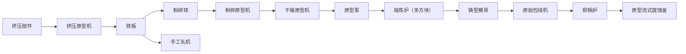
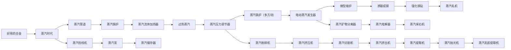

# 任务结构：三章主线与产线

> 版本：本包 1.21.1 / NeoForge / FTB Quests 2101.1.38
> 覆盖章节：原始时代 / 工业之始 / 电力时代
> 排布生成器：`kubejs/tools/gen_linear_quest_tree.py`
> 本文档生成器：`kubejs/tools/gen_quest_doc.py`（表格与流程图直接从章节文件读）
> 文案：`config/ftbquests/quests/lang/zh_cn.snbt`

---

## 1. 结构怎么读

**一格一道工序。** 主线上每一格是一台机器、一道工序，或者一座多方块结构；多方块的砖、部件、控制器、燃料箱并进同一格，不再拆成建造清单。主线横铺在 `y = 0`，一格 2.0，第 N 格只依赖第 N-1 格，走完全部等于把这一时代走了一遍。

**支线是产线，不是图鉴。** 主线之外还需要的加工机台各自成一条支线，落在 `y = ±4 / ±8`，根节点竖直挂在主线上，同一条支线内部也是单链：从第一台接手的机器一路排到最后一台。支线可以整条不做，主线不会因此卡住。

**入口交代去处。** 每条支线的第一格，正文末尾有一句话说明这条线往后接哪几台、为什么不卡主线；主线那一格则说明它是必经的哪一步。读任务书的时候先看主线，再按需进支线。

**形状只标记里程碑。** `hexagon` 留给时代入口、网络核心、收尾工程这类节点，其余用章节默认圆点。

---

## 2. 三章总览

| 章节 | 任务 | 主线 | 支线 | 出口 |
| --- | ---: | ---: | ---: | --- |
| 原始时代 | 13 | 12 | 1 | 原型流式腐蚀釜 |
| 工业之始 | 26 | 13 | 13 | 蒸汽轧机 |
| 电力时代 | 35 | 12 | 23 | 能量接收器 |

三章合计 74 个任务，主线 37 格，支线 37 格。

---

## 3. 原始时代 / 工业之始 / 电力时代

### 原始时代（主线 12 + 支线 1）

`3f5a7c2b9e1d4a60.snbt`，分组「工业起步」，`order_index: 1`，共 13 个任务。

**主线**，`y = 0`，一格 2.0，第 N 格只依赖第 N-1 格：

| # | 任务 | id | 依赖 | 形状 |
| ---: | --- | --- | --- | --- |
| 1 | 挤压部件 | `7421786593C68B0E` | `5F132AD862CA787E` |  |
| 2 | 挤压原型机 | `079D6EAF9A441826` | `7421786593C68B0E` |  |
| 3 | 铁板 | `055588A7FFB2D789` | `079D6EAF9A441826` |  |
| 4 | 粉碎球 | `7830616AA30B63CD` | `055588A7FFB2D789` |  |
| 5 | 粉碎原型机 | `49C6261827C7A7B3` | `7830616AA30B63CD` |  |
| 6 | 干燥原型机 | `21DC1429D7B64A75` | `49C6261827C7A7B3` |  |
| 7 | 原型泵 | `0A449D27D8734333` | `21DC1429D7B64A75` |  |
| 8 | 熔炼炉（多方块） | `13B0197D7A36A72F` | `0A449D27D8734333` | 六边形 |
| 9 | 铸型模具 | `4180DCBFB8DD7D48` | `13B0197D7A36A72F` |  |
| 10 | 原始包线机 | `15E3CFD26FA821E0` | `4180DCBFB8DD7D48` |  |
| 11 | 铜锅炉 | `2C447CF0BBF40408` | `15E3CFD26FA821E0` |  |
| 12 | 原型流式腐蚀釜 | `04775118903D8E3F` | `2C447CF0BBF40408` | 六边形 |

第一格的跨章依赖是上一章的出口 `5F132AD862CA787E`（机械动力章收尾）。

**支线 1**，`y = -4`，竖直挂在「铁板」上，1 格单链：

| 顺序 | 任务 | id | 依赖 |
| ---: | --- | --- | --- |
| 1 | 手工轧机 | `73F4FB7D17278454` | `055588A7FFB2D789` |

### 工业之始（主线 13 + 支线 13）

`5fe0048b1a2b6a65.snbt`，分组「工业起步」，`order_index: 3`，共 26 个任务。

**主线**，`y = 0`，一格 2.0，第 N 格只依赖第 N-1 格：

| # | 任务 | id | 依赖 | 形状 |
| ---: | --- | --- | --- | --- |
| 1 | 好用的合金 | `6BDDB3A36AADF646` | `04775118903D8E3F` |  |
| 2 | 蒸汽时代 | `0706F92EF2C236B8` | `6BDDB3A36AADF646` |  |
| 3 | 蒸汽管道 | `2C027D8994527225` | `0706F92EF2C236B8` |  |
| 4 | 蒸汽锅炉 | `4C2722480E36EC49` | `2C027D8994527225` |  |
| 5 | 蒸汽流体加热器 | `0FEC076007556020` | `4C2722480E36EC49` |  |
| 6 | 过热蒸汽 | `50FFF3DA2CF84C7F` | `0FEC076007556020` |  |
| 7 | 蒸汽压力调节器 | `79789218839D6E7D` | `50FFF3DA2CF84C7F` | 六边形 |
| 8 | 蒸汽锅炉（多方块） | `43D5726B73FFD4E3` | `79789218839D6E7D` | 六边形 |
| 9 | 电动蒸汽发生器 | `15F9B4F39AC30284` | `43D5726B73FFD4E3` |  |
| 10 | 微型熔炉 | `35673E8862ECC966` | `15F9B4F39AC30284` |  |
| 11 | 渗碳成钢 | `6FC90AA2AAA16C3F` | `35673E8862ECC966` |  |
| 12 | 强化铁砧 | `39224A23A36F5D89` | `6FC90AA2AAA16C3F` |  |
| 13 | 蒸汽轧机 | `35B9A0B50B6D5A7C` | `39224A23A36F5D89` | 六边形 |

第一格的跨章依赖是上一章的出口 `04775118903D8E3F`（原始章「原型流式腐蚀釜」）。

**支线 1**，`y = -4`，竖直挂在「蒸汽压力调节器」上，7 格单链：

| 顺序 | 任务 | id | 依赖 |
| ---: | --- | --- | --- |
| 1 | 蒸汽粉碎机 | `553DE08FF8207EFC` | `79789218839D6E7D` |
| 2 | 蒸汽挤压机 | `160B66057D2A2BC2` | `553DE08FF8207EFC` |
| 3 | 蒸汽切割机 | `3FFD6CD6131BB41E` | `160B66057D2A2BC2` |
| 4 | 蒸汽挤出机 | `39E580844A461AC5` | `3FFD6CD6131BB41E` |
| 5 | 蒸汽提取机 | `0C5D79478D494E93` | `39E580844A461AC5` |
| 6 | 蒸汽抛光机 | `268F9CB2F5488846` | `0C5D79478D494E93` |
| 7 | 蒸汽乳胶提取机 | `19F5071BFF298275` | `268F9CB2F5488846` |

**支线 2**，`y = -8`，竖直挂在「蒸汽时代」上，3 格单链：

| 顺序 | 任务 | id | 依赖 |
| ---: | --- | --- | --- |
| 1 | 蒸汽包线机 | `22372738BD8CBD0F` | `0706F92EF2C236B8` |
| 2 | 蒸汽泵 | `34DB73A960C0D660` | `22372738BD8CBD0F` |
| 3 | 蒸汽储存器 | `3144BDD432A185BD` | `34DB73A960C0D660` |

**支线 3**，`y = -8`，竖直挂在「电动蒸汽发生器」上，3 格单链：

| 顺序 | 任务 | id | 依赖 |
| ---: | --- | --- | --- |
| 1 | 蒸汽矿物分离器 | `285AC19CE5FBC3ED` | `15F9B4F39AC30284` |
| 2 | 蒸汽电解器 | `57E4815EC1E82AC0` | `285AC19CE5FBC3ED` |
| 3 | 蒸汽采石机 | `3EEBC200020CEC1A` | `57E4815EC1E82AC0` |

### 电力时代（主线 12 + 支线 23）

`e1c0000000000000.snbt`，分组「科技革命」，`order_index: 1`，共 35 个任务。

```mermaid
graph LR
    M1["研究笔记·电力"]
    M2["发电机"]
    M3["电力机壳"]
    M4["晶体生长室"]
    M5["单晶硅"]
    M6["激光处理厂"]
    M7["晶圆"]
    M8["压印器"]
    M9["硅印刷片"]
    M10["逻辑处理器"]
    M11["ME 控制器"]
    M12["能量接收器"]
    M1 --> M2
    M2 --> M3
    M3 --> M4
    M4 --> M5
    M5 --> M6
    M6 --> M7
    M7 --> M8
    M8 --> M9
    M9 --> M10
    M10 --> M11
    M11 --> M12
    B1_1["接口与样板供应器"]
    B2_5 --> B1_1
    B1_2["样板编码终端"]
    B1_1 --> B1_2
    B1_3["导入总线"]
    B1_2 --> B1_3
    B1_4["导出总线"]
    B1_3 --> B1_4
    B2_1["充能器"]
    M11 --> B2_1
    B2_2["存储元件 1k"]
    B2_1 --> B2_2
    B2_3["ME 驱动器"]
    B2_2 --> B2_3
    B2_4["ME 终端"]
    B2_3 --> B2_4
    B2_5["合成终端"]
    B2_4 --> B2_5
    B3_1["电力干燥机"]
    M3 --> B3_1
    B3_2["电动乳胶提取机"]
    B3_1 --> B3_2
    B3_3["锯木厂"]
    B3_2 --> B3_3
    B3_4["电解器"]
    B3_3 --> B3_4
    B3_5["无线供能器"]
    B3_4 --> B3_5
    B4_1["高级 RE 电池"]
    M2 --> B4_1
    B4_2["元件:能源"]
    B4_1 --> B4_2
    B4_3["元件:增强能量"]
    B4_2 --> B4_3
    B5_1["怜悯发电机"]
    B3_5 --> B5_1
    B5_2["简陋机器框架"]
    B5_1 --> B5_2
    B5_3["乳胶处理单元"]
    B5_2 --> B5_3
    B5_4["流体提取机"]
    B5_3 --> B5_4
    B5_5["溶解室"]
    B5_4 --> B5_5
    B5_6["资源熔炉"]
    B5_5 --> B5_6
```

**主线**，`y = 0`，一格 2.0，第 N 格只依赖第 N-1 格：

| # | 任务 | id | 依赖 | 形状 |
| ---: | --- | --- | --- | --- |
| 1 | 研究笔记·电力 | `6598E70D2B013335` | `35B9A0B50B6D5A7C` | 六边形 |
| 2 | 发电机 | `4A3C44501E2E4EBE` | `6598E70D2B013335` |  |
| 3 | 电力机壳 | `47288C78398A483D` | `4A3C44501E2E4EBE` |  |
| 4 | 晶体生长室 | `60E63B47743E8117` | `47288C78398A483D` |  |
| 5 | 单晶硅 | `1B7E5957F8966C13` | `60E63B47743E8117` |  |
| 6 | 激光处理厂 | `1C7FAECA90C888F8` | `1B7E5957F8966C13` |  |
| 7 | 晶圆 | `3437F33FFBE53C4F` | `1C7FAECA90C888F8` |  |
| 8 | 压印器 | `4F873A6D435CC4C4` | `3437F33FFBE53C4F` |  |
| 9 | 硅印刷片 | `2180DC78F9A01842` | `4F873A6D435CC4C4` |  |
| 10 | 逻辑处理器 | `29F951B2995CE402` | `2180DC78F9A01842` |  |
| 11 | ME 控制器 | `0FC5052F1A436972` | `29F951B2995CE402` | 六边形 |
| 12 | 能量接收器 | `15EE1D0B0E4716BF` | `0FC5052F1A436972` |  |

第一格的跨章依赖是上一章的出口 `35B9A0B50B6D5A7C`（蒸汽章「蒸汽轧机」）。

**支线 1**，`y = 8`，竖直挂在「合成终端」上，4 格单链：

| 顺序 | 任务 | id | 依赖 |
| ---: | --- | --- | --- |
| 1 | 接口与样板供应器 | `720025C66313C2C6` | `70F98ED2C068FAEA` |
| 2 | 样板编码终端 | `1C8365FED8F3CDD7` | `720025C66313C2C6` |
| 3 | 导入总线 | `5985E9F5ED7AD07D` | `1C8365FED8F3CDD7` |
| 4 | 导出总线 | `13C9FF48FDE9B092` | `5985E9F5ED7AD07D` |

**支线 2**，`y = 4`，竖直挂在「ME 控制器」上，5 格单链：

| 顺序 | 任务 | id | 依赖 |
| ---: | --- | --- | --- |
| 1 | 充能器 | `03DDAA881059E878` | `0FC5052F1A436972` |
| 2 | 存储元件 1k | `384447519B8692CC` | `03DDAA881059E878` |
| 3 | ME 驱动器 | `70DA7660ACBB320E` | `384447519B8692CC` |
| 4 | ME 终端 | `7ACE93EC8204B651` | `70DA7660ACBB320E` |
| 5 | 合成终端 | `70F98ED2C068FAEA` | `7ACE93EC8204B651` |

**支线 3**，`y = -4`，竖直挂在「电力机壳」上，5 格单链：

| 顺序 | 任务 | id | 依赖 |
| ---: | --- | --- | --- |
| 1 | 电力干燥机 | `759CE071C62F7828` | `47288C78398A483D` |
| 2 | 电动乳胶提取机 | `19FBDF891F2A2D1A` | `759CE071C62F7828` |
| 3 | 锯木厂 | `77AAA4247AD5F8FF` | `19FBDF891F2A2D1A` |
| 4 | 电解器 | `649891A244FD0BF3` | `77AAA4247AD5F8FF` |
| 5 | 无线供能器 | `2E27EB9AE8646E22` | `649891A244FD0BF3` |

**支线 4**，`y = -8`，竖直挂在「发电机」上，3 格单链：

| 顺序 | 任务 | id | 依赖 |
| ---: | --- | --- | --- |
| 1 | 高级 RE 电池 | `7FBCB9C7839329EE` | `4A3C44501E2E4EBE` |
| 2 | 元件:能源 | `5FA34533C1B9802F` | `7FBCB9C7839329EE` |
| 3 | 元件:增强能量 | `34E2B4C7D5914293` | `5FA34533C1B9802F` |

**支线 5**，`y = -8`，竖直挂在「无线供能器」上，6 格单链：

| 顺序 | 任务 | id | 依赖 |
| ---: | --- | --- | --- |
| 1 | 怜悯发电机 | `3D241785EDD13C8D` | `2E27EB9AE8646E22` |
| 2 | 简陋机器框架 | `03B4867738AD7EBF` | `3D241785EDD13C8D` |
| 3 | 乳胶处理单元 | `5754619E9CA9D0F0` | `03B4867738AD7EBF` |
| 4 | 流体提取机 | `5C741FDE56BF03F6` | `5754619E9CA9D0F0` |
| 5 | 溶解室 | `1A1FA26750C0224F` | `5C741FDE56BF03F6` |
| 6 | 资源熔炉 | `5FFCF7EAE6D167D4` | `1A1FA26750C0224F` |

---

## 4. 多方块：零件并成一格

熔炼炉原来拆成五格（熔炼砖 → 炉体 → 炉缸 → 控制器 → 熔炼炉），那是建造清单，不是工序。现在合成一格 `13B0197D7A36A72F`「熔炼炉（多方块）」，任务是把零件攒齐：

| 零件 | 物品 id | 数量 |
| ---: | --- | --- |
| 熔炼炉燃料箱 | `industrialupgrade:smeltery/smeltery_fuel_tank` | 1 |
| 熔炼炉 | `industrialupgrade:smeltery/smeltery_furnace` | 1 |
| 熔炼炉浇注块 | `industrialupgrade:smeltery/smeltery_casting` | 1 |
| 熔炼砖 | `industrialupgrade:crafting_elements/crafting_772_element` | 16 |
| 熔炼炉体 | `industrialupgrade:smeltery/smeltery_casing` | 1 |
| 熔炼炉炉缸 | `industrialupgrade:smeltery/smeltery_tank` | 1 |
| 熔炼炉控制器 | `industrialupgrade:smeltery/smeltery_controller` | 1 |

四格的 task id 全部搬进了这一格，所以老存档里那四格已有的进度自动算数；这一格原来的奖励写成了 `ftbquests:missing_item`（旧 id 迁移留下的坏奖励），已改回铜锭 ×16。

蒸汽锅炉（多方块）本来就是一格，没动。

---

## 5. 存档兼容

- 任务 id、task id、奖励 id 一律沿用，重排只改 `dependencies` / `x` / `y`。
- 被合并的四个任务 id（`6CF34942F438033D` `13A2604227513CA1` `6BE74B67D1F9D1C3` `44D17A7248C73706`）已从章节和 lang 里删除，它们的 task id 仍在，挂在熔炼炉这一格下。
- 游戏内手改出来的任务 id 缺文案时，`TEXT_RENAMES` 把旧 id 的文案搬过来；死键（指向已不存在任务的 `quest.<id>.*`）在清理时一起删掉。
- `progression_mode: "linear"`，依赖链断掉的地方就是玩家卡住的地方，所以入口必须挂准上一章出口。

---

## 6. 改结构改哪里

`kubejs/tools/gen_linear_quest_tree.py` 一份文件里三块内容：

1. `CHAPTERS`：每章的 `main`（主线顺序）、`branches`（支线挂哪个锚点、y 车道、方向、顺序）、`entry`（跨章入口）。
2. `MULTIBLOCKS`：哪几格零件的任务要并进哪一格，`tasks` 里写 `(物品, 数量, task id)`。
3. `TEXT_APPEND` / `TEXT_OVERRIDES`：支线入口那句话、合并后任务的正文。

改完跑 `python kubejs/tools/gen_linear_quest_tree.py`，它只动依赖和坐标；顺带校验：坐标不许重叠、任务必须全部排进去、不许出现未知 id。

---

## 7. 验收

1. 重启，`/reload`，打开任务书。
2. 三章主线各自是一条从左到右的直线，支线竖直挂在主线下方（电力章 AE 两条在上方）。
3. 原始时代第一章应有 13 格：主线 12 格 + 手工轧机 1 格；熔炼炉一节里能一次看到全部零件。
4. 每个任务都有标题、副标题与正文；支线第一格的正文末尾有一句「这条线往后接什么」。
5. 老存档：熔炼炉这一格的完成度按原有零件进度计算，不会因为合并而清零。
