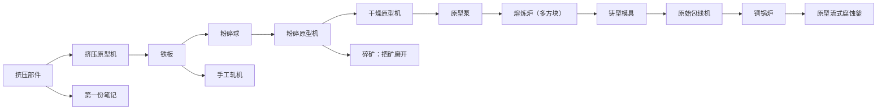
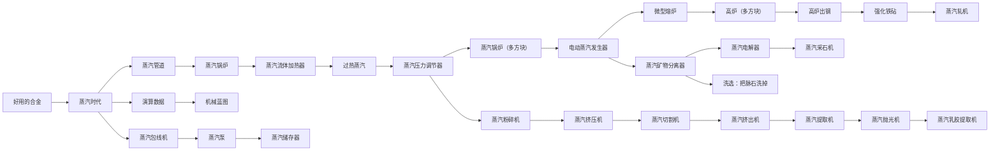
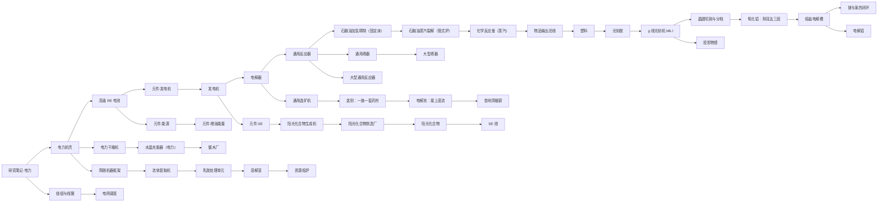

# 任务结构：三章主线与产线

> 版本：本包 1.21.1 / NeoForge / FTB Quests 2101.1.38
> 覆盖章节：原始时代 / 工业之始 / 电力时代
> 排布生成器：`kubejs/tools/gen_linear_quest_tree.py`（原始时代与电力时代）、`kubejs/tools/gen_steam_quests.py`（工业之始）、`kubejs/tools/gen_alien_quests.py`（「外星科技」章）
> 体检：`python kubejs/tools/check_quests.py`（id 唯一 / 依赖归属 / 坐标 / 文案）
> 写任务的完整流程：`kubejs/docs/QUEST_WORKFLOW.md`（口径 → 设计表 → 布局 → 生成 → 校验 → 配方 → 验收）
> 本文档生成器：`kubejs/tools/gen_quest_doc.py`（表格与流程图直接从章节文件读）
> 文案：`config/ftbquests/quests/lang/zh_cn.snbt`

---

## 0. 改良电力（L2）：一张机台网，铂与太空另起一章

**L2 的机台与材料并进「科技先锋」一章（41 格），画成一棵树而不是单链——分枝多，线不交叉。** 口径（2026-11-27 第八版：**铂处理排到钛之后**）：

- **核心是机台与材料网**：138 机壳一路到 139 高级机壳，本章出口是 139；
- **铂族处理线整段搬到「第一小步」**，接在钛衬里后面——铂要钛衬釜，钛在月球，所以顺序就是先月球后铂；
- **钼只服务 316L（139）与 M3 掩模**，降为支线——整条不做，本章照样收尾；
- 批量加工按 DJ2 铺成网：粉碎分三路（电炉 / 压缩 / 洗矿），压缩与轧制各自往下，齿轮机两路并入；
- 电解铜进主线（4N 铜：母线铜排、EIO 导电合金），冷却混合物支线负责「快」（超频模块）；
- 工业先锋的框架套娃挂在双联压缩机上，EnderIO 第一部分挂在电解铜上；
- **一阶火箭也搬到「第一小步」**：火箭、发射台、燃料、氧气、太空服一路排到月球；本章在电解铜那一格岔出去。

| 车道 | 入口格 | 展开 | 格数 |
| --- | --- | --- | ---: |
| 骨架 | 电容 | → 138 机壳 → 改良电动机 → 改良合金炉 | 4 |
| 加工网 | 双联粉碎 | 电炉 → 提取 → 压缩 → 轧制 → 裁切；压缩 → 挤出 → 齿轮机；粉碎 → 洗矿 → 离心 | 10 |
| 电网 | 改良水力 | → 风力 → 地热 → 太阳能蒸馏 → MFE | 5 |
| 铜与快 | 电解铜 | → 冷却混合物 → 10k 冷却单元 → 超频模块 | 4 |
| 框架套娃 | 基础框架 | → 高级 → 完美；基础 → 镭射钻 / 发酵站 → 水培床；高级 → 镭射钻基座 | 7 |
| 钼（支线） | 钼焙砂 | → 垂熔钼锭 → 139 高级机壳 | 3 |
| i 线（支线） | 西门子沉积 | → 9N 晶圆 → M3 掩模 → Mk.II | 4 |
| EnderIO（第一部分） | 虚空框架 | → 合金炉 → 导电合金 → 能量导管 | 4 |
| 太空（另起一章） | NASA 工作台 | → 一阶火箭 → 发射台 → 炼油厂 → 氧气 → 太空服 → 着陆月球 → 月球钛 → 钛锭 → 钛衬里 | 10 |
| 铂族（同章） | 铂族精矿 | → 氯铂酸铵 → 海绵铂 → 铂锭；支线 铱锇渣 / 海绵钯 | 6 |
| IU 无人线（同章） | 月球钒 / 火箭装配台 | → IU 发射台 → 空间研究台 → 月面陨铁 → 太空模块模板 → 太空模块：采矿 | 7 |

**坐标不手摆**：`kubejs/tools/l2_layout.py` 把设计表当树分层（深度往右、叶子往下），
父格坐在子格正中，布局完做一次线段相交检查——现在 **0 处交叉**。
跨章的依赖（简陋框架、月球钛）不画线，FTB 会把它们画成格子边上的小箭头。

**框架是套娃**：简陋（电力时代 L1 那格）→ 基础 → 高级 → 完美，每层都要求上一层在里面；
高级框架解开「镭射钻基座」，镭射钻这才真的转得起来——之前那一格是「造得出、转不动」。

**两处真的并流**（同层相邻两格合成下一格）：双联齿轮机吃「挤出 + 裁切」，镭射钻基座吃「高级框架 + 镭射钻」。
别的多源关系（MFE 的 304 双板、M3 的钼板、导电合金的电解铜）写在正文里，不再画第二条线——
这是「线不交叉」的代价，换来的是每个格子只有一条来线、整章读起来是一条主干加分叉。

| 章 | 入口 | 出口 |
| --- | --- | --- |
| 科技先锋 | 电力时代「晶圆切割与分档」`5A1B00000000A107` | 高级机壳 139 `5E0E000000000050`（材料）与能量导管 `5E0E00000000005C`（网络） |
| 第一小步 | 科技先锋「电解铜」`5E0E000000000054`（NASA 工作台） | 铂锭 `5E0E000000000063`（铂族线收口）；IU 一侧到 `25AC0000000000D7` 太空模块：采矿 |

跨章箭头只有四条，全是「第一小步」指向科技先锋：NASA 工作台与一阶火箭 ← 电解铜、
铂族精矿 ← 双联离心机、火箭装配台 ← 垂熔钼锭。科技先锋不再回指太空，读起来就是
「先把机台网铺完 → 上月球拿钛 → 回来把铂做出来 → IU 无人线开张」。

### 0.1 IU 太空模块为什么还差三格

七件太空模块要 `spaceupgrademodule_schedule`，它吃四块陨铁板；陨铁在包里**只剩一个来源**：
`industrialupgrade:blockspace3/moon_meteoric_iron_ore`（冶炼或高炉出 `itemingots/meteoric_iron`）。
2026-11-26 的矿表重排把每个天体的 `blockspace*` 矿换成本层的三种（月球层是钛钒锆），
这一块**不在新表里**，世界里也不生成，陨铁链断了，模块与 `crafting_764`、`tome_research` 一起悬空。

**2026-11-27 定的补法（用户选 A）**：`Sink-Journey-Core` 的 `SpaceOreTable` 给月球补一条**独立出矿**
（`EXTRA_BY_BODY` 里 `moon` → `industrialupgrade:blockspace3/moon_meteoric_iron_ore`）：
不挤掉钛钒锆，也不改原来几条的循环，数量与概率照抄该天体的第一条矿，多出一条陨铁。
陨铁是月球风化层里的 Fe-Ni 天铁，留在月球层不算越层；`allOresRegistered()` 也把它算进去了。

**2026-11-27 的状态**：`maven.neoforged.net` 在这台机器上连不上，跑不了 `gradlew build`，
所以当天是**热补**——用 `build/classes` + 包内 NeoForge 与 IU 的 jar 编译 `SpaceOreTable.java`，
只把 `SpaceOreTable.class` / `SpaceOreTable$Row.class` / `SpaceOreTable$ColonyRow.class` 三个 class
换进 `mods/sinkjourneycore-0.1.0.jar`（对照过新旧 class 的常量池引用，两边完全一致）。
原 jar 备份在 `~/.capy/work/moonline/sinkjourneycore-0.1.0.jar.orig`。

网络恢复后按正规流程再走一遍，源码与产物就对得上了：

```bash
cd Sink-Journey-Core && ./gradlew build
cp build/libs/sinkjourneycore-0.1.0.jar ../mods/
```

启动日志会打「IU 太空矿表已按矿物文档重排：N 个天体…」，进游戏打开月球远征界面能看见陨铁矿石即生效。
任务侧的三格「月面陨铁 → 太空模块模板 → 太空模块：采矿」已经挂回 `第一小步`。

配套魔改（DJ2 的「材料进时代」手法，不在任务书里但图要靠它成立）：

| 文件 | 改了什么 |
| --- | --- |
| `server_scripts/industrial/iu_l2_improved_electric.js` | MFE 母线 = 铝排 + 2 块 4N 电解铜铜排（铜铝过渡） |
| `server_scripts/misc/ad_astra_l2.js` | 一阶火箭 6 个钢块 → 4 钢 + 2 铝块（铝进主线硬门槛） |
| `server_scripts/industrial/enderio_l2.js` | 虚空框架 / 研磨机改 304 板，合金炉发热体改镍铬板，导电合金改吃电解铜 |

细节在 [`IU_L2_IMPROVED_ELECTRIC.md`](IU_L2_IMPROVED_ELECTRIC.md) §7（含 FTB 重写 id 的自愈流程与 DJ2 对照）。

L2 之后**不直接进 L3**：先走星际探索，L3（139/140 一族、`era.advanced`）等星际那段定案再开。

---

## 1. 结构怎么读

**一格一道工序。** 主线上每一格是一台机器、一道工序，或者一座多方块结构；多方块的砖、部件、控制器、燃料箱并进同一格，不再拆成建造清单。主线横铺在 `y = 0`，一格 2.0，第 N 格只依赖第 N-1 格，走完全部等于把这一时代走了一遍。

**支线是产线，不是图鉴。** 主线之外还需要的加工机台各自成一条支线，落在 `y = ±4 / ±8 / ±12`，根节点竖直挂在主线上，同一条支线内部也是单链：从第一台接手的机器一路排到最后一台。支线可以整条不做，主线不会因此卡住。

**入口交代去处。** 每条支线的第一格，正文末尾有一句话说明这条线往后接哪几台、为什么不卡主线；主线那一格则说明它是必经的哪一步。读任务书的时候先看主线，再按需进支线。

**形状只标记里程碑。** `hexagon` 留给时代入口、网络核心、收尾工程这类节点，其余用章节默认圆点；
电力章三处：研究笔记·电力、塑料、晶圆切割与分档。

---

## 2. 三章总览

| 章节 | 任务 | 主线 | 支线 | 出口 |
| --- | ---: | ---: | ---: | --- |
| 原始时代 | 15 | 12 | 3 | 原型流式腐蚀釜 |
| 工业之始 | 30 | 14 | 16 | 蒸汽轧机 |
| 电力时代 | 44 | 15 | 29 | 晶圆切割与分档 |

三章合计 89 个任务，主线 41 格，支线 48 格。

下面这两章排在同组的后面，口径与格数记在各自的文档里：

| 章节 | 任务 | 出口 | 文档 |
| --- | ---: | --- | --- |
| 科技先锋（L2 机台网） | 41 | 高级机壳 139 | [`IU_L2_IMPROVED_ELECTRIC.md`](IU_L2_IMPROVED_ELECTRIC.md) |
| 第一小步（月球 · 铂族 · IU） | 23（太空 10 + 铂族 6 + IU 无人线 7） | 铂锭 / 太空模块：采矿 | [`IU_L2_IMPROVED_ELECTRIC.md`](IU_L2_IMPROVED_ELECTRIC.md) §7.4 |
| 外星科技 | 45（入口 3 + 主线 25 + 支线 17） | 电解分离机 | [`AE_MEK_LINES.md`](AE_MEK_LINES.md)、[`OSMIUM_LUMEN_ALLOY.md`](OSMIUM_LUMEN_ALLOY.md) |

「外星科技」章 2026-11-27 补到 45 格并重排：入口摆在两条主线正中间，往上一斜给 AE、往下一斜给通用机械；
通用机械十三格连成一条主线（三段相接，第一格是灌注红石），AE 十二格占上面一条（第一格是灌注赛特斯石英），
支线一律竖直挂在主线格子正上方或正下方，几何检查 0 交叉 0 穿格。
生成器 `kubejs/tools/gen_alien_quests.py`；两件灌注料的配方见
[`INFUSED_REDSTONE_QUARTZ.md`](INFUSED_REDSTONE_QUARTZ.md)。

---

## 3. 原始时代 / 工业之始 / 电力时代

### 原始时代（主线 12 + 支线 3）

`3f5a7c2b9e1d4a60.snbt`，分组「工业起步」，`order_index: 1`，共 15 个任务。



**主线**，`y = 0`，一格 2.0，第 N 格只依赖第 N-1 格：

| # | 任务 | id | 依赖 | 形状 |
| ---: | --- | --- | --- | --- |
| 1 | 挤压部件 | `7421786593C68B0E` | `5F132AD862CA787E` |  |
| 2 | 挤压原型机 | `079D6EAF9A441826` | `7421786593C68B0E` |  |
| 3 | 铁板 | `055588A7FFB2D789` | `079D6EAF9A441826` |  |
| 4 | 粉碎球 | `7830616AA30B63CD` | `055588A7FFB2D789` |  |
| 5 | 粉碎原型机 | `49C6261827C7A7B3` | `7830616AA30B63CD` |  |
| 6 | 干燥原型机 | `21DC1429D7B64A75` | `49C6261827C7A7B3` |  |
| 7 | 原型泵 | `0A449D27D8734333` | `21DC1429D7B64A75` |  |
| 8 | 熔炼炉（多方块） | `13B0197D7A36A72F` | `0A449D27D8734333` | 六边形 |
| 9 | 铸型模具 | `4180DCBFB8DD7D48` | `13B0197D7A36A72F` |  |
| 10 | 原始包线机 | `15E3CFD26FA821E0` | `4180DCBFB8DD7D48` |  |
| 11 | 铜锅炉 | `2C447CF0BBF40408` | `15E3CFD26FA821E0` |  |
| 12 | 原型流式腐蚀釜 | `04775118903D8E3F` | `2C447CF0BBF40408` | 六边形 |

第一格的跨章依赖是上一章的出口 `5F132AD862CA787E`（机械动力章收尾）。

**支线 1**，`y = -4`，挂在「挤压部件」上，1 格单链：

| 顺序 | 任务 | id | 依赖 |
| ---: | --- | --- | --- |
| 1 | 第一份笔记 | `5A1B000000000001` | `7421786593C68B0E` |

**支线 2**，`y = -4`，挂在「铁板」上，1 格单链：

| 顺序 | 任务 | id | 依赖 |
| ---: | --- | --- | --- |
| 1 | 手工轧机 | `73F4FB7D17278454` | `055588A7FFB2D789` |

**支线 3**，`y = -8`，挂在「粉碎原型机」上，1 格单链：

| 顺序 | 任务 | id | 依赖 |
| ---: | --- | --- | --- |
| 1 | 碎矿：把矿磨开 | `3F5A0000000000C1` | `49C6261827C7A7B3` |

### 工业之始（主线 14 + 支线 16）

`5fe0048b1a2b6a65.snbt`，分组「工业起步」，`order_index: 3`，共 30 个任务。



**主线**，`y = 0`，一格 2.0，第 N 格只依赖第 N-1 格：

| # | 任务 | id | 依赖 | 形状 |
| ---: | --- | --- | --- | --- |
| 1 | 好用的合金 | `6BDDB3A36AADF646` | `04775118903D8E3F` |  |
| 2 | 蒸汽时代 | `0706F92EF2C236B8` | `6BDDB3A36AADF646` |  |
| 3 | 蒸汽管道 | `2C027D8994527225` | `0706F92EF2C236B8` |  |
| 4 | 蒸汽锅炉 | `4C2722480E36EC49` | `2C027D8994527225` |  |
| 5 | 蒸汽流体加热器 | `0FEC076007556020` | `4C2722480E36EC49` |  |
| 6 | 过热蒸汽 | `50FFF3DA2CF84C7F` | `0FEC076007556020` |  |
| 7 | 蒸汽压力调节器 | `79789218839D6E7D` | `50FFF3DA2CF84C7F` | 六边形 |
| 8 | 蒸汽锅炉（多方块） | `43D5726B73FFD4E3` | `79789218839D6E7D` | 六边形 |
| 9 | 电动蒸汽发生器 | `15F9B4F39AC30284` | `43D5726B73FFD4E3` |  |
| 10 | 微型熔炉 | `35673E8862ECC966` | `15F9B4F39AC30284` |  |
| 11 | 高炉（多方块） | `5A1B000000000010` | `35673E8862ECC966` | 六边形 |
| 12 | 高炉出钢 | `6FC90AA2AAA16C3F` | `5A1B000000000010` |  |
| 13 | 强化铁砧 | `39224A23A36F5D89` | `6FC90AA2AAA16C3F` |  |
| 14 | 蒸汽轧机 | `35B9A0B50B6D5A7C` | `39224A23A36F5D89` | 六边形 |

第一格的跨章依赖是上一章的出口 `04775118903D8E3F`（原始章「原型流式腐蚀釜」）。

**支线 1（研究）**，`y = -4`，2 格单链，挂在「蒸汽时代」：

| 顺序 | 任务 | id | 依赖 |
| ---: | --- | --- | --- |
| 1 | 演算数据 | `5A1B000000000005` | 挂在「蒸汽时代」 |
| 2 | 机械蓝图 | `5A1B000000000002` | `5A1B000000000005` |

**支线 2（洗矿与采石）**，`y = -4`，3 格单链，挂在「电动蒸汽发生器」：

| 顺序 | 任务 | id | 依赖 |
| ---: | --- | --- | --- |
| 1 | 蒸汽矿物分离器 | `285AC19CE5FBC3ED` | 挂在「电动蒸汽发生器」 |
| 2 | 蒸汽电解器 | `57E4815EC1E82AC0` | `285AC19CE5FBC3ED` |
| 3 | 蒸汽采石机 | `3EEBC200020CEC1A` | `57E4815EC1E82AC0` |

**支线 3（洗选）**，`y = -8`，1 格单链，挂在「蒸汽矿物分离器」：

| 顺序 | 任务 | id | 依赖 |
| ---: | --- | --- | --- |
| 1 | 洗选：把脉石洗掉 | `5FE00000000000C1` | 挂在「蒸汽矿物分离器」 |

**支线 4（输送与储能）**，`y = -8`，3 格单链，挂在「蒸汽时代」：

| 顺序 | 任务 | id | 依赖 |
| ---: | --- | --- | --- |
| 1 | 蒸汽包线机 | `22372738BD8CBD0F` | 挂在「蒸汽时代」 |
| 2 | 蒸汽泵 | `34DB73A960C0D660` | `22372738BD8CBD0F` |
| 3 | 蒸汽储存器 | `3144BDD432A185BD` | `34DB73A960C0D660` |

**支线 5（蒸汽机台群）**，`y = -12`，7 格单链，挂在「蒸汽压力调节器」：

| 顺序 | 任务 | id | 依赖 |
| ---: | --- | --- | --- |
| 1 | 蒸汽粉碎机 | `553DE08FF8207EFC` | 挂在「蒸汽压力调节器」 |
| 2 | 蒸汽挤压机 | `160B66057D2A2BC2` | `553DE08FF8207EFC` |
| 3 | 蒸汽切割机 | `3FFD6CD6131BB41E` | `160B66057D2A2BC2` |
| 4 | 蒸汽挤出机 | `39E580844A461AC5` | `3FFD6CD6131BB41E` |
| 5 | 蒸汽提取机 | `0C5D79478D494E93` | `39E580844A461AC5` |
| 6 | 蒸汽抛光机 | `268F9CB2F5488846` | `0C5D79478D494E93` |
| 7 | 蒸汽乳胶提取机 | `19F5071BFF298275` | `268F9CB2F5488846` |

支线挂在主线格子的正下方，一层一层往下排；洗选再挂在分离器正下方。坐标由 `kubejs/tools/gen_steam_quests.py`
算出来，摆完跑一次 `l2_layout.crossings()`：2026-11-27 这一版 0 交叉 0 穿格。


### 电力时代（主线 15 + 支线 29）

`e1c0000000000000.snbt`，分组「科技革命」，`order_index: 2`，共 44 个任务。



**主线**，`y = 0`，一格 2.0，第 N 格只依赖第 N-1 格：

| # | 任务 | id | 依赖 | 形状 |
| ---: | --- | --- | --- | --- |
| 1 | 研究笔记·电力 | `6598E70D2B013335` | `35B9A0B50B6D5A7C` | 六边形 |
| 2 | 电力机壳 | `47288C78398A483D` | `6598E70D2B013335` |  |
| 3 | 高级 RE 电池 | `7FBCB9C7839329EE` | `47288C78398A483D` |  |
| 4 | 元件:发电机 | `5E50B081F63F8757` | `7FBCB9C7839329EE` |  |
| 5 | 发电机 | `4A3C44501E2E4EBE` | `5E50B081F63F8757` |  |
| 6 | 电解器 | `649891A244FD0BF3` | `4A3C44501E2E4EBE` |  |
| 7 | 通用反应器 | `0C41A7B3D9E25710` | `649891A244FD0BF3` |  |
| 8 | 石脑油加氢精制（固定床） | `0C41A7B3D9E256F1` | `0C41A7B3D9E25710` |  |
| 9 | 石脑油蒸汽裂解（管式炉） | `0C41A7B3D9E256F2` | `0C41A7B3D9E256F1` |  |
| 10 | 化学反应釜（蒸汽） | `0C41A7B3D9E256F8` | `0C41A7B3D9E256F2` |  |
| 11 | 物品输出总线 | `0C41A7B3D9E256F9` | `0C41A7B3D9E256F8` |  |
| 12 | 塑料 | `0C41A7B3D9E256FA` | `0C41A7B3D9E256F9` | 六边形 |
| 13 | 光刻胶 | `5A1B00000000A101` | `0C41A7B3D9E256FA` |  |
| 14 | g 线光刻机 Mk.I | `5A1B00000000A102` | `5A1B00000000A101` |  |
| 15 | 晶圆切割与分档 | `5A1B00000000A107` | `5A1B00000000A102` | 六边形 |

第一格的跨章依赖是上一章的出口 `35B9A0B50B6D5A7C`（蒸汽章「蒸汽轧机」）。

**支线 1**，`y = 8`，挂在「电解器」上，4 格单链：

| 顺序 | 任务 | id | 依赖 |
| ---: | --- | --- | --- |
| 1 | 通用选矿机 | `5A1B00000000B201` | `649891A244FD0BF3` |
| 2 | 选别：一族一套药剂 | `5A1B00000000B202` | `5A1B00000000B201` |
| 3 | 电解池：接上直流 | `5A1B00000000B203` | `5A1B00000000B202` |
| 4 | 首块阴极铜 | `5A1B00000000B204` | `5A1B00000000B203` |

**支线 2**，`y = 8`，挂在「熔盐电解槽」上，1 格单链：

| 顺序 | 任务 | id | 依赖 |
| ---: | --- | --- | --- |
| 1 | 镁与氯的闭环 | `5A1B00000000B304` | `5A1B00000000B302` |

**支线 3**，`y = 4`，挂在「研究笔记·电力」上，2 格单链：

| 顺序 | 任务 | id | 依赖 |
| ---: | --- | --- | --- |
| 1 | 绕组与线圈 | `5A1B000000000008` | `6598E70D2B013335` |
| 2 | 电网调度 | `5A1B000000000009` | `5A1B000000000008` |

**支线 4**，`y = 4`，挂在「高级 RE 电池」上，2 格单链：

| 顺序 | 任务 | id | 依赖 |
| ---: | --- | --- | --- |
| 1 | 元件:能源 | `5FA34533C1B9802F` | `7FBCB9C7839329EE` |
| 2 | 元件:增强能量 | `34E2B4C7D5914293` | `5FA34533C1B9802F` |

**支线 5**，`y = 4`，挂在「发电机」上，5 格单链：

| 顺序 | 任务 | id | 依赖 |
| ---: | --- | --- | --- |
| 1 | 元件:SE | `56E66A5D88A8BE7E` | `4A3C44501E2E4EBE` |
| 2 | 阳光化合物生成机 | `787BF4D3F587AFBA` | `56E66A5D88A8BE7E` |
| 3 | 阳光化合物制造厂 | `203117A926D8F616` | `787BF4D3F587AFBA` |
| 4 | 阳光化合物 | `24BB85BA4A497A2A` | `203117A926D8F616` |
| 5 | SE 线 | `7C37F85FE343A710` | `24BB85BA4A497A2A` |

**支线 6**，`y = 4`，挂在「g 线光刻机 Mk.I」上，1 格单链：

| 顺序 | 任务 | id | 依赖 |
| ---: | --- | --- | --- |
| 1 | 投影物镜 | `5A1B00000000A106` | `5A1B00000000A102` |

**支线 7**，`y = 4`，挂在「晶圆切割与分档」上，3 格单链：

| 顺序 | 任务 | id | 依赖 |
| ---: | --- | --- | --- |
| 1 | 氧化铝：拜耳法三段 | `5A1B00000000B301` | `5A1B00000000A107` |
| 2 | 熔盐电解槽 | `5A1B00000000B302` | `5A1B00000000B301` |
| 3 | 电解铝 | `5A1B00000000B303` | `5A1B00000000B302` |

**支线 8**，`y = -4`，挂在「电力机壳」上，3 格单链：

| 顺序 | 任务 | id | 依赖 |
| ---: | --- | --- | --- |
| 1 | 电力干燥机 | `759CE071C62F7828` | `47288C78398A483D` |
| 2 | 水晶充能器（电力） | `6E8B42AD1CFCD6E2` | `759CE071C62F7828` |
| 3 | 锯木厂 | `77AAA4247AD5F8FF` | `6E8B42AD1CFCD6E2` |

**支线 9**，`y = -4`，挂在「通用反应器」上，2 格单链：

| 顺序 | 任务 | id | 依赖 |
| ---: | --- | --- | --- |
| 1 | 通用塔器 | `0C41A7B3D9E25711` | `0C41A7B3D9E25710` |
| 2 | 大型塔器 | `0C41A7B3D9E25713` | `0C41A7B3D9E25711` |

**支线 10**，`y = -4`，挂在「通用反应器」上，1 格单链：

| 顺序 | 任务 | id | 依赖 |
| ---: | --- | --- | --- |
| 1 | 大型通用反应器 | `0C41A7B3D9E25712` | `0C41A7B3D9E25710` |

**支线 11**，`y = -8`，挂在「电力机壳」上，5 格单链：

| 顺序 | 任务 | id | 依赖 |
| ---: | --- | --- | --- |
| 1 | 简陋机器框架 | `03B4867738AD7EBF` | `47288C78398A483D` |
| 2 | 流体提取机 | `5C741FDE56BF03F6` | `03B4867738AD7EBF` |
| 3 | 乳胶处理单元 | `5754619E9CA9D0F0` | `5C741FDE56BF03F6` |
| 4 | 溶解室 | `1A1FA26750C0224F` | `5754619E9CA9D0F0` |
| 5 | 资源熔炉 | `5FFCF7EAE6D167D4` | `1A1FA26750C0224F` |

---

## 4. 多方块：零件并成一格

熔炼炉原来拆成五格（熔炼砖 → 炉体 → 炉缸 → 控制器 → 熔炼炉），那是建造清单，不是工序。现在合成一格 `13B0197D7A36A72F`「熔炼炉（多方块）」，任务是把零件攒齐：

| 零件 | 物品 id | 数量 |
| ---: | --- | --- |
| 熔炼炉燃料箱 | `industrialupgrade:smeltery/smeltery_fuel_tank` | 1 |
| 熔炼炉 | `industrialupgrade:smeltery/smeltery_furnace` | 1 |
| 熔炼炉浇注块 | `industrialupgrade:smeltery/smeltery_casting` | 1 |
| 熔炼砖 | `industrialupgrade:crafting_elements/crafting_772_element` | 16 |
| 熔炼炉体 | `industrialupgrade:smeltery/smeltery_casing` | 1 |
| 熔炼炉炉缸 | `industrialupgrade:smeltery/smeltery_tank` | 1 |
| 熔炼炉控制器 | `industrialupgrade:smeltery/smeltery_controller` | 1 |

四格的 task id 全部搬进了这一格，所以老存档里那四格已有的进度自动算数；这一格原来的奖励写成了 `ftbquests:missing_item`（旧 id 迁移留下的坏奖励），已改回铜锭 ×16。

蒸汽锅炉（多方块）本来就是一格，没动。

---

## 5. 存档兼容

- 任务 id、task id、奖励 id 一律沿用，重排只改 `dependencies` / `x` / `y`。
- 被合并的四个任务 id（`6CF34942F438033D` `13A2604227513CA1` `6BE74B67D1F9D1C3` `44D17A7248C73706`）已从章节和 lang 里删除，它们的 task id 仍在，挂在熔炼炉这一格下。
- 游戏内手改出来的任务 id 缺文案时，`TEXT_RENAMES` 把旧 id 的文案搬过来；死键（指向已不存在任务的 `quest.<id>.*`）在清理时一起删掉。
- `progression_mode: "linear"`，依赖链断掉的地方就是玩家卡住的地方，所以入口必须挂准上一章出口。

---

## 6. 改结构改哪里

`kubejs/tools/gen_linear_quest_tree.py` 一份文件里三块内容：

1. `CHAPTERS`：每章的 `main`（主线顺序）、`branches`（支线挂哪个锚点、y 车道、方向、顺序）、`entry`（跨章入口）。
2. `MULTIBLOCKS`：哪几格零件的任务要并进哪一格，`tasks` 里写 `(物品, 数量, task id)`。
3. `TEXT_APPEND` / `TEXT_OVERRIDES`：支线入口那句话、合并后任务的正文。

改完跑 `python kubejs/tools/gen_linear_quest_tree.py`，它只动依赖和坐标；顺带校验：坐标不许重叠、任务必须全部排进去、不许出现未知 id。

---

## 7. 验收

1. 重启，`/reload`，打开任务书。
2. 三章主线各自是一条从左到右的直线，支线竖直挂在主线的上或下（电力章六条在上、四条在下）。
3. 原始时代第一章应有 15 格：主线 12 格 + 支线 3 格；熔炼炉一节里能一次看到全部零件。
4. 每个任务都有标题、副标题与正文；支线第一格的正文末尾有一句「这条线往后接什么」。
5. 老存档：熔炼炉这一格的完成度按原有零件进度计算，不会因为合并而清零。
