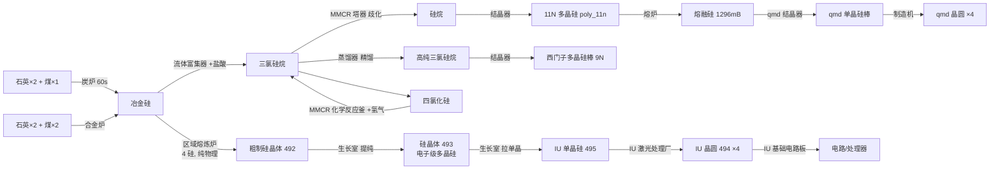

# 晶圆产线（Silicon Wafer Line）

> **本文已升级为五级工艺，分级与掩模门槛见 `docs/SILICON_WAFER_TIERS.md`。**
> 下面保留细节，但「硅烷直出 493」「熔融硅吃 493」这两条已经作废：
> 硅烷现在出 11N 多晶硅（`kubejs:poly_11n`），熔融硅也只吃 11N 料；西门子线（9N）另走精馏。
>
> 把「沙子 → 硅 → 晶圆」的捷径换成真实硅料链：冶金硅经区熔或化工提纯拿到多晶硅，
> 再分头去 qmd 单晶棒切片和工业升级的晶圆/电路。
> 前期靠**炭炉 + 区域熔炼**（纯物理），中后期靠**三氯硅烷**化工线。
>
> 配方：`server_scripts/silicon/wafer_line.js`、`zone_refiner.js`、`iu_chip.js`
> 流体：`startup_scripts/silicon/fluids.js`
> IU 内存配方：`server_scripts/silicon/iu_crystal.js`
> 炭炉烧硅：`server_scripts/metallurgy/furnace_recipes.js`
> JEI：`client_scripts/silicon/wafer_line_info.js`

---

## 1. 总流程



四条提纯工艺，各自的产物不再共用物品：

| 路线 | 机器 | 产物 | 特点 |
|---|---|---|---|
| T1 区熔 + 直拉（前期） | 炭炉 → MMCR 区域熔炼炉 → IU 晶体生长室 | 492 → 493 → 495 → 494（6N） | 只要石英、铁/金/钻石加热圈和 Create 应力，不用化学品；慢，4 硅 → 1 根 |
| T2 改良西门子（中后期） | 蒸馏器 + 结晶器 + 生长室 + 激光 | 高纯三氯硅烷 → 西门子棒 → 9N 晶圆（9N） | 精馏决定硼磷残留；1 硅 → 4 片 |
| T3 硅烷裂解（中后期） | 化学反应釜 + 结晶器 + 生长室 + 激光 | 硅烷 → 11N 多晶硅 → 11N 晶圆（11N） | 比西门子再高一档，qmd 器件线也吃它 |
| T4 磁控直拉（后期） | 磁控直拉炉 + 液氦 + 铌钛线圈 | 11N 料 → 12N 单晶棒 → 12N 晶圆（12N） | 纯度不再涨，涨的是晶体质量（低氧、低偏析） |

> `493` 现在只是 T1 生长室的中间体；硅烷裂解与西门子各自产自己的料，谁也不升级谁。

---

## 2. 冶金硅从哪来

| 阶段 | 机器 | 配方 | 时间 |
|---|---|---|---|
| 前期 | **炭炉**（`kubejs:charcoal_furnace`） | 石英×2 + 煤/木炭×1 → 冶金硅×1 | 60 秒 |
| 中后期 | 核科技 **合金炉** | 石英×2 + 煤或木炭×2 → 冶金硅×1 | 倍率 1.5 / 2.0 |

炭炉那条让硅线在 Create/余烬阶段就能起步，不用先造核科技机器。

---

## 3. 化工线（核科技）

三氯硅烷往下分两路：精馏做西门子棒（9N），歧化做硅烷（11N）。

| 工序 | 机器 | 输入 | 输出 | 倍率（功耗/时间） |
|---|---|---|---|---|
| 氯化 | 流体富集器 | 冶金硅×1 + 盐酸 1000mB | 三氯硅烷 1000mB | 2.0 / 3.0 |
| 精馏 | 多方块蒸馏器 | 三氯硅烷 1000mB | 高纯三氯硅烷 850mB + 四氯化硅 150mB | 2.0 / 2.0 |
| 西门子沉积 | 结晶器 | 高纯三氯硅烷 850mB | **西门子多晶硅棒 ×1（9N）** | 3.0 / 6.0 |
| 歧化提纯 | MMCR 塔器（反应精馏） | 三氯硅烷 4000mB | 硅烷 1000mB + 四氯化硅 3000mB | 300 tick / 256 FE/t |
| 氯回收 | MMCR 化学反应釜 | 四氯化硅 3000mB + 氢气 3000mB | 三氯硅烷 3000mB + 盐酸 3000mB | 300 tick / 256 FE/t |
| 硅烷裂解 | 结晶器 | 硅烷 1000mB | **11N 多晶硅 ×1** | 3.0 / 6.0 |
| P 型掺杂 | 组装机 | 硅晶圆×1 + 硼粉×1 | P 型掺杂片 ×1 | 1.0 / 1.0 |
| 熔融 | 熔炉 | 11N 多晶硅 ×1 | 熔融硅 1296mB | 2.0 / 2.0 |

> 西门子段之所以是「高温分解沉积」而不是「氢气还原出 HCl」：核科技结晶器只有一个流体入口，
> 两种气体塞不进同一台机器。氢的成本留在四氯化硅回收段。

化学品对照：三氯硅烷 SiHCl₃、硅烷 SiH₄、四氯化硅 SiCl₄、盐酸 HCl、氢气 H₂（`#c:hydrogen`）。

物料衡算（1 根棒）：1 冶金硅 + 3000mB 氢气，氯在回路里循环，每轮净产 2000mB 盐酸。

---

## 4. 区域熔炼炉（MMCR，前期物理提纯）

机器：`sinkjourney:zone_refiner`，结构 3×3×4 卧式石英管。
控制器配方：8 石英块 + 4 安山机壳 + 1 精密构件（`mmcr:zone_refiner_controller`）。

```
z0  XXX      z1  XRX      z2  XXX      z3  XXX
    XIX          S O          X X          XFX
    XXX          XXX          XXX          XXX
```

- `X` = 石英块（管壁）
- `I` = 物品输入（北墙），`O` = 物品输出（东墙），`S` = 应力输入（西墙）
- `R` = 加热圈等级槽（管顶，伸手就能换），铁/金/钻石块
- `F` = 控制器（南墙）

| 加热圈 | 输入 | 输出 | 时间 | 应力 |
|---|---|---|---|---|
| 铁块 | 冶金硅×4 | 粗制硅晶体 492×1 | 60 秒 | 24 SU @32 RPM |
| 钻石块 | 冶金硅×4 | 粗制硅晶体 492×1 | 30 秒 | 32 SU @32 RPM |

加热圈沿石英管缓慢扫过，熔区把杂质带到两端；游戏里用「长时间 + 高应力」表现这个慢过程。
扫完仍是 `492`：物理熔炼只做粗提纯，要变成电子级料还得进晶体生长室再长一次（492 → 493）。
这是 T1 路线；要 9N 以上就得走精馏（T2）或硅烷（T3），区熔再怎么扫也去不掉硼磷。

---

## 5. 工业升级支线：晶圆与芯片

- 粗制硅晶体 `492` →（晶体生长室 `silicon_recipe`，原型机共用）→ 硅晶体 `493`（电子级多晶硅）
- 硅晶体 `493` →（晶体生长室）→ 单晶硅 `495`
- 单晶硅 →（激光处理厂 `laser` / 原型激光抛光机 `primal_laser_polisher`）→ 晶圆 `crafting_494` ×4
- **基础电路板 `circuit_part1` 改为消耗晶圆**（原配方的打火石换成晶圆），
  由它派生的电路板、处理器都要先过晶圆线。
- qmd 那条熔融硅只吃 `493`，所以两条晶圆路线都绕不开电子级这一关。

> 这几条 IU 机器配方在 `RecipesCore` 内存里，靠 kubejs_iu 桥接在 `ServerEvents.loaded`
> 注入（晚于 IU 在 TagsUpdatedEvent 的重建），所以 `/reload` 之后仍然生效。

---

## 6. 被删掉的捷径

| 配方 id | 原来做什么 | 为什么删 |
|---|---|---|
| `nuclearcraftneohaul:manufactory/silicon_gem` | 沙子 1:1 出硅 | 沙子直接当半导体硅料 |
| `nuclearcraftneohaul:silicon_gem_from_smelting_silica` | 二氧化硅烧成硅 | 跳过还原与提纯 |
| `nuclearcraftneohaul:silicon_gem_from_blasting_silica` | 同上（高炉） | 同上 |
| `nuclearcraftneohaul:melter/molten_silicon_from_gem` | 硅锭（按标签）熔成熔融硅 | 冶金硅绕过提纯直接拉单晶 |
| `nuclearcraftneohaul:melter/molten_silicon_from_block` | 硅块熔成熔融硅 | 同上 |
| `nuclearcraftneohaul:melter/silicon_from_` | 硅锭熔成 144mB 熔融硅 | 同上，这条按物品匹配，最容易漏 |

> `ingot_former/silicon_gem`（熔融硅 → 硅锭）保留：它只把电子级硅倒回锭，不构成绕过。
> qmd 的 `qmd:silicon` 流体在本包里没有任何产出配方，不构成第二条熔融硅来源。

---

## 7. 验收步骤

1. **重启游戏**（startup 脚本：新流体、MMCR 机器都只在启动时加载）。
2. JEI 检查：
   - 炭炉多出 `石英×2 + 煤×1 → 冶金硅`（60 秒）；
   - 核科技「硅」：熔炉里没有「硅 → 熔融硅」；
   - 区域熔炼炉控制器两条配方；
   - 硅烷 → 电子级多晶硅 493；
   - 晶体生长室：`492 → 493`、`493 → 495`；激光处理厂：`495 → 晶圆×4`；
   - 基础电路板 `circuit_part1` 配方中心是晶圆。
3. 实测区域熔炼炉：3×3×4 石英管 + 铁圈 + 应力，4 个冶金硅，60 秒后出 492。
4. 实测 IU 支线：492 进生长室出 493，再长出 495，激光切片出 4 片 494。
5. 若 IU 那几条配方没出现，看日志 `[晶圆线] … 注册失败`。

---

## 8. 已知边界

- IU 更高代数的电路/处理器是代码注册的配方，KubeJS 改不到；这里只把根配方
  （基础电路板）改成消耗晶圆。若发现某条高级电路不经过 `circuit_part1`，需要单独用桥接补。
- 区域熔炼炉没有升级槽（结构里没有 `U` 位），要提速就换加热圈。
- qmd 的 P 型掺杂目前没有上游配方，不在本次范围内。
